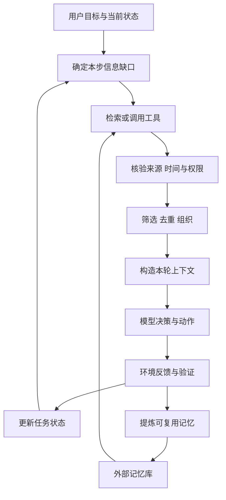

# Agent 上下文建设学习调研

Agent 上下文建设，是为每一步模型调用准备足够、相关、可追溯且不过时的信息。它包括任务目标、约束、当前状态、工具、证据、历史与记忆的选择和更新。学习目标是理解这些信息如何影响 Agent 行动，并能设计一个可验证的上下文管理流程。

核心结论：把长期资料保存完整，把当前上下文组织清楚；让 Agent 按需读取证据，并把可复用经验以可审计的增量条目保存。更大的窗口不能代替信息选择，更短的摘要也不自动更好。

调研日期：2026 年 10 月 14 日。覆盖基础研究与工程方法，含 2026 年研究，不是穷尽式论文排行榜。论文与项目事实来自 A 类原始来源；实验模板与设计取舍为本文综合分析，本次没有执行模型评测。

## 1 调研来源与证据标准

| 优先级 | 来源 | 使用方式 |
| --- | --- | --- |
| A | arXiv、会议或期刊官网、原文 PDF | 标题、方法、实验与发表日期 |
| A | 作者 GitHub、Hugging Face、数据集卡片 | 代码、数据、许可证与可用性 |
| A | 研究机构、模型厂商、开源组织官方技术文档 | 工程方法与发布说明 |
| B | Hugging Face Papers、Papers with Code、技术社区 | 发现候选，回到 A 类核验 |
| C | 中文公众号、机器之心、量子位、知乎与论坛 | 获取中文线索，核心事实回链 A 类 |

公开仓库不自动代表所有数据和依赖都具有相同许可证；最近推送日期也不证明维护质量。论文首次 arXiv 日期与正式发表年份分开记录。未确认发表状态的工作按预印本阅读。

## 2 什么是上下文建设

假设你让 Agent 修复项目中的错误。只说“修好它”提供了目标，却没有错误信息、代码入口、运行命令或完成标准。把整个仓库一次塞进提示，也会混入无关文件和旧记录。

可行做法是先给它项目入口与目标，再让它查找相关代码、读取报错、执行验证，保存已确认的状态。这就是管理上下文，而不只是修改一句提示词。

| 概念 | 关注点 | 与上下文建设的关系 |
| --- | --- | --- |
| Prompt engineering | 如何写清指令和示例 | 其中一个组成部分 |
| RAG | 从外部资料中检索证据 | 为上下文提供内容 |
| Agent memory | 如何保存与找回经验 | 管理跨步骤和跨会话的信息 |
| Context engineering | 此刻模型应该看到什么 | 统筹指令、证据、工具与状态 |
| Agent harness | 调用、工具、状态、恢复与评估的运行框架 | 在系统中执行上下文策略 |
| MCP | 工具与资源交互的协议 | 提供接口，不自动解决信息选择或可信性 |

[上下文工程综述](https://arxiv.org/abs/2507.13334)把领域组织为检索与生成、处理、管理及系统集成。本文进一步用“写入、选择、整理、隔离、验证”作为学习框架，这五项是教学组织方式，并非该论文原样提出的统一标准。

## 3 上下文应该分哪些层

以下是建议的系统结构：

| 层 | 内容 | 更新方式 |
| --- | --- | --- |
| 稳定规则 | 角色、长期行为规范、权限边界 | 版本化维护 |
| 当前任务 | 目标、用户限制、完成标准 | 随用户澄清更新 |
| 工作状态 | 已完成动作、下一步、待解决问题 | 每个关键步骤更新 |
| 外部证据 | 文件片段、网页、数据库和工具观察 | 按需加载并记录来源 |
| 近期历史 | 当前步骤所需的对话与工具结果 | 选择保留 |
| 长期记忆 | 偏好、环境经验、可复用方法 | 有来源和失效规则地写入 |
| 外部存储 | 原始日志、完整文件、轨迹 | 保留索引与读取入口 |

文本被放进上下文，不意味着自动取得指令权威。网页和工具结果是待处理资料；其中要求改变任务、泄露信息的文字不能被提升为高优先级指令。权限还应由程序执行检查，不能只依赖模型“记得规则”。

## 4 为什么不能简单扩大窗口

Lost in the Middle 在多文档问答与键值检索实验中观察到：相关信息位置改变会影响效果，位于中间时可能更难使用。这说明“容纳得下”与“可靠用得到”不同，但不能把该论文中的旧模型曲线当成所有 2026 年模型的固定规律。[TACL 2024 原文](https://aclanthology.org/2024.tacl-1.9/)

实际问题还包括过时状态、相互矛盾的记录和无关工具日志。把已经解决的报错重复带入，会让 Agent 继续修复不存在的问题；只保留最新摘要，又可能丢掉用户的禁止事项。

应在自己的任务上测试上下文长度、证据位置和噪声数量的影响。所谓 context rot 应对应可测的失败现象，不宜当作所有错误的解释。

## 5 一个完整的信息生命周期



ReAct 将推理与行动、观察交替组织，强调 Agent 必须根据环境反馈继续决策。对上下文建设的启示是：工具观察需要影响下一步状态，而不是成为永远追加的日志。[ReAct 论文](https://arxiv.org/abs/2210.03629)

并非每一次工具输出都值得永久记忆。一次网络超时是临时观察；重复验证出的“此接口必须分页”可能是环境经验，两者应分别处理。

## 6 检索与按需加载

RAG 的基本思想是结合模型参数知识与外部检索内容。原始 RAG 论文针对知识密集型 NLP，不等于完整 Agent 控制系统，但为把证据动态放入上下文提供基础。[RAG 论文](https://arxiv.org/abs/2005.11401)

一个可实践的检索链路是：根据当前问题生成查询，使用文本和语义索引召回候选，按来源、时间与相关性筛选，读出支持结论的具体片段。事实冲突时同时保留版本信息，不能仅选最高相似度的一条。

Anthropic 的工程文章讨论通过文件路径、查询和链接等轻量引用，在需要时加载具体内容，以及压缩和结构化笔记等长期任务方法。这是官方实践建议，应通过自己的任务评估，而不是把它当成通用最优算法。[官方工程文章](https://www.anthropic.com/engineering/effective-context-engineering-for-ai-agents)

**设计取舍：** 固定加载能减少搜索轮次；按需读取能降低初始噪声，却增加工具调用和遗漏风险。基础材料先加载、详细证据按需读，是可测试的混合方案。

## 7 记忆不只是向量数据库

### MemGPT 分层管理

MemGPT 借鉴操作系统的内外存层次，通过移动信息扩展有限窗口的可用信息范围，研究文档分析和跨会话对话。它提供的是上下文管理思路，并没有把模型窗口真的变成无限容量。[MemGPT 原文](https://arxiv.org/html/2310.08560v2)

### A-MEM 动态组织

A-MEM 给记忆生成描述、关键词与标签，建立关联，并允许新记忆影响旧条目的组织。它强调写入和关联维护，而不只是“保存向量然后查 Top-k”。[A-MEM 原文](https://arxiv.org/html/2502.12110v11)

### 业务中应区分的记忆

| 类型 | 例子 | 失效风险 |
| --- | --- | --- |
| 用户偏好 | 喜欢中文解释与简短示例 | 新要求可能覆盖旧偏好 |
| 情景记录 | 某次接口失败与解决过程 | 环境可能已经变化 |
| 环境事实 | 某页面入口与字段含义 | 版本更新导致过时 |
| 程序经验 | 先检查权限再提交操作 | 不能从一次成功推及所有场景 |

这张分类表是工程分析，不是 MemGPT 或 A-MEM 的完整分类。

建议每条记忆记录内容、来源、适用范围、观察时间、有效期、状态与版本。确认的事实和模型推断分开；删除、纠正及用户边界变更应传播到索引和派生摘要，不能只改一份文本。

## 8 压缩与经验积累如何兼容

LLMLingua 研究用预算控制和 token 级压缩减少提示长度。它是特定方法的实验研究，不能据此断言任意压缩比例对 Agent 都无损。删除“不允许发布”中的否定词，就可能改变任务意义。[LLMLingua 原文](https://arxiv.org/html/2310.05736)

ACE 把可复用上下文视为持续演化的 playbook，通过生成、反思和整理，使用条目化增量更新避免整体重写导致细节流失。[ACE 原文](https://arxiv.org/html/2510.04618v1)

这两种思路可以用于不同对象：

- 对原始重复日志，去重或移出当前窗口。
- 对当前任务，压缩成可恢复状态，同时保留关键限制。
- 对已经验证的经验，使用条目更新并保留版本。
- 对完整资料库，保留原文引用；每次只选与任务相关的部分。

ACE 的 AppWorld 表 1 中，DeepSeek-V3.1 的基线四项指标均值为 42.4，带真值标签的离线 ACE 为 59.4，相差 17.0 个百分点。该均值混合了正常与挑战集的 TGC、SGC，不是单一业务成功率；也不是当前排行榜。不要把“无需更新模型权重”误说成“系统完全没有学习成本”。

## 9 论文阅读地图

| 论文 | 主要问题 | 值得学习的部分 | 结论边界 |
| --- | --- | --- | --- |
| RAG，2020 | 如何使用外部知识 | 检索与生成结合 | 非完整 Agent 记忆系统 |
| ReAct，2022 首发 | 如何根据环境观察继续行动 | 行动和反馈循环 | 非长期记忆全套方案 |
| Lost in the Middle，2023 首发，TACL 2024 | 长上下文能否可靠使用 | 位置与干扰实验 | 不覆盖所有新模型 |
| MemGPT，2023 首发 | 有限窗口如何管理大量历史 | 信息分层与读取 | 依赖管理动作的正确性 |
| LLMLingua，2023 | 如何压缩提示 | 预算和压缩误差 | 压缩效果随任务变化 |
| LongMemEval，2024 首发 | 长期对话记忆怎么测 | 时间、更新与拒答 | 对话问答不等于动作完成 |
| A-MEM，2025，NeurIPS 2025 | 如何关联并演化记忆 | 写入结构和关系 | 自动关联可能传播错误 |
| 上下文工程综述，2025 | 如何组织领域 | 术语与方法地图 | 综述不是统一效果实验 |
| ACE，2025 首发 | 如何保留积累的经验 | 增量 playbook 与反馈 | 需要审计反思内容 |
| LongMemEval-V2，2026 | 如何记住环境经验 | 状态、工作流与失败经验 | 证据问答仍需动作验证 |

逐篇日期、作者、链接及读法见仓库的论文阅读笔记。正文不根据未经验证的会议宣传认定所有工作已经发表。

## 10 长期记忆该怎样评估

LongMemEval 关注信息提取、多会话推理、时间推理、知识更新和拒答，研究索引、检索、读取三个阶段。适合检验是否记住用户历史，以及能否处理信息变更。[原文](https://arxiv.org/html/2410.10813v2)

LongMemEval-V2 转向环境经验，包含 451 个问题，评估静态状态回忆、动态状态跟踪、流程知识、环境陷阱和前提意识，采用从历史轨迹收集证据供问答的形式。[2026 年原文](https://arxiv.org/html/2605.12493v1)

两者不能用分数直接排名。能够答出“哪个按钮会保存”，不等于能够在真实页面正确点击并核验保存结果。

建议分三层评估：

| 层 | 指标 | 诊断意义 |
| --- | --- | --- |
| 内容 | 关键约束保留率、来源完整率、过时条目使用率 | 判断材料是否可靠 |
| 检索与读取 | 证据 Recall@k、多证据完整性、引用支持率 | 区分没有找回与找回但没读对 |
| 最终任务 | 完成率、恢复率、延迟、token、工具成本 | 评价整体系统是否改善 |

Recall@k 必须基于预先标注的证据集合；多个证据缺一不可时，单条命中率不够。关键约束保留率也要先定义约束清单，不能用模型随意给自己打分。

## 11 一个上下文状态模板

以下是本文建议的应用格式，并非某框架的官方协议：

```yaml
task:
  objective: 修复导出故障
  acceptance: 能在指定输入上导出并通过回归验证
  constraints:
    - 不发布生产环境
state:
  confirmed:
    - 故障在 CSV 格式转换阶段
  completed:
    - 已复现错误
  pending:
    - 检查编码处理
evidence:
  - ref: logs/export_error.txt
    observed_at: 2026-10-14
    status: verified_observation
memory_candidates:
  - claim: 该版本导出接口要求 UTF-8
    status: needs_verification
next_step:
  action: 读取转换函数与相关测试
```

压缩之后，应能回答目标、禁止事项、已完成动作、关键证据在哪里、下一步是什么。未验证条目不能升级成确定事实。写入记忆前先检查来源与适用范围。

## 12 学习实验与消融设计

构造同一组多步任务，固定模型版本、工具、预算和任务拆分，比较：

1. 全历史直接拼接。
2. 最近消息窗口。
3. 结构化任务摘要。
4. 摘要加检索。
5. 摘要、检索和版本化经验条目。

每次只改变一个策略，例如检索、压缩或记忆更新。复杂方案增加反思调用时，单独计入成本，不让它隐含获得更高算力预算。

加入五类合成测试：旧事实被新事实替换、证据在长文中间、多个来源相互冲突、压缩后恢复任务、外部资料含有伪指令。中文与英文分别报告，避免把翻译改进当成上下文策略改进。

在线更新要保证先预测、后获得反馈，不能提前使用当前测试题答案。开发任务与最终测试任务分离；批次之间的记忆污染与跨用户信息串用应单独测量。

上述为实验计划，没有已跑出的效果数据。

## 13 开源项目与数据使用

| 项目 | 用途 | 核验结果 |
| --- | --- | --- |
| agiresearch/A-mem | 记忆系统组件 | MIT；提供系统实现 |
| WujiangXu/A-mem | A-MEM 实验代码 | MIT；旧 AgenticMemory 链接重定向到此 |
| ace-agent/ace | ACE 实现 | Apache-2.0；含评估与 AppWorld 子模块 |
| xiaowu0162/LongMemEval | 对话记忆基准 | MIT；提供基准和评估入口 |
| xiaowu0162/LongMemEval-V2 | 环境经验基准 | Apache-2.0；官方仓库 |
| microsoft/LLMLingua | 提示压缩 | MIT；论文与示例入口 |

这些仓库在核验时均未归档。最近推送时间见来源记录；它只表明仓库时间戳，不等于复现成功。模型、数据集与第三方依赖的许可需分别检查。

[LongMemEval 数据集入口](https://huggingface.co/datasets/xiaowu0162/longmemeval-cleaned)提供下载线索。没有安装依赖、下载完整数据或执行基准；复现前固定 commit 和评估模型版本。

## 14 两周学习路线

| 阶段 | 学习内容 | 产出 |
| --- | --- | --- |
| 第 1 至 2 天 | 术语、分层、ReAct 与 RAG | 画出信息生命周期 |
| 第 3 至 4 天 | 长上下文与证据检索 | 设计位置、噪声和多证据测试 |
| 第 5 至 6 天 | MemGPT 与 A-MEM | 写记忆 schema 与失效规则 |
| 第 7 至 8 天 | 压缩与 ACE | 对比整体重写和增量更新 |
| 第 9 至 10 天 | 两代 LongMemEval | 区分对话事实与环境经验 |
| 第 11 至 12 天 | 五种策略消融 | 编写实验协议和成本表 |
| 第 13 至 14 天 | 失败分析与复盘 | 提交报告与改进优先级 |

自测：为什么记忆库很大却不必全部读入？压缩如何保留用户限制？找到相似片段为什么不等于找到证据？环境变化如何使经验失效？更新上下文与更新模型权重有何区别？

## 15 结合 llm-learn 的落地方案

项目中可把 AGENTS.md 用于稳定协作规则，主题 README 用作信息入口，docs 保存解释与证据，output 保存成熟结论，intermediate 保存需要保留的实验轨迹。它们只是上下文资产；Agent 需要按任务选择读取，不必每轮加载全部文件。

对持续调研，建议新增“结论条目”时同时记录来源、核验日期与适用条件；补充文档尽量局部更新，并保存 Git 差异。下一次任务先看主题入口与近期变更，再读取必要资料。

若使用此前的 Jev 做检索片段相关性判断，应把它当作待评估的重排或判别组件，不能把其 confidence 当成上下文充分性证明。相关性、可信来源和证据覆盖是不同问题。

优先实施顺序：先有清晰状态与来源，再加检索和恢复机制，最后根据消融结果决定是否采用复杂记忆图或自动经验更新。
