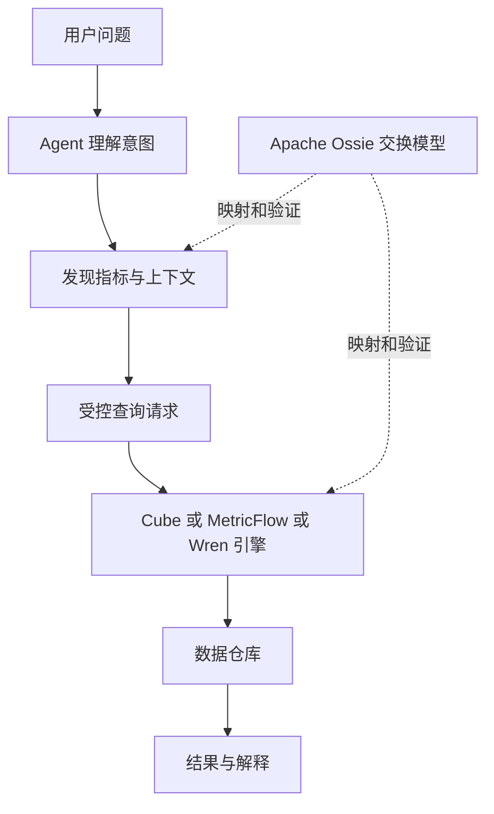

# Cube MetricFlow WrenAI Apache Ossie 对比调研报告

四个项目解决的是不同层次的“统一语义”：Cube Core 提供可复用的语义查询服务；MetricFlow 在 dbt 模型上编译指标请求；WrenAI 组织业务上下文并提供 Agent 查询与执行链路；Apache Ossie 定义语义模型交换规范及相关工具。它们有交集，也可以组合，但不是四个功能等价的产品。

本报告服务于 AI-Ready 数据与数据分析 Agent 的选型。核验日期为 2026 年 10 月 14 日，采用 A 类官方仓库、规范、许可证和技术文档，并克隆四项目追踪源码。完成 Wren 和 Ossie 的针对性测试及 Wren DuckDB 黄金案例；Cube、MetricFlow 为静态源码核验。第 16 节归纳源码结论，[源码追踪与验证](../docs/源码追踪与验证.md) 提供固定提交、代码路径和复现命令。场景选择为工程分析，不提供四引擎性能排行榜。

## 1 结论与推荐场景

| 你的主要问题 | 优先考察 | 理由 |
| --- | --- | --- |
| 多个 BI、应用和 Agent 共用指标，并需要持续查询服务 | Cube Core | 独立 API 服务与预聚合设计 |
| 已有 dbt，想避免每个 Agent 重写指标和关联 | MetricFlow | 编译受控指标请求，与 dbt 语义模型衔接 |
| 想让已有 Agent 读取业务说明、查询历史并生成分析 | WrenAI | MDL、上下文资产、检索与执行链路 |
| 需要跨平台传递语义模型，减少重复定义 | Apache Ossie | 厂商中立模型交换与验证 |
| 需要证明多平台结果一致 | 任一引擎加等价性测试 | 格式转换成功不能证明计算与权限一致 |

这些是选择候选的起点，最终应根据同一业务契约、数据与测试判断。Ossie 可以与执行引擎配合，不应和引擎一起比较查询延迟。

## 2 四者处于哪一层

| 层次 | Cube Core | MetricFlow | WrenAI | Apache Ossie |
| --- | --- | --- | --- | --- |
| 定义实体、指标与关系 | 数据模型 | dbt 语义模型与指标 | MDL 与相关知识文件 | JSON/YAML 交换模型 |
| 编译或规划查询 | 有 | 核心职责 | 有语义引擎与规划 | 规范描述，不是完整查询服务 |
| 执行与服务接口 | SQL、REST、GraphQL | 库与 dbt 运行环境；服务需另组织 | 连接器、CLI、SDK、MCP 等 | 转换、验证等工具 |
| Agent 上下文 | 语义模型描述与接口 | 指标与维度发现，由集成层提供 | 业务规则、示例与记忆检索 | ai_context 等注释 |
| 性能加速 | 缓存与预聚合 | 主要关注编译；仓库或服务层承担执行优化 | 按实现与连接器核验缓存 | 不承担生产查询加速 |
| 跨平台交换 | 专用模型 | 专用模型 | 专用模型 | 首要目标 |

“有”说明公开文档描述相关机制，不等于已经满足你的完整环境、权限和数据源需求。连接多种数据库，也不自动支持跨数据库的任意关联。

这是逻辑关系图，不表示四个项目已提供彼此无损的现成适配器。

## 3 Cube Core 深入分析

### 架构与语义资产

Cube 以 cubes、views 和成员定义组织业务语义。模型可表达 measures、dimensions、joins、pre-aggregations 与访问策略；YAML 或 JavaScript 定义作为可版本化资产。[模型参考](https://docs.cube.dev/reference/data-modeling/cube)

作为独立服务，它可以把同一业务定义提供给多个客户端，减少每个工具各自生成聚合逻辑。Cube Core 的 headless 定位与 Cube 平台的聊天、仪表板和托管功能要分开，不能从平台页面推定 Core 含全部产品功能。[Core 仓库](https://github.com/cube-js/cube)

### 查询正确性

关联关系和主键用于构造聚合查询；一对多关系下要考虑重复计数。定义错误或源数据违反唯一性时，框架不能自动修复业务真值。[关联文档](https://docs.cube.dev/reference/data-modeling/joins)

PoC 应检查：订单金额跨明细关联后是否重复、distinct count 是否符合业务、多事实表是否正确分粒度聚合、无法执行的维度是否明确报错。

### 缓存与预聚合

预聚合把常用结果组织成可复用的汇总，加速适配的查询；它同时引入构建、刷新、存储和命中规划的成本。[预聚合参考](https://docs.cube.dev/reference/data-modeling/pre-aggregations)

因此测试必须区分首次构建、冷查询、热查询和更新后查询。所谓“低延迟”不能脱离模型、数据规模、刷新频率与部署配置；本报告不引用厂商延迟宣传作为四者实测。

### Agent 集成与治理

Agent 可通过服务接口发现模型并提出查询请求。应用需把用户身份映射为经过验证的上下文，不能让 LLM 自报管理员或租户。开放源库的查询账户、Cube 入口和访问策略必须共同构成边界。

Core 与平台版本的策略、AI 功能和运维能力需按实际版本逐项核对。开发模式不能作为生产鉴权验收结果。

### 适用与代价

适合把语义查询当成共享基础设施、需要稳定服务与查询加速的团队。代价是新增运行服务、模型管理、预聚合刷新和缓存隔离的维护。若只为少数离线指标生成 SQL，部署规模可能超出需求。

## 4 MetricFlow 深入分析

### 核心定位

MetricFlow 将指标请求编译为数据流查询计划，再输出目标引擎 SQL。公开 README 当前描述它为查询编译与 SQL 渲染库，配合 dbt 项目及适配器使用。[仓库说明](https://github.com/dbt-labs/metricflow)

不要把开源库、dbt CLI 运行方式与 dbt 托管 Semantic Layer 服务混成一种交付。API、鉴权、运行并发和运营能力需要按你选择的服务路径评价。[官方架构说明](https://docs.getdbt.com/docs/use-dbt-semantic-layer/sl-architecture)

### 实体与关联推导

语义模型里的 entity 类型帮助构造关系图和可用关联路径，减少手写 joins。文档解释了如何根据实体类型避免 fan-out 和 chasm joins。[关联逻辑](https://docs.getdbt.com/docs/build/join-logic)

这不是任意 SQL 关联自动正确的保证。业务实体标错、事实粒度不清和多个合法路径，都需要建模与验收。对允许与拒绝的关联分别测试，比只看能否跑通一个例子更有价值。

### 指标与时间

指标表达覆盖简单聚合以及组合、比例、累计等需求。累计指标的时间对齐涉及 time spine，缺失日期、窗口边界与时间粒度必须明确。[累计指标](https://docs.getdbt.com/docs/build/cumulative)

购买用户占比不应平均日占比；要按目标粒度重新计算分子分母。累计收入、期末余额和平均客单价也不是同一类聚合，应检查非加性与半加性逻辑能否准确表达。

### Agent 接入

推荐让 Agent 输出指标名、维度、过滤与时间范围，经允许列表验证后交给 MetricFlow 编译。自然语言理解可以放在自建 Agent 层，MetricFlow 不需要替你承担整个对话管理。

已有 dbt 团队可能更容易复用模型、测试与发布流程，但仍需建立服务封装、模型版本发现和错误反馈。不要把开源编译器对指标的约束等同于对数据库任意 SQL 的访问限制。

### 适用与代价

适合 dbt 为中心的指标治理和仓库分析。新团队要接受 dbt、适配器和语义资产的约束；脱离 dbt 或需要低延迟共享服务时，应计算额外集成成本。托管服务缓存与 API 的能力不能记到开源库本身。

## 5 WrenAI 深入分析

### 当前架构与历史教程差异

核验版本包含 Rust wren-core、Python 接口、连接器和可选记忆层。引擎处理 MDL 状态、计算字段、关联表达与模型展开，连接器负责目标数据库执行。[架构文档](https://github.com/Canner/WrenAI/blob/main/docs/core/reference/architecture.md)

应以固定 commit 的文档为准，避免把旧 Wren 部署教程与现行 CLI、项目布局混用。

### MDL 与知识资产

MDL 描述物理表或 SQL 模型、列、关系、计算字段、视图和聚合对象；项目还可保存业务规则、词汇、示例及相关知识。项目 YAML 与编译后的 MDL wire 格式也有区别。[MDL 参考](https://github.com/Canner/WrenAI/blob/main/docs/core/reference/mdl.md)

这里的 Wren cubes 是其自己的聚合对象，不代表内置了 cube-js/cube。名称相同不能证明模型可以直接互换。

### 上下文与执行链路

可选记忆使用 schema_items 与 NL-SQL 历史，帮助 Agent 找到相关结构和查询案例。store_query 本身不验证执行成功，“确认过的示例”需由上层收录流程保证。Agent 得到上下文、生成请求或 SQL，再经规划、验证与连接器执行。[架构说明](https://github.com/Canner/WrenAI/blob/main/docs/core/reference/architecture.md)

风险在于上下文与执行资产发生漂移：指标改变后，旧示例仍可能被召回。正确执行 SQL 不代表问对了指标；成功查询也不应未经业务确认就成为可复用真值。

### 受控执行的边界

固定版本的 core/wren README 标明 strict_mode 默认 false，启用后要求查询中的表在 MDL 中声明；denied_functions 默认空列表。这说明“governed”不能理解为所有限制默认开启。[核心配置](https://github.com/Canner/WrenAI/blob/main/core/wren/README.md)

源码还实现了 Rust AccessControlProvider 的行过滤与列访问控制，以及展开前后的只读 SQL 检查；只读检查不依赖 strict_mode 开启。声明对象限制、行列策略和身份认证是不同职责。部署需可信地绑定 session properties，验收租户边界和资源预算。dry-plan 成功只证明规划条件满足，业务口径与权限仍需验证。[权限接口](https://github.com/Canner/WrenAI/blob/13e8bd3654534c528715e0bb6fa687caca25ebd4/core/wren-core/core/src/logical_plan/analyze/access_control/provider.rs#L34)

### 适用与代价

适合业务上下文丰富、需要对接现有 Agent 的分析场景。相比只做编译的方案，它的模型、知识文件、索引、记忆与连接器都要管理版本。是否使用 LLM、嵌入、托管服务及其费用取决于实际配置，而不由“开源”决定。

## 6 Apache Ossie 深入分析

### 目标与资产

Ossie 原名 Open Semantic Interchange，当前为 Apache 孵化项目。仓库提供核心规范、机器可读 schema、示例、转换器及验证工具，关注语义模型交换。[项目入口](https://github.com/apache/ossie)

它表达 datasets、fields、relationships、metrics、方言表达式、ai_context 与扩展内容。标准模型不自动提供鉴权服务、生产查询缓存或完整 NL-to-SQL 系统。

### 版本边界

本次固定 commit 中，core-spec 标明 0.2.0.dev0 为未发布草稿、结构可变化；当前草稿采用根部单模型结构，并说明早期版本的 semantic_model 数组发生破坏性变更。规范版本与仓库 commit 都应固定。[规范](https://github.com/apache/ossie/blob/main/core-spec/spec.md)

这直接影响适配器：同样名为 OSI/Ossie 的导入导出器，可能针对不同版本，不能用“支持 OSI”一句话判断兼容。

### 交换成功不等于计算一致

表达式可带 SQL 方言，扩展字段可保存平台特性；但被保存的字符串不一定能被目标引擎执行。参考转换器与映射说明是核验入口，不能推出所有高阶指标都可无损转换。[转换器说明](https://github.com/apache/ossie/blob/main/converters/README.md)

标准表达语言也有范围，应区分声明模型的表达式与终端用户查询语言。[表达语言规范](https://github.com/apache/ossie/blob/main/core-spec/expression_language.md)

对窗口、财政日历、半加性、过滤位置和关系基数，必须做转换后的等价性测试。自定义扩展若只有原平台理解，提供了携带能力却没有消除锁定。

### 适用与代价

适合建立交换契约、减少平台之间重复录入。短期成本在映射、版本治理、兼容验证与未支持特性清单。若现在只需把指标查出来，规范不能替代执行引擎。

## 7 关键能力对照

下表区分已描述机制与待验收行为，不给未经实测的星级评分。

| 维度 | Cube Core | MetricFlow | WrenAI | Ossie |
| --- | --- | --- | --- | --- |
| 建模方式 | YAML/JS，cubes 与 views | dbt 语义模型、实体与指标 | MDL、项目 YAML 与知识文件 | 交换规范 JSON/YAML |
| Join 表达 | 显式关系与条件 | 以 entity 构造路径 | 关系定义与表达展开 | 关系元数据，执行端解释 |
| 防重复聚合 | 依赖关系与主键建模 | 依赖实体类型和可用路径 | 依赖主键、关系及请求 | 需目标引擎保证 |
| 时间语义 | 时间维度与相关聚合配置 | time spine 与指标时间配置 | 模型和聚合对象配置 | 需核对版本与引擎映射 |
| 查询服务 | 独立服务 | 集成或托管层组织 | CLI、SDK、连接器及服务方式 | 非同类服务 |
| 上下文维护 | 模型描述，集成层组织 | 指标描述，集成层组织 | 显式知识和检索资产 | ai_context 注释 |
| 执行限制 | 身份上下文和策略需配置 | 服务及数据库权限需配置 | strict_mode、函数限制等需配置 | 规范不执行权限 |
| 性能优化 | 预聚合和缓存设计 | 编译与仓库优化分工 | 按连接器与缓存配置验证 | 不参与运行比较 |

无论采用哪个项目，元数据中的“主键”都需要通过真实数据检查。指标描述“只计算已支付订单”，若表达式忘记过滤，Agent 阅读描述也不能补偿执行定义的错误。

## 8 开源与商业边界

| 项目 | 本次核验的许可 | 应避免的误读 |
| --- | --- | --- |
| Cube | 根说明默认 Apache-2.0，部分包 MIT | 不把 Cloud 全功能当 Core 免费能力 |
| MetricFlow | Apache-2.0 | 开源库不等于完整托管 API 服务 |
| WrenAI | core/sdk/skills/examples Apache-2.0，docs CC-BY-4.0；按路径区分 | 仓库放有 AGPL 文本不代表当前所有组件 AGPL |
| Ossie | Apache-2.0 | 开源规范不等于供应商实现免费 |

Cube 与 WrenAI 在 GitHub API 中显示 NOASSERTION，是自动识别结果，不等于没有许可。应阅读根文件与包级声明。WrenAI 根说明还区分发布包清单和源码路径，实际再分发要按具体构件核对。[Cube LICENSE](https://github.com/cube-js/cube/blob/master/LICENSE)、[WrenAI LICENSE](https://github.com/Canner/WrenAI/blob/main/LICENSE)

费用拆为开发建模、运行服务、仓库扫描、预聚合储存、LLM/嵌入与维护成本。本报告不提供未经核实的套餐价格，也不把不同供应商的成本宣传放进同一排行榜。

## 9 一个必须统一的业务契约

以下为自构造验收案例：

净收入按支付时间统计，为已支付订单金额减去该订单截至查询时点已确认的退款；币种为 CNY，金额单位为分，默认不做汇率换算。取消订单不计入。订单与退款一对多，商品明细也一对多。

| 订单 | 租户 | 已支付金额分 | 退款分列表 | 商品明细数 |
| --- | --- | --- | --- | --- |
| O1 | A | 10000 | 1000、2000 | 2 |
| O2 | A | 20000 | 无 | 1 |
| O3 | B | 30000 | 5000 | 2 |

不增加商品筛选时，租户 A 净收入为 27000 分，全局为 52000 分。这些是教学黄金值，不是四项目实测。

风险点：把订单、退款、商品一次原始 join 后求和，会出现行乘积。正确方案应按各事实粒度聚合，或使用已证明等价的引擎规划。退款按支付日扣减与按退款发生日扣减属于两种指标，不能靠工具自行猜测。

## 10 四者如何处理同一个请求

问题：“租户 A 本月净收入是多少？”

- Cube：把净收入和时间、租户维度定义为模型成员，经身份上下文约束后查询；检查预聚合是否匹配且足够新。
- MetricFlow：先准备相应事实与 entity，定义指标并请求时间、租户维度，审查编译 SQL 及执行权限。
- WrenAI：MDL 与业务知识说明口径，Agent 发现并生成查询，经模型展开、策略与数据库执行；检查召回到的示例版本。
- Ossie：交换上述语义定义；目标引擎还需编译、执行和应用身份约束。

这是建议实现路径，不是已验证的配置教程。若退款与商品组合的过滤分配不明确，先澄清业务契约，而不是强行选一个引擎默认。

## 11 PoC 测试矩阵

| 用例 | 验收点 | 对谁测试 |
| --- | --- | --- |
| 净收入基本聚合 | 黄金值与单位正确 | 三个执行方案 |
| 加入商品关联但不筛选 | 收入不能因明细倍增 | 三个执行方案 |
| 重复退款记录 | 规则明确拒绝或按定义处理 | 三个执行方案 |
| 多事实比率 | 分子分母独立粒度后重算 | 三个执行方案 |
| 没有订单的日期 | 空、零与 time spine 定义一致 | 三个执行方案 |
| 非法指标或维度 | 结构化拒绝，不能悄悄换口径 | Agent 与执行层 |
| 租户 B 查询租户 A | 服务、缓存与 DB 都不能泄漏 | 三个执行方案 |
| 修改指标定义 | 更新与缓存失效可追踪 | 三个执行方案 |
| 错误旧 NL-SQL 例子 | 不覆盖现行指标定义 | Agent 上下文链路 |
| 规范导出再导入 | 口径、时间、关系、扩展保留或明确报告缺失 | Ossie 加目标适配器 |

对 Ossie 分别评价 schema validation、映射覆盖与结果等价；不能把三项合成“通过”。合法 schema 可以存一条语义错误的表达式。

性能测试固定数据、硬件、并发、用户身份、查询粒度、刷新与超时。单独报告 cold、warm、缓存更新等待、p50/p95、仓库扫描和失败率；Ossie 只报告转换与验证指标。

## 12 组合架构与迁移策略

有 dbt 时，优先把现有指标定义当事实来源；选择 MetricFlow 查询路径，或经过明确映射再用其他执行引擎。避免长期维护两份没有一致性验证的“收入”。

没有指标层但需要分析 Agent 时，WrenAI 可作为一条候选链路；若要把指标提供给多个应用并需要缓存加速，则同时评估 Cube。二者组合不是本报告已确认的原生方案，必须验证模型映射和查询语义，不能重复让两层各自发明口径。

Ossie 可承担交换契约。建议保留原始模型、转换输出、映射版本、unsupported 列表和黄金查询结果。对不能表示的特性主动报错，比“转换成功”但默默丢掉窗口更可维护。

## 13 场景选择与投入估计

| 场景 | 优先路线 | 决定前必须解决 |
| --- | --- | --- |
| dbt 基础完善，指标是主要需求 | MetricFlow | 服务封装、权限、版本与支持维度 |
| 多客户端共享低延迟分析 | Cube | 预聚合刷新、缓存隔离与运维 |
| NL 分析，业务说明和例子很多 | WrenAI | 知识更新、strict_mode、错误 SQL 反馈 |
| 多平台模型治理和交换 | Ossie | 稳定规范版本与映射测试 |
| 一个小型本地学习项目 | 选择一个执行引擎做黄金用例 | 不先引入全部组件 |

相对投入是工程推断：MetricFlow 可减少已有 dbt 团队的重复建模；Cube 增加服务运营；Wren 增加上下文资产运营；Ossie 增加转换和版本运营。每个团队条件不同，不提供统一人天估算。

## 14 学习与落地顺序

第一阶段：写清净收入、关联粒度、退款时间和权限契约，制作黄金数据。

第二阶段：分别建一个最小执行模型。先给结构化请求，再引入自然语言 Agent，这样能区分理解错误与引擎错误。

第三阶段：加入中文同义词、歧义澄清、上下文示例、拒答和身份隔离。

第四阶段：只选择实际需要的模型交换路径，固定 Ossie 版本，验证转换后的黄金值和权限边界。

第五阶段：依据任务完成率、维护成本和刷新需求选型。没有这些结果前，不根据 stars 或功能数量给四者总体排名。

本报告配套的来源记录保存固定 commit 与证据链接；PoC 方案供后续复现，不声称已经验证平台质量。

## 15 适配场景与能力项决策矩阵

标记含义：原生表示项目公开资料直接描述该能力；集成表示需要 Agent、服务或数据库层配合；外部表示不属于该项目主体职责；验收表示实现边界必须以目标版本测试。原生不是“无需配置”或“默认安全”。

| 能力项 | Cube Core | MetricFlow 开源库 | WrenAI | Apache Ossie |
| --- | --- | --- | --- | --- |
| 业务指标定义 | 原生 | 原生 | 原生 MDL 与聚合对象 | 原生表达与交换 |
| 查询 SQL 编译或规划 | 原生 | 原生 | 原生 | 外部执行端 |
| 关系与粒度管理 | 原生，数据约束需验收 | 原生 entity，路径需验收 | 原生关系，粒度需验收 | 表达后需执行端验收 |
| 生产查询服务 | 原生，需部署 | 集成服务 | 原生工具链或服务，需部署 | 外部 |
| 自然语言意图理解 | 集成；Cloud 功能另计 | 集成 | 面向已有 Agent 的原生集成链路 | 外部 |
| 已确认 NL-SQL 记忆 | 集成 | 集成 | 原生可选存储与检索，确认流程需集成 | 外部 |
| 中文业务问答正确率 | 验收 | 验收 | 验收 | 评价适配后整体系统 |
| 预聚合加速 | 原生 | 外部仓库或服务层 | 不按 Cube 同等能力计，需验收 | 外部 |
| 身份认证与多租户隔离 | 配置与外部身份集成，需验收 | 集成服务与数据库权限 | 配置与身份集成，需验收 | 不执行 |
| 多格式无损互换 | 集成映射，需验收 | 集成映射，需验收 | 集成映射，需验收 | 规范与转换器，仍需验收 |
| 数据清洗和源事实纠错 | 外部 | 外部 | 外部 | 外部 |
| 执行业务写动作 | 不是本报告分析查询层的默认范围 | 外部 | 不按查询能力推定写动作授权 | 外部 |

### 四类团队怎么选

**数据工程团队已有 dbt：** 首选验证 MetricFlow。若团队更在意对应用提供稳定服务与查询加速，则额外验证 Cube 的价值和模型映射成本。不要为了接一个 Agent 重建已经验证的指标口径。

**SaaS 或多租户嵌入式分析团队：** 首选验证 Cube 的服务与缓存链路，关键门槛是身份、租户隔离、缓存隔离、刷新时效和并发。Wren 可用于候选 Agent 上下文方案，但不是未经测试的即插即用组合。

**业务分析或 ChatBI 团队：** 首选验证 Wren 的业务知识、示例检索、规划和执行体验。若要求多个 BI 与 Agent 共用稳定指标服务，也应对比 Cube。先确认指标口径，再讨论自然语言生成效果。

**平台治理与互操作团队：** 研究 Ossie，制定交换版本、映射规则与不支持能力的显式报告。若尚未有任何执行引擎，应先选择查询方案，规范本身不能交付业务答案。

### 应暂缓采用的条件

- Cube：团队无法维护查询服务与预聚合刷新，且仅有少数离线指标需求。
- MetricFlow：没有 dbt 项目或不愿承担适配器与服务封装。
- WrenAI：缺少维护业务知识与确认示例的流程，期待默认开启完整访问治理。
- Ossie：急需现成查询应用，却没有执行端；或希望草稿版本自动实现复杂指标无损迁移。

这是按需求与责任分工推导的建议，不是项目全面优劣结论。

## 16 基于克隆源码的深度对比

### 同一个查询在四项目中的路径

| 项目 | 关键路径 | 得到的产物 |
| --- | --- | --- |
| Cube | ApiGateway → 权限改写 → CompilerApi → 模型/关系与 SQL 规划 → orchestrator | SQL、预聚合匹配、缓存与查询结果 |
| MetricFlow | 指标请求 → QuerySpec → DataflowPlan → SqlPlan → renderer/executor | 指标 SQL、解释计划和结果 |
| WrenAI | SQL 策略检查 → 子 MDL → DataFusion/CTE 展开 → 目标方言 → 输出检查 → connector | 目标 SQL 和 Arrow 结果；上下文检索另属 memory |
| Ossie | 模型文件 → Schema/引用/表达式检查 → 特定转换器 | 校验诊断与目标模型，查询由消费端执行 |

Cube 的 SQL 规划有 JS 与原生路径，不能只按语言标签比较；MetricFlow 的 query 不只是返回 SQL，也可执行，但生产服务仍需集成。Wren 当前架构应与旧版 UI/AI service 教程区分。Ossie 的特定 Microsoft 转换器有可选真引擎校验，但核心规范仍不是通用查询执行器。

### 关联正确性采用不同机制

Cube 的 JoinGraph 记录 multiplicationFactor，并在相关度量路径检查主键；BaseQuery 对被倍增度量分组聚合。MetricFlow 的 JoinEvaluator 明列 entity 合法组合，拒绝 primary→foreign、foreign→foreign 等危险路径，数据流验证另识别右侧已聚合到 entity 的情况。两者都依赖真实数据满足建模契约。

Wren 的语义模型展开不意味着任意手写 SQL 会自动修正粒度。实际 DuckDB 案例中，同样的订单、退款和商品数据，退款先按订单聚合得到全局净收入 **52000 分**；直接关联两张明细表得到 **104000 分**。这只覆盖声明基础模型上的手写 SQL 路径，不推断所有 Wren 关系和聚合对象行为。Ossie 的关系引用与列数量检查不验证数据唯一性或计算结果。

### 权限与缓存需要分别验收

Cube 源码包含行级权限、成员授权与掩码改写；静态 query cache key 包括 SQL、参数和预聚合 load SQL，不能据此认定原始身份天然进入所有缓存 key。应验证权限如何进入 SQL/参数与 orchestrator 隔离。

Wren 源码包含行列访问控制和两道只读 SQL 检查。strict_mode 默认关闭表示对象范围限制未默认开启，不等于关闭只读检查；SessionContext 的 32 项 LRU 是规划会话复用，不是结果缓存或预聚合。NL-SQL store_query 本身也不证明示例执行成功，确认与版本管理属于上层流程。

Ossie validator 对 DAX、MDX 等方言跳过表达式语法检查；转换器会对无法映射的数据类型、表达式和扩展发出 warning。文件通过校验、转换输出成功、目标引擎可以编译、黄金结果一致、权限等价，是五个不同验收层级。

### 验证结果与选型影响

| 实际执行 | 结果 | 能支持的结论 |
| --- | --- | --- |
| Wren SQL 策略测试 | 83 passed | 指定 SQL 策略单元路径通过 |
| Wren 引擎单元测试 | 11 passed | dry-plan、字段展开和指定错误路径通过 |
| Wren + DuckDB 黄金案例 | 正确粒度、错误粒度及未知表拒绝断言通过 | 指定基础模型查询路径的实际结果 |
| Ossie validator 测试 | 244 passed，26 subtests passed | 指定校验器行为通过 |
| Ossie Python 类型测试 | 174 passed | 类型、验证和序列化行为通过 |

Wren 使用锁文件中的 wren-core-py 0.8.0 发布 wheel，未本地编译 checkout 的 Rust；Cube、MetricFlow 未运行，测试数量不能用于项目排名。完整证据、固定源码链接和命令见 [源码追踪与验证](../docs/源码追踪与验证.md)。

选择 Cube 时重点验收共享服务、预聚合与缓存隔离；选择 MetricFlow 时重点验收指标请求、entity 路径与时间口径；选择 Wren 时重点验收上下文维护、SQL 粒度和可信身份绑定；选择 Ossie 时重点验收指定转换路径的损失、版本兼容和目标执行等价性。
