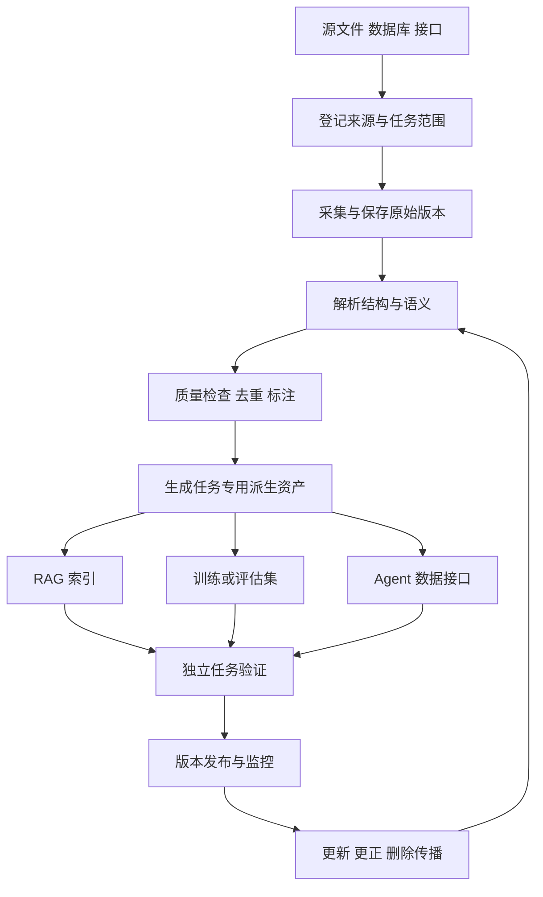

# 构建 AI-Ready 数据学习调研

AI-Ready 数据，是针对明确的 AI 任务，能够被正确获取、理解、使用、核验和持续更新的数据。它不是某一种文件格式，也不是“已经向量化”的标签。准备程度要用实际任务证明：模型是否找到正确依据、理解业务含义、遵守访问范围，并在数据变化后保持有效。

本课题以企业知识库、RAG 与 Agent 业务数据为主线，同时比较训练数据与评估数据的不同要求。适合已经了解大模型基本概念、准备建设知识库或数据流程的读者。调研核验日期：2026 年 10 月 14 日；本次未训练模型、运行商业数据或执行付费评测。

## 1 一份普通数据为什么还不够

假设公司有三个文件：2023 年退款政策 PDF、2026 年新政策 Word，以及缺少币种和时区的订单 CSV。它们都能打开，但 AI 仍可能回答错误：

- 旧政策与新政策同时被检索，没有生效范围。
- PDF 中表格的列错位，金额与条件对应错误。
- “付款后七天”没有说明自然日还是工作日。
- 订单状态是昨天的快照，Agent 把它当作当前事实。

准备工作应解决任务相关的内容、结构、时间、来源和访问问题，而不只是把文件转成文本。

数据就绪度综述整理了结构化与非结构化数据的质量、完整性、时效等指标，但其重点是 AI 数据尤其训练准备，不能把其指标目录直接当成企业 RAG 的认证标准。[Data Readiness for AI](https://arxiv.org/html/2404.05779)

## 2 先问准备给谁用

| 数据用途 | 需要提供什么 | 重点验证什么 |
| --- | --- | --- |
| 预训练 | 大规模语料与明确混合策略 | 去重、分布、过滤、训练评估污染 |
| 微调与偏好训练 | 输入输出示例或偏好标签 | 标签正确性、覆盖、格式与一致性 |
| RAG | 可检索的知识证据 | 分块语义、来源定位、生效范围 |
| Agent | 知识、当前状态、工具数据 | 时效、动作前提、权限与事实核验 |
| 独立评估 | 问题、答案、证据与任务结果 | 无泄漏、标注依据、可重复计分 |

同一份文档可以产生多种派生资产，但规则不能混用。例如知识库需要允许用户查找历史版本，训练集去重则通常避免同一内容反复出现。把历史政策全部删除可能改善重复率，却破坏审计问题的可回答性。

先写“目标任务卡”：用户是谁、要完成什么、可使用哪些来源、什么算正确、什么时候应拒答，以及哪些字段必须实时查询。这些定义决定数据应该如何加工。

## 3 一个可操作的就绪框架

下列八项为本文综合分析，不是统一行业标准：

| 维度 | 需要回答的问题 | 常见证据 |
| --- | --- | --- |
| 可用 | 数据能稳定获取吗 | 接口契约、格式、可用性记录 |
| 正确 | 内容与结构准确吗 | 源文对照、字段校验与抽检 |
| 充分 | 能支持目标任务吗 | 任务覆盖矩阵、缺失清单 |
| 可理解 | 名词、单位与关系明确吗 | 数据字典、实体 ID、语义定义 |
| 可检索 | 能定位相关证据吗 | 标注问题与检索指标 |
| 可追溯 | 能回到来源和加工版本吗 | 原文锚点、血缘与版本 |
| 可控 | 访问和使用范围明确吗 | 数据授权、行或文档访问规则 |
| 可维护 | 更新、纠正和删除能传播吗 | 增量流程、失效测试与负责人 |

不要把八项平均成一个分数后宣布“就绪”。若关键字段没有单位，或限制访问的数据能被其他用户检索，高相关性不能补偿这个问题。可先设必须满足的门槛，再评价覆盖与成本。

## 4 数据资产与来源说明

Datasheets for Datasets 提议说明数据的目的、组成、收集、清洗、用途、分发与维护，让消费者能判断适用性。[原文](https://arxiv.org/html/1803.09010)

Data Statements 则强调语言数据中的人群、语言和收集环境，提醒从一个群体的数据推及另一个群体存在局限。中文、方言、专业术语的覆盖不应只靠总体准确率证明。[TACL 原文](https://aclanthology.org/Q18-1041/)

在企业项目里，可以制作简化资产卡：

- 名称、负责人、用途与非用途。
- 来源系统、许可或内部授权依据、可访问人群。
- 实体和字段定义、语言、时间范围。
- 已知缺失、代表性限制与更新频率。
- 处理版本、数据快照和评估结果。
- 更正、删除和问题反馈入口。

[Hugging Face 数据集卡片文档](https://huggingface.co/docs/hub/datasets-cards)给出公开数据的文档化入口。卡片存在不代表数据已通过质量认证，也不把代码许可自动扩展到内容或模型权重。

## 5 从原始数据到可使用资产



保留受控的原始层用于追溯；规范层统一结构和元数据；服务层按任务生成 chunk、特征、训练样本或接口视图。这是推荐架构，不要求每个小项目购买完整数据平台。

每步记录输入版本、处理配置、输出版本和被排除原因。失败记录进入隔离区，不能悄悄把解析失败当作空文档。

## 6 文档解析不能只看文字多少

PDF 可能有双栏、扫描页、页眉页脚、合并单元格和脚注。OCR 把文字识别出来，不等于读序、表格关系和否定条件保留正确。

建议保留标题层级、列表、表格行列、单位、脚注和页码。表格若线性化，应把行标题和列标题随值一起输出。例如“12”应变成“华东区、2026 年第三季度、收入 12 万元”，且能够回到原单元格。

Docling 的技术报告介绍布局分析、表格结构恢复和文档统一表示，是文档解析的研究与实现案例；不能据此保证任意中文扫描件都能正确转换。[技术报告](https://arxiv.org/html/2408.09869)

解析验收可抽样覆盖纯文本、扫描、多栏、长表格和跨页表格；关键金额、日期、单位与例外条件单独检查。高 OCR 字符准确率可能掩盖一处决定性的“不得”识别错误。

## 7 结构化数据的语义准备

数据库字段规范也不代表 AI 理解业务。amount 可能是分、元或含税金额；status=3 必须有枚举解释；created_at 的时区与业务含义必须明确。

准备至少包括：

| 对象 | 需要保存的定义 |
| --- | --- |
| 字段 | 名称、类型、单位、缺失含义 |
| 指标 | 计算公式、过滤条件、统计粒度 |
| 实体 | 稳定 ID、别名和跨表关联 |
| 时间 | 事件时间、采集时间、业务生效时间 |
| 状态 | 枚举含义与合法转换 |
| 关系 | 主键、外键与一对多语义 |

例如“营收”是下单额、已支付额还是确认收入？这应由业务字典定义，不能让 LLM 从字段名猜测。精确聚合和金额计算交给 SQL 或代码，模型用于选择与解释。

知识图谱适合显式关系、多跳问题和实体统一，但需要维护与抽取验证。向量库适合语义相似检索，不能代替所有业务关系和事务状态。

## 8 去重 清洗与覆盖的取舍

训练数据研究显示，重复和训练测试重叠会影响记忆与评估。去重论文比较了重复文本移除与模型结果，支持把重复度作为可实验控制的变量，不能推出所有领域都应越删越好。[Deduplicating Training Data](https://arxiv.org/html/2107.06499)

企业数据可区分：

- 完全重复：同一内容多份镜像，保留来源映射。
- 近重复：模板相同但客户、日期或金额不同。
- 版本关系：政策正文相似但条款变化，不能简单合并。
- 业务重复：两个真实订单内容相同，却是两个独立事件。

清洗只修复确定的格式问题。缺失金额不要由模型猜填；推断标签应标明生成方式和验证状态。用模型打“质量分”时，抽检被过滤的数据，观察是否误删专业术语、少数语言或稀有类别。

DCLM 为去重、过滤、混合策略提供受控数据实验；Dolma 展示语料组成与处理的公开案例。它们是训练数据工程参考，不能直接证明某企业知识库的分块效果。[DCLM](https://arxiv.org/html/2406.11794)、[Dolma](https://arxiv.org/html/2402.00159)

## 9 RAG 数据怎样准备

RAG 的关键资产不是单独的向量，而是可定位、带语义和时间范围的证据单元。

一个 chunk 应有正文、文档 ID、版本、章节、源位置、语言、实体、访问范围与生效区间。片段大小应随文档结构和问题类型评估，不设万能字符数。长表格、例外条件与引用关系可能需要父子片段或关联加载。

可以同时使用关键词与向量召回。错误码、产品型号和人名等精确符号需要保留原值；改写成泛化摘要可能让它们无法被找到。重排也不能解决知识库本来没有答案的问题。

Contextual Retrieval 给片段补充文档相关背景，再用于嵌入和词法索引，减少脱离原文的歧义。这是官方工程方法，不是独立论文；生成背景须区分原文与模型补充，并检查事实一致性。[官方文章](https://www.anthropic.com/engineering/contextual-retrieval)

检索权限应在内容提供给模型前生效，并在最终读取时再次验证。已经越权进入上下文的内容，不能靠生成后删掉回答来补救。

## 10 一个证据记录的教学模板

下面是设计示例，不是任何框架的官方 schema：

```json
{
  "document_id": "refund-policy",
  "document_version": "2026-10-v2",
  "chunk_id": "refund-policy:2026-10-v2:section-3",
  "title": "退款规则",
  "section_path": ["售后政策", "期限与例外"],
  "text": "签收后七个自然日内可申请；定制商品除外。",
  "source_ref": "internal://policies/refund/v2",
  "source_locator": {"section": "3"},
  "language": "zh",
  "valid_from": "2026-10-01",
  "valid_to": null,
  "access_groups": ["support"],
  "status": "approved",
  "pipeline_version": "parser-config-v1"
}
```

source_ref 为虚构示例 URI。生产系统应存可访问的真实引用，使用明确的时间边界约定，并保存原始对象校验值或版本标识。

不要把 text 中“定制商品除外”放到无关联的另一个片段，否则 Agent 可能回答出七天期限却漏掉例外。索引更新要关联到 document_version，不能只改正文而留下旧 embedding 或缓存。

## 11 Agent 需要实时事实与动作前提

知识库可以回答“重复扣款应如何处理”，但“这笔交易是否重复”要查询账本。业务状态应通过有鉴权的工具接口获取，返回对象 ID、观察时间、版本和状态。

动作前需要验证目标对象、权限、最新状态与幂等条件。例如 Agent 在十分钟前看到订单待退款，真正执行时必须重新检查，避免状态变化后重复退款。

外部内容中的“忽略规则”不是业务授权。资料可信度与指令优先级不同；即使内容来自内部知识库，也不应自动授予操作权。

与上一篇 Agent 上下文建设的关系是：AI-Ready 管理可用数据资产，上下文工程决定某次调用选择哪些资产。高质量资料可能因检索失误无法进入上下文；正确检索也可能因资料过时而产生错误。

## 12 更新 删除与版本管理

明确三种时间：事件何时发生、系统何时看到、规则何时生效。“今天上传”不意味着“今天生效”。未来生效政策应能检索，但不能被当成当前规则。

对增量发布，采用版本清单确认原文、片段、向量、关键词索引和派生摘要的一致性。删除和撤销权限需传播到这些资产、缓存及允许保留的日志，定义失败重试和最大传播延迟。

训练语料一旦进入模型参数，删除原文件不能自动移除模型学到的影响。因此训练用途与运行时检索用途的撤销能力不同，需要在选型时明确。

一个简单的数据发布清单应记录 source_snapshot、parser_version、chunk_config、embedding_version、index_version 与 eval_set_version。便于回滚和解释结果变化。

## 13 评估数据必须独立建设

给知识库准备测试问题时，每题记录目标用户、查询时间、答案、必要证据、可接受表述与拒答条件。多证据题需记录完整证据集合。

训练与测试按文档、实体或时间分组切分，避免同一文档的相邻 chunk 或模板变体落入不同集合。RAG 评估中允许从知识库检索目标证据，这是任务定义；把测试答案用于调参或提前写入策略记忆，则是另一种泄漏。

BEIR 用跨领域检索评估提醒我们：一个检索方法在某类语料表现好，不等于换领域也好。[BEIR 原文](https://arxiv.org/html/2104.08663)

RAGAs 提供自动评估检索与生成的思路，适合加速迭代；模型裁判仍可能偏差，不能代替人审关键样例，更不能证明业务状态正确。[EACL 原文](https://aclanthology.org/2024.eacl-demo.16.pdf)

合成题可扩展覆盖，但应人工检查题目和证据，不能由同一生成器自动宣布自己的答案都正确。

## 14 数据与系统怎样验收

| 层级 | 可测指标 | 必须注明的条件 |
| --- | --- | --- |
| 来源 | 有来源和授权依据的资产比例 | 分母为哪些已登记资产 |
| 结构 | 必填字段完整率、解析错误率 | 必填定义与抽检样本 |
| 内容 | 重复率、标签一致率、语义抽检 | 去重算法与标注规则 |
| 时间 | 过时证据使用率、更新传播延迟 | 查询时刻与生效区间 |
| 检索 | Recall@k、nDCG、多证据完整率 | qrels、去重计分与权限范围 |
| 回答 | 正确率、引用支持率、拒答质量 | 人工标签及裁判配置 |
| 动作 | 任务完成率、越权与重复执行 | 环境最终状态 |
| 成本 | 入库、查询、存储与维护成本 | 包含失败和重试 |

教学例子：100 条证据记录中，80 条来源完整、90 条时间字段齐全，两项比例为 80% 和 90%；不能假定两项都完整的记录有 72 条，必须检查交集。

50 个问题各需一条证据，Top-5 找回 40 个时题目级命中率是 80%；遇到每题需两条证据时，至少找回一条不等于完整支持答案。

阈值按业务风险确定。硬门槛、指标与端到端结果共同判断，不把自动评分模型的 confidence 当作数据真实性证明。

## 15 论文和工具该如何选择

| 主题 | 优先阅读 | 用途 |
| --- | --- | --- |
| 就绪度定义 | Data Readiness for AI | 指标地图 |
| 数据透明性 | Datasheets、Data Statements | 来源与适用范围 |
| 文档解析 | Docling Technical Report | 布局、表格与结构 |
| 训练整理 | 去重研究、DCLM、Dolma | 过滤、混合与对照实验 |
| 检索评估 | BEIR | 跨领域检索验证 |
| RAG 评估 | RAGAs | 检索与生成分层指标 |

Docling、DataTrove、Dolma、DCLM、BEIR 和 Ragas 的作者或组织仓库已核对。代码许可证与数据许可证分开记录，仓库推送时间也不等同于复现成功。具体快照见来源记录。

不需要一开始就引入图数据库、全量预训练或复杂 Agent。先挑一类资料、一组问题、一条可追溯处理链路，证明确有改进，再扩大范围。

## 16 四周学习与实践路线

| 周 | 学习内容 | 可交付成果 |
| --- | --- | --- |
| 第 1 周 | 任务范围、来源说明、字段语义 | 任务卡、资产卡、数据字典 |
| 第 2 周 | 解析、去重、时间与版本 | 规范样本、错误清单、发布清单 |
| 第 3 周 | 分块、混合检索、证据定位 | 问题与证据集、检索对照 |
| 第 4 周 | 回答、权限、更新与成本 | 分层评估报告、运维方案 |

建议从虚构退款政策与订单样例开始，覆盖政策更新、例外条件、无答案、权限限制和过时状态。文档中的配套实践模板给出记录格式与验收要求。

自测问题：向量化为何不代表数据就绪？同文本为何不一定是重复业务事件？上传时间与生效时间有何区别？知识库能否决定实时退款？删除一份源文件要更新哪些派生资产？

完成标准：能够把一个 AI 错误定位到来源、解析、语义、检索、读取或动作环节，并为对应环节提出可复验的修复。
