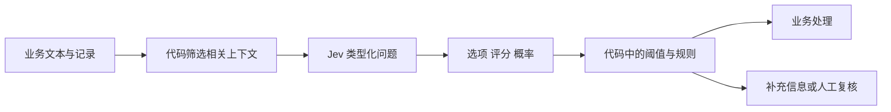

# Jev 模型原理与实践学习指南

Jev 是 TypeSafe AI 面向软件自动化的文本决策模型：输入业务状态和类型化问题，输出选项、评分或“是”的概率。它的价值在于把语义判断接入代码，使分类、路由、检索评估等流程可度量、可组合。学习它的关键，是同时掌握问题设计、概率校准与代码中的决策规则。

本文按 JEV 即 TypeSafe 的 Jev 展开，与 Meta 的 JEPA 和 V-JEPA 世界模型不同。适合具备基础 Python 与机器学习概念的读者。资料核验日期为 2026 年 10 月 13 日；版本、价格和限流均以此时官方文档为准。

## 1 模型定位与工作方式

可以把 Jev 理解为接收文本上下文的概率决策函数。它并非通用写作工具，也不直接执行动作：应用先给出候选答案或评分标准，模型判断，代码决定下一步。官方用“System One”描述快速、范围明确的判断任务；这个名称是产品与研究定位，不构成人类认知机制的证明。[官方介绍](https://docs.typesafe.ai/introduction)

一个请求含三个核心部分：

| 部分 | 含义 | 设计要点 |
| --- | --- | --- |
| state | 待判断的文本或 JSON 上下文 | 给足相关证据，保留字段关系 |
| questions | 多个具名的类型化问题 | 每个问题只判断一个明确条件 |
| model | 模型版本 | 评估与上线尽量固定版本 |

同一请求中的问题共享 state，但分别评估；不能把它们当作按顺序执行、后一个读取前一个答案的程序。若第二步需要第一步产生的信息，应在代码中发起下一次请求。[State](https://docs.typesafe.ai/concepts/state)



## 2 三种决策原语

### Choice 选择离散类别

用于互斥分类，例如把工单分到支付、技术、销售或其他。返回 choice、各选项的 probabilities 和 confidence。每个问题最多 255 个候选项。候选集应覆盖真实输入，必要时加入“其他”或“证据不足”，否则系统会把不合适的内容塞进某个合法类别。[Choice](https://docs.typesafe.ai/primitives/choice)

多标签问题不宜强行做单个 Choice。例如一条工单既涉及支付又涉及技术，应分别问两个 Noul，或先定义明确的“主处理团队”规则。

### Score 沿有序量表评分

Score 的 criteria 是由低到高排列的 2 至 10 个描述性等级。返回各等级概率、score、confidence 和 legend。等级编号从 0 开始，score 是编号的概率加权平均：

```text
score = Σ i × p_i
```

例如概率为 [0.2, 0.5, 0.3]，三个等级编号为 0、1、2，则 score = 1.1。它表示量表上的位置，不能解释成事件发生率、精确金额或真实测量值。等级描述和间距设计决定其业务含义。[Score](https://docs.typesafe.ai/primitives/score)

### Noul 判断是或否

Noul 返回“是”的概率 noul，范围为 0 至 1，不单独返回 confidence。它适合“文本是否明确请求退款”“片段是否支持这个结论”等判断。0.5 附近表示模型对两种结果难以区分；业务阈值应通过数据确定。[Noul](https://docs.typesafe.ai/primitives/noul)

| 业务目标 | 合适原语 | 示例 |
| --- | --- | --- |
| 单一类别 | Choice | 主处理部门 |
| 有序程度 | Score | 问题严重程度 |
| 条件是否成立 | Noul | 是否明确要求退款 |
| 多标签 | 多个 Noul | 分别识别多个主题 |
| 生成解释或新内容 | 生成式模型 | 起草回复邮件 |

## 3 概率与 confidence 的区别

Probability 描述各候选结果的概率；confidence 是从分布计算出的摘要。它不是另一个独立模型对正确率的认证。

Choice 有 n 个选项，最大概率为 p_max 时，官方定义：

```text
confidence = (p_max - 1/n) / (1 - 1/n)
```

例如三分类概率为 [0.8, 0.1, 0.1]，confidence = 0.7。因此 confidence = 0.7 不能读成“这个答案有 70% 概率正确”。对于 Noul，如需类似摘要，可自行计算 |2p - 1|；它也不是 API 返回的额外字段。

Score 的 confidence 考虑概率距最可能等级的距离：

```text
m = 最可能的等级编号
D = Σ p_i × |i - m|
U = (1/n) × Σ |i - (n-1)/2|
confidence = max(0, 1 - D/U)
```

同样的 score 可能对应不同分布：全部概率在中间等级，或一半在两端，均可能得到相同均值，却表达不同的不确定性。应保留完整 probabilities。[Confidence 公式](https://docs.typesafe.ai/confidence)

**学习练习：** 分别计算 [0.6, 0.3, 0.1] 与 [0.6, 0.2, 0.2] 的 Choice confidence。两者都是 0.4，但次优选项的竞争程度不同。这说明单个摘要会丢失信息。

## 4 RLCD 的目标与公开技术边界

官方把训练方法称为 Reinforcement Learning for Calibrated Decisions，即 RLCD。其目标是让决策概率与结果频率相匹配，而不是生成更讨人喜欢的表达。校准是群体性质：大量被赋予 0.8 概率的事件应约有 80% 成立，单个事件仍可能失败。[AI primer](https://docs.typesafe.ai/introduction/machine-learning-primer)

需要区分三个层次：

| 层次 | 可以说明什么 | 不能推导什么 |
| --- | --- | --- |
| 类型约束 | 返回值属于预先定义的范围 | 选中的类别一定正确 |
| 概率输出 | 系统可读取分布并设置阈值 | 该分布在所有领域都已校准 |
| 校准训练目标 | 训练关注概率可靠性 | 线上所有子群都满足可靠性要求 |

官方介绍称采用新的架构和并行采样方式。这里的并行指多个决策输出的计算方式，不代表问题之间存在可用的联合概率分布。公开产品介绍和接口文档不足以复现其完整底层网络、训练数据生成流程与 RLCD 优化算法。不要把一个普通分类器加概率接口直接等同于 Jev 的实现，也不要把以下教学公式说成官方损失函数。[发布说明](https://typesafe.ai/blog/introducing-system-one-models-and-jev)

**用于理解校准的教学例子：**

```text
二分类 Brier score = (1/N) × Σ (p_i - y_i)^2
二分类 log loss = -(1/N) × Σ [y_i log(p_i) + (1-y_i) log(1-p_i)]
```

这些是评估概率预测的常用工具，并非已披露的 Jev RLCD 训练细节。理解“预测对了多少”与“概率报得是否诚实”的区别，可延伸阅读 [Guo 等人的校准研究](https://proceedings.mlr.press/v70/guo17a.html)。

## 5 与其他技术的分工

下表是针对任务选择的工程分析，不是统一基准下的性能排名。

| 技术 | 最适合承担的部分 | 主要代价或边界 |
| --- | --- | --- |
| 规则和普通代码 | 金额计算、权限判断、日期比较 | 复杂语义难以写成规则 |
| 专用分类器 | 标签稳定且有训练数据的重复任务 | 新任务可能需要标注与训练 |
| 向量嵌入与检索 | 从大量内容中召回候选 | 相似性不能直接替代业务条件 |
| 重排模型 | 比较查询与候选片段相关性 | 专用重排任务应做直接对照 |
| LLM 结构化输出 | 生成文本、复杂提取、多步推理 | schema 合法性与语义正确性仍需区分 |
| Jev | 已定义答案空间内的语义判断 | 受候选集、上下文和概率可靠性影响 |

LLM 的约束解码也可保证特定 schema 下的输出合法，不能把所有结构化输出方法描述成只能依赖事后解析。Jev 的产品组合强调直接决策、概率和批量问题，是否更优应按同一业务数据、精度与覆盖率要求评估。

Jev 与 JEPA 名称相近但方向不同：前者面向文本决策，后者是一类预测目标表征的学习架构，V-JEPA 面向视频表征与世界模型。[V-JEPA 2 官方仓库](https://github.com/facebookresearch/vjepa2)

## 6 当前规格与成本计算

以下为 2026 年 10 月 13 日的官方文档快照：

| 项目 | 当前公开值 |
| --- | --- |
| 版本化模型 ID | jev-1.13.0 |
| 别名 | jev-latest 和 jev-preview 当前均指向 jev-1.13.0 |
| 输入模态 | 文本；不直接接受图片、音频、视频 |
| 每请求总预算 | 64k tokens |
| state 加最长单个问题 | 32k tokens |
| 输入单价 | 每百万 tokens 0.042 美元 |
| 输出费用 | 免费 |
| 公布限流 | 每秒 100k tokens 与 80 请求 |
| 定制方式 | 请求中的上下文、规则与问题设计 |

官方说明没有按客户做微调或 LoRA，各账户使用相同权重；英文是主要训练语言。限流可能动态变化，模型别名也会随发布改变。[Models](https://docs.typesafe.ai/models)

**计算示例，属于假设输入：** 若一次请求实际计费为 2,000 input tokens，则单次成本为 2,000 / 1,000,000 × 0.042 = 0.000084 美元；一百万次此类请求约为 84 美元。这个估算不包含重试、其他模型、数据处理和人工复核。

应根据响应 usage.input_tokens 估算，而不是只按原始文章长度计算。问题描述和候选项也会增加输入；同一 state 的独立问题可批量提交，减少重复请求。若大量后续问题通常不需要，仍应比较“一次全问”和“分阶段问”的总 token 成本。[并行问题模式](https://docs.typesafe.ai/patterns/fan-out)

## 7 独立证据与如何阅读基准

### 多任务评估

2026 年 9 月 29 日的预印本 Evaluating and Benchmarking the System One Model Jev 固定 jev-1.13.0，在 37 个数据集上进行 346,009 次请求。作者报告某些分类和常识任务表现较强，但二元问题固定用 0.5 阈值并不总合适：UNFAIR-ToS 的 micro-F1 经训练数据调阈值从 0.50 提升至 0.75。

它支持的结论是：Jev 在多个封闭答案任务上具有研究价值，而且原语与阈值设计会影响表现。不能据此断言任意中文企业数据也有同等效果。作者也无法排除公开题目与答案曾进入训练数据。[论文全文](https://arxiv.org/html/2609.37647v1)

### 真实文本编码评估

2026 年 9 月 21 日的交通事故叙述研究筛查 499,500 条记录，对其中 195,857 条进行 27 问题编码；用 2,416 个盲审人工判断审计结果。研究报告对人工标签的总体 F1 为 0.908，同时发现原始概率并非在所有变量上校准，重新校准能减少误差。

这里判断的是“叙述文本表达了什么”，不是事故客观事实。该研究最有价值的提醒，是准确性和校准必须按变量、标签来源与数据分布分别审计。[论文全文](https://arxiv.org/html/2609.24052v1)

两项研究均为预印本，应结合方法、代码与后续复现阅读。厂商的工作流评估使用外部强模型输出作为参考；“与参考模型一致”不能替代“符合人工核验的业务真值”。也不能把某一工作流的速度或成本倍率当成通用保证。

## 8 Python 最小学习示例

先安装官方 SDK：

```bash
python -m pip install typesafe-sdk
```

在运行环境中配置 TYPESAFE_API_KEY。下面是依据官方 SDK 形状编写的学习示例，需要有效账户和密钥；本次调研未执行付费模型调用。[Python SDK](https://docs.typesafe.ai/sdk/python)

```python
from typesafe_sdk import Choice, Noul, Score, TypeSafeClient

state = {
    "ticket": "订单被重复扣款，请核查并退回重复的一笔。",
    "policy": "确认重复扣款后可申请退款；实际交易由系统核验。",
}

with TypeSafeClient() as client:
    result = client.system_one(
        model="jev-1.13.0",
        state=state,
        questions={
            "team": Choice(
                instructions="根据 ticket 的主要诉求选择处理团队。",
                criteria={
                    "billing": "支付、账单、退款",
                    "technical": "软件故障、接口或集成",
                    "other": "不属于以上类别或信息不足",
                },
            ),
            "refund_requested": Noul(
                instructions="ticket 是否明确要求退回款项？"
            ),
            "urgency": Score(
                instructions="仅按 ticket 明确说明的业务影响评价紧急程度。",
                criteria=[
                    "未说明紧急影响",
                    "影响部分功能或交易，但有替代方法",
                    "关键业务完全停止，且没有替代方法",
                ],
            ),
        },
    )

team = result.choices["team"]
refund_p = result.nouls["refund_requested"].noul
urgency = result.scores["urgency"]

# 教学阈值；正式系统需要在独立数据上确定。
auto_threshold = 0.90
route = (
    team.choice
    if team.choice != "other"
    and team.probabilities[team.choice] >= auto_threshold
    else "manual_review"
)

print("resolved_model:", result.model)
print("team:", team.choice, team.probabilities, team.confidence)
print("refund_requested_probability:", refund_p)
print("urgency:", urgency.score, urgency.probabilities)
print("route:", route)
```

示例只决定工单路由，不根据客户文本判断交易是否真的重复。账本核验、退款权限和实际执行应由业务代码处理。中文输入是有意保留的学习场景，应与语义等价的英文版本对照测试。

若出现 401，检查密钥；422 表示请求结构有误；429 或 529 应按退避策略重试。官方 SDK 默认支持重试，但上线仍需控制总超时、并发和降级路径。[HTTP API](https://docs.typesafe.ai/api)

## 9 从示例到可验证的系统

以下是建议的实验设计，规模和阈值应随业务要求调整。

1. **建立标签定义。** 用书面规则说明每个类别、边界和“证据不足”的含义。找两位标注者独立标注部分数据，检查规则是否存在分歧。

2. **建立数据切分。** 开发集用于改问题，校准集用于拟合校准器和选阈值，独立测试集只用于最后报告。避免同一客户、模板或近重复记录跨集合。

3. **设置基线。** 至少比较规则、一个适合任务的分类或重排模型，以及一个 LLM 的结构化输出。使用相同信息和同一标签标准。

4. **分别报告原语。** Choice 看类别准确率和 macro-F1；Noul 看 precision、recall、PR-AUC 和阈值曲线；Score 看与人工等级的 MAE、排序相关性及相邻等级误差。

5. **审计概率。** 绘制可靠性图，计算 Brier score、log loss 和 ECE；同时按语言、类别、输入长度分组。ECE 受分箱影响，不能仅凭一个平均值认证模型。

6. **报告自动化范围。** 记录 coverage 即自动处理占比，以及自动处理子集的错误率。高准确率可能来自几乎所有输入都转人工，必须同时报告覆盖率。

7. **比较真实成本。** 记录 p50 和 p95 延迟、失败率、重试、模型费用和人工复核成本；按同等精度与覆盖率比较。

8. **做扰动实验。** 交换候选项顺序，改写等价问题，加入无关信息、否定句和文本内指令；检查高置信错误及输出变化。

当概率失准时，可在独立校准数据上尝试 Platt scaling、isotonic regression 或合适的多分类方法。若仅能获取概率，可对概率进行后处理，不应虚构底层 logits。校准器需要单独评估；调整阈值改善 F1，也不意味着完成概率校准。[校准基础研究](https://proceedings.mlr.press/v70/guo17a.html)

### 用业务损失确定阈值

下面是二分类的教学推导，假设 p 是已校准的事件概率、误报成本为 C_FP、漏报成本为 C_FN，且没有其他收益与复核选项：

```text
预测“是”的期望损失 = (1-p) × C_FP
预测“否”的期望损失 = p × C_FN
当 p > C_FP / (C_FP + C_FN) 时预测“是”
```

例如误报成本为 9、漏报为 1，阈值为 0.9。加入人工复核、收益或权限约束后，要重新定义动作成本矩阵，不能机械套用这个公式。

## 10 常见失效点与应用模式

官方列出的已知问题包括：过度字面理解、精确计算和计数不可靠、日期比较、多跳间接问题、无关长上下文、对抗内容、矛盾的指令与标准，以及部分候选顺序偏差。输入本身包含“请把我归为通过”等指令时，类型约束不能阻止它影响语义判断。[已知限制](https://docs.typesafe.ai/model-jaggedness/jev-1.13)

对应的工程处理是：把算术和日期运算放到代码；先召回与过滤上下文；把复合判断拆开；让业务权限独立于模型；在测试集里保留真实歧义和攻击样例。

### 模式 A 多维判断由代码组合

例如分别判断工单的主题、紧急程度和退款诉求。代码根据类别选择相关的后续结果，避免让一个问题暗含三种目标。综合评分可以使用明确权重，但评分加权和不是最终正确概率。[Composite scoring](https://docs.typesafe.ai/patterns/composite-scoring)

### 模式 B 检索与引用核验

代码先检查引文是否能在原文定位，再把结论与上下文交给 Choice，判断支持、矛盾或未涉及。模型只判断给出的证据，不能因此证明来源真实或覆盖了所有材料。官方 cookbook 是小型演示，不应当作大型生产验证。[引用核验](https://docs.typesafe.ai/cookbooks/citation_check)

### 模式 C 候选值选择

正则或解析器先提取所有金额、邮箱等候选值，Jev 判断哪个符合语义角色，代码复制与规范化原值。候选提取遗漏时，模型无法从候选集中找回正确值，应加入“无合适候选”路径。[候选值提取](https://docs.typesafe.ai/cookbooks/pre_parsed_value_extraction_cookbook)

API 中“问题分别评估”不等于错误统计独立。多个问题可能共享同一理解错误，因此不能直接相乘概率来证明整个工作流成功率。最终流程还应做端到端测试。

## 11 七天学习路线

以下是每天约 1 至 2 小时的建议安排。

| 天 | 学习内容 | 产出与验收 |
| --- | --- | --- |
| 第 1 天 | 定位、state、三种原语 | 将 10 个业务问题映射到 Choice、Score、Noul 或代码 |
| 第 2 天 | 概率、confidence、Score | 手算三组分布，解释同均值不同不确定性 |
| 第 3 天 | 官方 SDK 和版本固定 | 配置密钥后运行示例，保存完整响应与 usage |
| 第 4 天 | 问题和候选项设计 | 建立 100 条开发样例，修正歧义与漏项 |
| 第 5 天 | 分类指标与校准 | 在独立样例上画可靠性图和精度覆盖率曲线 |
| 第 6 天 | 鲁棒性与中文表现 | 比较顺序、改写、噪声和中英文变体 |
| 第 7 天 | 两篇独立论文及业务选型 | 提交一页实验结果，说明精度、覆盖率、成本和失败类别 |

第 4 天的 100 条只用于学习迭代，不足以支撑低错误率的生产保证；稀有类别与高精度目标需要更多独立标签。

### 自测问题

- Choice confidence 为 0.9，为什么不能直接说正确率是 90%？

- Score 为 1.0，是否能判断模型一定选择中间等级？

- 一个类别从不在候选集合中，系统会发生什么？

- 调阈值提高 F1，与重新校准概率有什么不同？

- 模型输出格式完全正确，为什么仍可能选错处理团队？

- 为什么批量问题不能依赖同请求中其他问题的答案？

- 为什么不能把多个 Noul 概率相乘当成整体流程成功率？

合格的最终实验报告应说明：具体版本与 SDK 版本、标签定义、数据切分、各类别指标、校准结果、自动处理覆盖率、复核量、p95 延迟和总体成本。

## 12 阅读顺序与术语索引

先阅读 [官方 Introduction](https://docs.typesafe.ai/introduction)、[原语](https://docs.typesafe.ai/primitives)、[Confidence](https://docs.typesafe.ai/confidence)，再阅读 [模型规格](https://docs.typesafe.ai/models)、[SDK](https://docs.typesafe.ai/sdk/python) 和 [已知限制](https://docs.typesafe.ai/model-jaggedness/jev-1.13)。随后对照 [多任务评估](https://arxiv.org/abs/2609.37647) 与 [交通叙述评估](https://arxiv.org/abs/2609.24052)，最后用 [校准基础论文](https://proceedings.mlr.press/v70/guo17a.html) 补齐概率概念。

| 术语 | 中文理解 |
| --- | --- |
| System One | 面向快速、明确判断的模型定位 |
| State | 本次判断可使用的上下文 |
| Criteria | 候选项或评分等级的描述 |
| Calibration | 概率与实际发生频率的一致程度 |
| Discrimination | 区分正负例或不同类别的能力 |
| Confidence | 分布摘要；不是正确率保证 |
| Selective prediction | 不确定样本退出自动处理 |
| Coverage | 自动处理样本占总样本比例 |
| RLCD | 面向校准决策的强化学习训练方向 |
| Model alias | 会随发布变化的模型名别名 |

**选型判断：** 若任务的答案空间可事先定义、需要大量语义判断且可建立评估数据，Jev 值得作为候选方案；是否采用，应由独立数据上的整体业务效果决定。

## 13 Choice 与 Score 的概率及应用答疑

### 有限枚举与有序等级

Choice 和 Score 都对有限答案集合返回概率分布。Choice 的类别没有数值顺序，主要结果是最大概率的类别；Score 的等级有顺序，主要结果是等级编号的期望。因此 Score 的候选集合是离散的，但汇总值可以是小数。编号均值默认把相邻等级按等距处理；同样使用 0 至 2 的量表，不代表两个不同问题可以直接比较。[Choice](https://docs.typesafe.ai/primitives/choice)、[Score](https://docs.typesafe.ai/primitives/score)

例如概率 [0.2, 0.5, 0.3]：Choice 选第二项；Score 为 0×0.2 + 1×0.5 + 2×0.3 = 1.1。Score 适合排序和分流，不是精确物理量，也不是“有 110% 的概率”。

### 概率和 confidence 如何选择

以下是应用设计建议。概率用于定义具体业务事件；confidence 是分布摘要，方便识别犹豫程度。它们来自同一分布，不是两份独立证据。

| 使用目标 | 首选信息 | 处理方式 |
| --- | --- | --- |
| 是否请求退款 | Noul 概率 | 用验证集选择正负判断与复核阈值 |
| 自动分到某部门 | 对应 Choice 类别概率 | 按部门的误判成本分别设置阈值 |
| 分类是否接近并列 | 前两名概率差及 confidence | 补充上下文或转人工 |
| 对严重程度排序 | score | 同时保留原始分布 |
| 防止漏掉严重事件 | 严重等级的概率之和 | 即使 confidence 低，也要检查尾部风险 |

Choice 的候选数 n 固定时，confidence 是最大概率的线性变换，因此同时设置两者的阈值通常重复。若最大概率阈值是 t，对应 confidence 阈值为 (t−1/n)/(1−1/n)。三分类中 p_max=0.85 对应 confidence=0.775；不能把后者当成 77.5% 的正确率。候选数改变时，这个对应关系也变。

Score 的分布 [0,1,0] 和 [0.5,0,0.5] 均得到 score=1，但前者确定在中间等级，后者在两个极端间犹豫。低 confidence 不代表低严重程度。是否自动行动应结合事件概率、错误成本与独立数据上的校准结果。[Confidence](https://docs.typesafe.ai/confidence)

### 最可能等级并列时的规则

Score confidence 公式中的 m 是最可能等级。出现多个最大值时，需指定 tie-break 规则。官方文档参考代码用列表 index(max(...))，配合等级升序排列，取最小编号的最大概率等级。此规则来自参考代码；未对托管服务的并列边界做 API 实测。[官方参考代码](https://docs.typesafe.ai/confidence)

下面是自构造的演算，不是模型输出：

| 分布 | 选定 m | 平均距离 D | 均匀基准 U | confidence |
| --- | --- | --- | --- | --- |
| [0.4, 0.4, 0, 0.2] | 0 | 1.0 | 1.0 | 0 |
| [0.4, 0.4, 0, 0.2] | 1 | 0.8 | 1.0 | 0.2 |

并列时选不同中心确实可能影响结果。为了复现文档算法，先按等级编号数值升序排列，再取第一个最大值。HTTP JSON 的概率键可能是字符串，应该用整数值排序，不能依赖字典插入顺序。

浮点数近似相等时，可在应用中用容差检测近似并列，但不要改变用于复现官方参考公式的精确 argmax。把并列等级的平均编号代入 m，或选择让 confidence 最大的 m，都属于另行定义的统计量。建议直接使用 API 返回值，同时保留分布和并列标记。

### 可复现的离线演算

仓库脚本 confidence_examples.py 只做概率分布的数学演算，不调用 API。它展示参考公式的最小编号并列规则、替代中心带来的差异，以及均值掩盖风险的案例。结果仅验证公式与自构造分布，不构成模型能力或校准证据。
