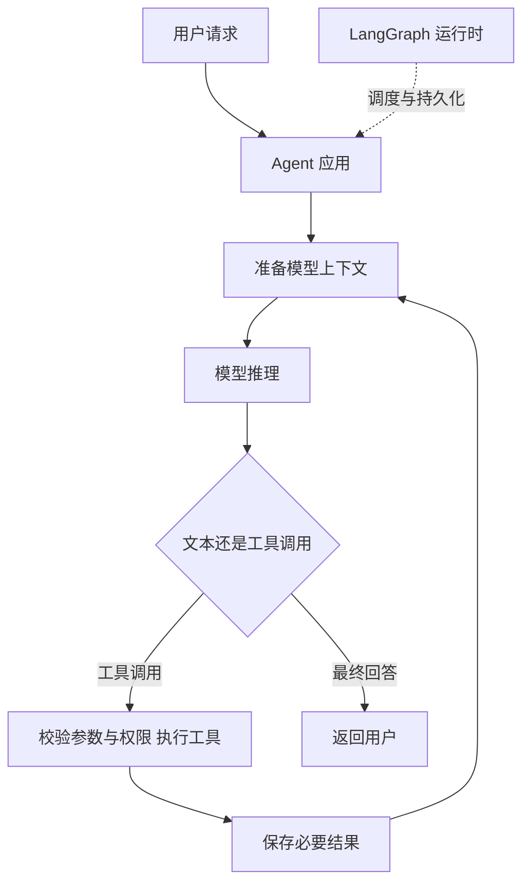
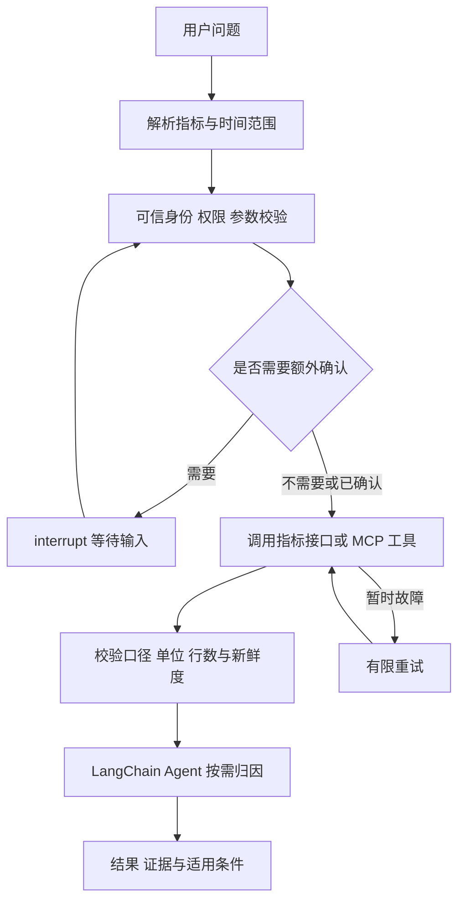

# LangChain 与 LangGraph 深度学习指南

LangChain 提供模型、工具与 Agent 循环的高层接口；LangGraph 提供状态化工作流与 Agent 的编排运行时。当前 LangChain 的 create_agent 基于 LangGraph，因此两者可以在同一个系统中使用。

本指南面向会写基础 Python、理解 API 调用、正在学习 Agent 的开发者。读完应能画出工具调用链路，分清模型上下文和应用状态，设计可恢复的取数流程，并按业务需求选择抽象层。这里的“深度学习”指系统学习框架，不涉及训练模型权重。

核验日期：2026-10-26；示例基线 LangChain 1.4.7、LangGraph 1.2.17，Python 3.12。框架事实来自 [官方来源记录](../docs/来源与版本核验.md)；方案推荐是工程分析，实验观察单独注明。

## 1 从一个业务问题开始

用户说：“查询 2026 年 9 月净收入，并说明下降原因。”系统至少需要处理三个问题：指标和时间是什么、当前用户能访问哪些数据、取得的数据如何解释。

普通程序可以调用确定的数据接口。Agent 则允许模型根据问题和中间结果选择工具。流程一旦加入重试、审批、并行查询和跨天恢复，仅有一个 while 循环就不容易管理了。

| 问题 | 优先使用的机制 | 责任边界 |
| --- | --- | --- |
| 不同模型如何统一调用 | LangChain 模型接口或供应商 SDK | 模型能力与参数仍有差异 |
| 如何让模型选择查询工具 | LangChain Agent 与工具接口 | 工具需自行校验权限与参数 |
| 如何强制查询前检查权限 | LangGraph 节点及可信业务代码 | 不能交给提示词保证 |
| 超时、审批和恢复如何组织 | LangGraph 状态、分支和检查点 | 存储、幂等及恢复策略需配置 |
| 净收入到底怎么算 | 指标服务或语义层 | 框架不会自动决定业务口径 |

## 2 先分清模型、Agent 与运行时

**模型**接收消息和工具定义，生成文本或结构化工具调用。**Agent 应用**准备上下文、执行工具、保存结果，并决定是否继续循环。**运行时**负责调度步骤、合并状态、写入检查点和处理恢复。



图中的模型通常是远程 API，也可以本地部署。普通自定义工具在 Agent 进程、MCP Server 或其他业务服务中执行；“模型外执行”不限定浏览器或服务端。连接方式取决于部署。

LangGraph 可以编排完全不调用模型的普通函数。一个节点也可以运行完整 LangChain Agent，因而“节点数”不等于“模型调用次数”。

## 3 两个框架的关系与包边界

官方将 LangChain 定位为 Agent 框架，将 LangGraph 定位为低层编排运行时。[S1][S2]

```text
业务应用
├── LangChain：模型接口、工具、Agent、中间件和生态集成
│   └── create_agent 使用 LangGraph 构建并编译 Agent 图
├── 直接使用 LangGraph：自定义业务状态和执行流程
│   └── 节点中可以使用 LangChain，也可以调用普通 Python/模型 SDK
└── 外部系统：模型 API、MCP Server、数据接口、检查点数据库
```

“LangGraph 可不使用 LangChain”表示无需采用 LangChain 高层 Agent 和集成方式；不表示安装包依赖中绝对没有 langchain-core。应区分产品抽象层与 Python 依赖树。

| 常见包或产品 | 用途 | 不应混淆的地方 |
| --- | --- | --- |
| langchain | 当前 Agent 高层接口 | 不是整个生态的全部实现 |
| langchain-core | 消息、模型、Runnable 等基础抽象 | 不是完整 Agent 产品 |
| 提供商/集成包 | 特定模型、向量库等集成 | 往往需要单独安装与配置 |
| langgraph | 图与函数式编排运行时 | 不是自动托管好的业务系统 |
| checkpointer 扩展包 | SQLite、Postgres 等持久化实现 | 内存 saver 与磁盘 saver 的耐久性不同 |
| LangSmith | 追踪、评估、调试与部署平台 | 与 MIT 开源框架的许可、定价分开 |
| Deep Agents | 同一生态的更高层 Agent harness | 本指南不对其做全面比较 |

不同语言版本、集成包和旧教程可能使用不同 API。本指南的版本与代码以 Python 锁定依赖为准，不直接套用于 JavaScript。

## 4 LangChain 的核心能力

### 4.1 模型、消息与工具

LangChain 提供统一的消息和模型调用方式，便于连接不同模型。统一接口降低适配工作，不保证供应商功能完全等价；尤其要检查工具调用、流式输出、结构化输出和多模态支持。

工具通常由名称、说明、参数 schema 和执行函数组成。模型依据前几项生成调用；执行函数本身及凭据通常不发送给模型。工具返回内容由应用组织为工具消息，再交给模型解释。

以 query_net_revenue(month) 为例，模型提供月份，应用从可信身份中确定租户，调用指标服务，返回整数分、币种、口径版本和数据时间。不要让模型传入的 tenant 自动成为授权依据。

### 4.2 create_agent 与模型工具循环

典型入口：

```python
# 接口形态示意：model、tools 由应用初始化；并非独立可运行脚本。
from langchain.agents import create_agent

agent = create_agent(
    model=model,
    tools=tools,
    system_prompt="根据明确的指标口径和查询结果回答。",
)
result = agent.invoke({"messages": [{"role": "user", "content": question}]})
```

框架处理模型调用、工具执行和消息流转。模型可能调用多个工具、重复查询或直接给出回答，因此业务中必须执行的检查不能仅依靠它主动调用。

循环还需要停止条件、调用预算、递归上限和错误处理。递归限制是执行保护，不是模型 token 预算，也不能保证满足用户任务。

### 4.3 中间件与上下文工程

中间件可以在模型调用或工具执行前后介入，调整提示词、工具集合、消息和错误处理。例如按当前步骤只暴露相关工具，避免将几百个工具定义每轮全部发送。[S3][S4]

| 内容 | 存放位置 | 是否自动进入模型上下文 |
| --- | --- | --- |
| 用户消息与历史工具消息 | Agent state 中的 messages | 取决于模型调用如何准备消息 |
| 工具名称、说明和参数 | 工具定义 | 绑定并暴露后进入模型输入 |
| 用户身份、数据库连接配置 | 运行时 context/应用配置 | 不应自动整份发送 |
| 长期偏好与知识 | Store 或业务存储 | 读取并选择后再注入 |
| 大批明细结果 | 数据库、对象存储、文件 | 优先保存引用，按需取摘要 |

**State 是应用状态，context window 是模型单轮输入；二者不是同一个东西。** 将内容存进 state 不代表必须把它全部发给模型，也不代表存储成本可以忽略。

### 4.4 结构化输出、RAG 与 MCP

结构化输出约束最终结果的字段与类型，便于下游使用，但“schema 合法”不等于事实正确。需要检验指标口径、数值、单位和引用。

RAG 可以是固定的“先检索再生成”，也可以让 Agent 动态决定检索什么。LangChain 生态提供加载、切分、Embedding、检索和向量存储集成；已有知识库也可以直接封装为工具，不必全部重建。[S5]

MCP 负责工具与资源连接协议，LangChain 将其适配为模型可使用的工具；MCP 不负责模型推理或整个业务流程。2026-10-26 官方文档中的 langchain.mcp.MCPAdapter 要求 langchain[mcp]>=1.4.0，且标为 beta。它与旧 langchain-mcp-adapters 教程需要区分；本文未安装 MCP extra 或实测 MCP 服务。[S6]

Skill 则通常是任务指南和资源包。可以由应用按需读取并注入提示，也可能使用额外技能中间件；不能因为采用 LangGraph 就假设 SKILL.md 会自动被发现和加载。

## 5 LangGraph 的核心机制

### 5.1 State、Node、Edge

Graph API 用状态定义步骤间共享的数据，用节点执行操作，用边决定下一步。编译图会做结构检查并配置运行时，不是把工作流训练成模型。[S7]

```python
# 最小图示意：完整审批与恢复示例见 scripts/langgraph_checkpoint_flow.py。
from typing import TypedDict
from langgraph.graph import StateGraph, START, END

class State(TypedDict):
    amount_cents: int
    net_cents: int

def compute(state: State):
    return {"net_cents": state["amount_cents"] - 3000}

builder = StateGraph(State)
builder.add_node("compute", compute)
builder.add_edge(START, "compute")
builder.add_edge("compute", END)
graph = builder.compile()
```

节点返回的是状态更新。TypedDict 主要提供类型描述，不等同于运行时全面校验；金额、日期和权限还需要业务验证。

### 5.2 Reducer 与并发合并

默认字段更新通常采用覆盖语义。若多个并行节点在同一执行步更新同一普通字段，不能假设“最后写入者获胜”，可能触发并发更新错误。列表、消息等需要设计 reducer。[S7]

例如 Annotated[list[str], operator.add] 可将分支列表合并。但返回空列表只是追加空内容，不会清空既有值；需要显式重置设计。add_messages 能根据消息 ID 合并或更新消息，也不应简单等同于列表拼接。

Reducer 还影响重试、重复结果与汇总顺序。业务结果尽量以稳定 ID 去重；并行分支的完成顺序不应成为财务计算或展示顺序的隐含依赖。

### 5.3 顺序、分支、循环与并行

| 模式 | 例子 | 关键设计 |
| --- | --- | --- |
| 顺序 | 解析 → 校验 → 查询 | 哪些步骤必须执行 |
| 条件分支 | 缺少时间范围就追问 | 路由依据与可解释错误 |
| 循环 | 失败后修正查询 | 次数上限与不可重试错误 |
| 并行 | 同时查收入和退款 | 独立性、限流和状态合并 |
| 汇合 | 两个查询都完成才计算净收入 | 使用明确的 join barrier |
| 子图 | 专门的异常归因 Agent | 输入输出契约与状态边界 |

图可以含环，因此不应一概称为 DAG。节点可以执行确定性规则，也可以让模型动态选择后续动作。[S8]

### 5.4 Checkpointer、thread_id 与 Store

Checkpointer 保存同一 thread 的执行检查点。复用 thread_id 才能继续对应的状态；换一个 ID 通常意味着新的会话/任务空间。生产端还应校验用户是否有权访问该 thread，ID 本身不是授权凭证。[S9]

Store 保存跨 thread 的应用数据，如用户偏好和长期事实。它不自动保证记忆真实、过期、可见范围或删除策略；这些都需应用定义。

| 存储方式 | 适合用途 | 局限 |
| --- | --- | --- |
| InMemorySaver | 单进程实验 | 进程退出后丢失 |
| SQLite saver | 本地持久化与学习 | 共享文件、并发和运维需评估 |
| Postgres 等后端 | 生产持久化候选 | 需配置数据库、隔离、保留与备份 |

Graph API 在执行步边界保存检查点，并有任务写入等恢复机制。检查点不保存任意 Python 函数栈，也不是外部系统的事务日志。不要把数据库连接对象、原始密钥和大量明细随意写入可持久化 state。

### 5.5 interrupt 与恢复语义

节点内 interrupt(payload) 暂停运行，把请求返回给外部调用方。后续通过相同 thread_id 和 Command(resume=...) 提供输入。同步 invoke 返回并不意味着进程仍阻塞在那里；应用负责接收输入并重新驱动执行。[S10]

恢复时包含 interrupt 的节点会从开头重新进入，之前的语句可能再执行。若把“发送通知”放在 interrupt 前，用户审批后可能又发一次。

实践上将写操作拆成独立步骤，使用业务幂等键并保存执行回执。即使节点结果被缓存，也不能据此保证外部服务 exactly-once：外部写成功而本地回执未落盘的窗口仍可能存在。

### 5.6 重试、超时、补偿

对暂时性网络错误可以有限重试；缺少权限、参数非法等错误应直接反馈或进入修正路径。配置最大尝试次数、异常类型和退避，避免每个错误都自动重试。[S11]

当前 LangGraph 1.2 文档提供节点超时与 error handler，但节点 timeout 仅适用于异步节点。超时取消也不代表远端 API 或数据库查询已撤销；需要底层取消协议或操作回执。

扣款等操作失败后可能要执行补偿步骤，但补偿也是应用编写的业务逻辑，不是图运行时自动回滚所有外部影响。

### 5.7 Functional API

如果已有代码使用 if、for 和函数调用，可以考虑 @entrypoint 与 @task 组织持久化流程。它与 Graph API 共享底层运行时，但状态和检查点组织方式不同。[S12]

Graph API 更适合显式展示状态流转、路由与汇合；Functional API 更贴近现有函数代码。采用后者也需要遵守恢复时任务顺序与确定性要求，不能理解为任意 Python 脚本都能无条件透明恢复。

## 6 能力与选型对比

| 维度 | LangChain | LangGraph |
| --- | --- | --- |
| 主要抽象 | 模型、工具、Agent、中间件 | 状态、节点、边与任务 |
| 常用入口 | create_agent | StateGraph 或 Functional API |
| 自主工具循环 | 开箱可配置 | 可自行组织或嵌入 LangChain Agent |
| 固定业务流程 | 可扩展，但不是主要表达方式 | 可以直接表达 |
| 状态和恢复 | 使用底层 LangGraph 能力 | 直接管理运行时与持久化 |
| 人工介入 | 可集成，不能说不支持 | 可明确放入业务步骤 |
| 多 Agent | 组合与调用模式 | 子图、路由、并行与汇总更显式 |
| RAG | 组件与集成较丰富 | 适合复杂检索和验证编排 |
| MCP/数据接口 | 通过工具接入 | 节点可调用接口或适配工具 |
| 初始成本 | 常规 Agent 通常更低 | 状态与流程设计更多 |
| 主要风险 | 自主循环偏离业务预期 | 并发、状态与恢复设计错误 |

选型不是比较谁的功能列表更长，而是判断哪些控制需要由程序明确负责。

| 场景 | 建议起点 | 需要补齐什么 |
| --- | --- | --- |
| 固定参数的一次数据查询 | 直接业务 API | 权限、口径与错误处理 |
| 单次摘要、分类或结构化抽取 | 模型 SDK 或 LangChain 模型组件 | 输出验证与评估 |
| 常规知识库问答 | LangChain 检索组件 | 引用、召回与权限过滤 |
| 少量工具的业务助手 | create_agent | 工具约束、上下文和预算 |
| 必须检查权限后才执行 | LangGraph + 业务代码 | 身份绑定与租户隔离 |
| 跨进程恢复、人工审批 | LangGraph 或具备相应配置的 Agent | 持久化与幂等 |
| 多角色并行分析 | LangGraph 编排，节点可使用 LangChain | 分工契约、合并与成本控制 |

框架核心仓库均为 MIT。LangSmith 的托管、追踪和评估是独立平台能力，是否使用它不应与能否本地运行开源框架混为一谈。[S13][S14]

## 7 设计一个可控的取数 Agent

### 7.1 先确定业务契约

以“2026 年 9 月净收入”为例，必须明确租户、币种、单位、支付日期还是退款日期、退款确认状态、数据截止时间和指标版本。教学样本使用人民币整数分，收入 30000、退款 3000、净收入 27000。

这些数值是虚构数据，不是任何真实平台表现。净收入下降原因还需要上期、渠道、订单或退款结构等数据；仅取得净收入不能证明因果解释。

### 7.2 推荐的分层



LangGraph 控制业务阶段，LangChain Agent 负责某个阶段内的动态探索。MCP 连接工具，Cube/MetricFlow 等语义层负责指标计算；Wren 可作为上下文及 SQL 工具链候选，Ossie 可承载语义资产交换。组合关系是架构建议，不能当作已经验证的原生兼容方案。

### 7.3 给模型足够信息，但不交出执行边界

模型可见：指标名称、参数、口径、汇总结果与来源。工具运行时可见：可信用户身份、权限范围和服务连接。持久化状态可保存：任务 ID、查询引用、指标版本、重试情况与结果摘要。

不要把模型自由生成的 SQL、tenant 参数或工具名当作授权结论。服务端必须校验调用，恢复执行时也要重新检查当前权限；审批通过不代表未来永久有权访问。

## 8 两个离线实验学到什么

### 8.1 LangChain：工具循环与身份注入

[langchain_tool_loop.py](../scripts/langchain_tool_loop.py) 使用脚本模型产生预定工具调用，运行真实 create_agent 与工具执行流程。它不使用真实 LLM，不能衡量自然语言理解或工具选择能力。

工具模型可见参数只有 month；ToolRuntime 中的身份不进入工具调用参数 schema。分别注入租户 A、B，预期净收入为 27000、25000 分；消息序列应包含 human → ai → tool → ai。

这验证了模型提议参数、应用执行函数、工具结果回传模型的结构，以及可信运行参数可以与模型生成参数分离。它没有实现登录、OAuth、真实数据库行权限或攻击防护。

### 8.2 LangGraph：恢复、分支、汇合与重试

[langgraph_checkpoint_flow.py](../scripts/langgraph_checkpoint_flow.py) 用独立子进程先保存审批暂停状态，再开启新子进程恢复，SQLite 是两个进程之间的状态载体。

同意路径中，收入与退款分支由图调度，汇合后得到 27000 分；收入节点人为首次抛出 TimeoutError，限定第二次成功。拒绝路径不执行收入或退款查询。独立分支更新不同字段，避免依赖共享列表的隐式合并。

两个进程都会进入审批函数，说明恢复会重新执行节点前部代码。此处只在进程内计数，不执行真实写操作。实验验证正常暂停后跨进程恢复，不覆盖断电、数据库损坏或写入成功但回执丢失。

安装与实测结果见 [实验说明与验收](../docs/实验说明与验收.md) 和 [验证记录](../intermediate/验证记录.json)。

## 9 性能、成本与评估

端到端耗时可以按关键路径分析：模型推理、工具网络与执行、检查点写入、排队重试和用户等待。并行步骤通常按最慢分支决定汇合等待，不能把所有分支耗时简单相加。

| 指标 | 测量目的 | 控制条件 |
| --- | --- | --- |
| 任务完成率与数值正确率 | 是否完成业务目标 | 同一问题集与业务真值 |
| 工具选择与参数正确率 | Agent 是否调用正确能力 | 同模型、工具说明与权限 |
| P50/P95 完整耗时 | 用户等待时间 | 同结果大小、缓存与并发 |
| 模型与工具调用次数 | 循环是否浪费 | 同停止条件与失败预算 |
| token 与实际费用 | 上下文和模型成本 | 固定模型版本与计费口径 |
| 恢复与幂等正确率 | 故障后是否重复写或漏执行 | 在关键边界注入故障 |
| 状态体积与持久化耗时 | 检查点是否成为瓶颈 | 同样的历史长度与存储 |

同一 Agent 因底层共享 LangGraph，不能仅根据框架名称推定快慢。显式流程可能减少无效模型循环，也可能增加验证步骤。离线脚本的运行速度不代表真实取数 Agent 延迟，本指南不提供倍率结论。

RAG 评估还应区分召回质量、答案引用与事实正确性；多 Agent 需要比较单 Agent 基线，角色更多不保证结果更好。

## 10 常见误区与故障定位

| 现象或说法 | 应如何理解或排查 |
| --- | --- |
| LangChain 无状态 | 当前 Agent 基于 LangGraph，可配置检查点 |
| LangGraph 必须调用大模型 | 节点可以是普通函数 |
| 保存 state 就保存了全部模型记忆 | 还需正确加载、筛选并构造模型输入 |
| 换 thread_id 后历史没了 | 检查是否意外创建新会话 |
| 内存 saver 重启后无法恢复 | 这是存储介质边界，改用持久化后端 |
| 审批前的日志/写入重复 | interrupt 恢复重进节点，需要拆分和幂等 |
| 并行更新报错 | 检查是否同时写同一字段及 reducer |
| 清空列表却仍保留旧数据 | 合并 reducer 不把空列表当作重置 |
| schema 正确但金额错误 | 输出结构不验证指标语义和数据真值 |
| MCP 接通就有完整 Agent | 协议连接不等于任务编排、权限或评估 |
| 旧教程导入路径失效 | 对照具体包版本与当前 API，避免混搭 |
| 超时就没有外部副作用 | 远端操作可能仍在执行，需回执与幂等 |

## 11 学习路线与自测

第一阶段理解模型、消息、工具与执行位置，运行 LangChain 实验，说明哪部分参数由模型生成、哪部分由应用注入。

第二阶段学习 StateGraph，运行恢复实验，画出节点、分支与汇合，解释为什么收入会尝试两次，而退款只执行一次。

第三阶段替换真实只读数据服务，固定查询契约；加入可信身份、预算、口径版本和大结果引用。先只做读取，再评估写操作。

第四阶段配置持久化与观测，构造超时、进程退出、重复提交、权限变化和模型错误参数，检验恢复与业务一致性。

第五阶段按需要使用子图、多 Agent 和动态规划。先与简单单 Agent、固定流程比较，证明增加复杂度确有收益。

| 自测题 | 参考答案要点 |
| --- | --- |
| 固定取数接口一定需要 Agent 吗 | 不需要；模型决策价值要大于额外开销 |
| 一个节点等于一次模型调用吗 | 不等于，可能零次或多次 |
| ToolRuntime 参数为什么不暴露给模型 | 由应用注入，属于执行上下文 |
| Graph state 是否全部进入模型输入 | 不必；需由节点或中间件选择 |
| 为什么检查点不能保证写操作只执行一次 | 外部事务与本地检查点不原子，且节点可能重跑 |
| 审批恢复为什么必须沿用 thread_id | 检查点按相应 thread 定位 |
| 什么时候选择 LangChain + LangGraph | 外部业务流程需受控，局部任务需要模型自主探索 |

## 12 来源索引与扩展阅读

文内 [S1]—[S14] 对应 [来源与版本核验](../docs/来源与版本核验.md) 中的条目。该记录包含官网链接、固定源码、许可与核验边界。

继续学习：[Agent 上下文建设](../../202610_agent上下文建设/README.md)、[AI-Ready 数据](../../202610_ai-ready数据建设/README.md)、[Agent 统一语义层](../../202610_agent统一语义层/README.md)。
