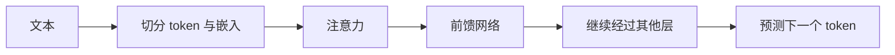
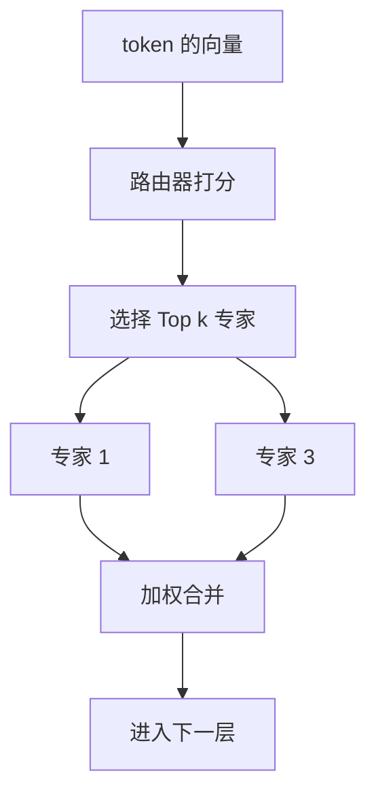

# MoE 与 Dense 模型小白学习指南

这份文档面向第一次接触大模型架构的读者。学完后，你应能解释 Dense 与 MoE 的计算路径，读懂“总参数”和“激活参数”，并知道比较模型时该看哪些指标。

Dense 的正确拼写是 Dense，中文叫稠密模型。MoE 是 Mixture of Experts，中文叫混合专家。本文讨论大语言模型中常见的稀疏 MoE，不把所有历史上的混合专家形式都归为同一种结构。资料核验日期：2026 年 10 月 13 日。

## 1 先建立一个直观印象

把模型的一层计算想成处理材料的工位。

Dense：每份材料进入同一个固定处理模块。MoE：调度员先看材料的特征，再把它送到少数几个处理模块，最后合并结果。

这里“材料”对应一个 token 在该层的向量，“调度员”对应路由器，“处理模块”对应专家网络。专家不是人，也不是独立聊天机器人；模型仍作为一个整体输出答案。

**核心区别：Dense 的计算模块固定参与；稀疏 MoE 根据输入选择部分专家参与。** 是否更聪明、更便宜或更快，需要结合具体训练与部署条件比较，不能只看名字。[稀疏 MoE 原始论文](https://arxiv.org/abs/1701.06538)

## 2 看懂模型前需要认识的六个词

| 术语 | 小白可以怎样理解 | 容易误会的地方 |
| --- | --- | --- |
| Token | 文本被切分后的处理单位 | 不一定对应一个字或一个单词 |
| 向量 | 一串数字，表示 token 当前的特征 | 不是固定的人类词典定义 |
| 参数 | 训练得到的数值，如矩阵中的权重 | 参数多不自动等于效果好 |
| 层 | 对向量做一次加工的网络模块 | 一个 token 通常要经过很多层 |
| 前向计算 | 用当前参数把输入算成输出 | 与训练时更新参数不同 |
| 激活参数量 | 一条计算路径涉及的参数规模 | 不是激活函数输出，也不是显存占用 |

读到 7B，B 表示 billion，即十亿；7B 是约 70 亿个参数。参数是储存的数，计算是使用这些数做运算，两者相关但并不相同。

“Dense 使用全部参数”是粗略说法。更准确地说，token 会经过各层相同的稠密模块；输入嵌入只查相关 token 的向量，一些参数共享，特殊结构也会影响统计，所以不要把所有权重都理解成每次执行完全相同数量的乘法。

## 3 Transformer 的大致骨架

许多大语言模型以 Transformer 为基础。一层里通常有注意力与前馈网络等模块。此处省略归一化、残差和具体位置编码，便于理解。

注意力（Attention）让当前位置结合上下文中其他位置的信息。前馈网络（FFN）对每个位置的向量做进一步变换。FFN 是 Feed-Forward Network 的缩写。



MoE 大语言模型常把部分或全部 FFN 换成专家层。其余模块仍可能共享；具体哪些层使用 MoE 要看模型配置。原始 MoE 思路也可用在其他模块，不必把它严格等同于 FFN。[Switch Transformers](https://arxiv.org/abs/2101.03961)

## 4 Dense 是怎样工作的

对某一层，输入向量为 x，稠密 FFN 把它变成新向量。简化表达可以写作：

```text
输出 = FFN(x)
```

同一层里，不同 token 使用同一个 FFN 的权重，但因为输入向量不同，输出也不同。“相同模块”不表示模型对所有文本做相同判断。

Dense 的优点是计算路径规则，较容易组织大矩阵运算。对入门学习而言，其结构与训练步骤通常更容易跟踪。代价是当你加宽这些模块时，参数储存和每个 token 的计算通常同时增加。

这不意味着 Dense 模型不能通过量化、并行、缓存和其他优化提速，也不意味着它必定比 MoE 弱。

## 5 MoE 是怎样工作的

一个典型稀疏专家层由多个专家 FFN 和路由器组成。路由器读取输入向量，对专家打分，选择少量专家；选中的专家处理输入，输出按权重合并。



Top-k 表示选择分数最高的 k 个专家。Top-1 选一个，Top-2 选两个。图中编号是示意，不代表固定选这些专家。

路由器通常是训练得到的模块，并不是人工写成“中文进专家 1，数学进专家 2”的分类规则。不同 token 在不同层可以选择不同专家，相同字面 token 也可能因上下文向量变化走不同路径。[稀疏门控论文](https://arxiv.org/abs/1701.06538)

### 一个不需要训练的手算例子

假设四个专家的路由分数为 [0.5, 0.1, 0.3, 0.1]，选择 Top-2，选中专家 1 和 3。若这套教学实现把选中分数重新归一化，则权重为：

```text
专家 1：0.5/(0.5+0.3)=0.625
专家 3：0.3/(0.5+0.3)=0.375
输出：0.625×专家1(x) + 0.375×专家3(x)
```

这是自构造例子，实际路由可能先对 logits 做 softmax，也可能采用不同加权规则。不能把这组公式当成所有 MoE 的统一实现。

路由权重表达如何组合计算，不等于模型答案正确的概率，也不是此前 Jev 文档里的业务 confidence。

## 6 总参数和激活参数为什么不同

以下是自构造的简化模型，不对应实际产品。设共享参数为 S，每个专家参数为 E，专家数为 N，每次选择 k 个。忽略较小的路由器参数和其他统计差异：

```text
总参数 ≈ S + N×E
每 token 激活参数 ≈ S + k×E
```

设 S=2B、E=1B、N=8、k=2，则总参数约 10B，激活参数约 4B。该 token 计算两个专家，但整套模型包含八个专家的权重。

一个批次中不同 token 选择不同专家，因此整个批次可能使用所有专家。“每 token 只激活一部分”不意味着其余专家永远闲置或可以直接删除。

实际参数统计还受共享专家、不同专家尺寸、混合 Dense 层等影响。不能机械地用“总参数乘 k/N”求出激活参数，因为共享部分不能被同样折减。

### 实际模型名称的例子

Mixtral 8x7B 是帮助理解命名的历史案例。其论文描述每个专家层有八个 FFN 专家，每个 token 选择两个；总参数约 47B，每 token 使用约 13B。8×7B 不能简单解释为八个独立的完整 7B 模型，注意力等参数是共享的。这些数字只对应该论文架构，不是现代 MoE 的通用比例。[Mixtral 论文](https://arxiv.org/abs/2401.04088)

## 7 为什么省计算却不一定省显存

把权重想成书架里的书，计算想成阅读与加工。一次只读其中两本，并不意味着整个书架只需要放两本。

常驻 GPU 的部署通常要储存完整模型权重，可分散在多张卡上。也可以把部分权重卸载到 CPU 等存储中，但搬运时间可能降低速度。不是所有专家必须装进同一张显卡。

教学估算：10B 参数，每参数使用 2 字节，单纯权重约需 20GB，约合 18.6GiB。若只用 4B 激活参数，并不能据此把完整权重需求写成 8GB。

这还没计入运行临时张量、KV cache、量化辅助信息和框架开销。KV cache 是生成时保留的注意力键值信息，会随上下文、并发和模型结构增加；训练还需要梯度与优化器状态。

量化减少单个权重的储存位数，MoE 减少部分计算模块的参与范围，两者可以结合，但不是同一技术。

## 8 快慢要看比较条件

“MoE 更快”必须说明与谁比较。

| 比较条件 | 可以讨论什么 | 不能直接推出什么 |
| --- | --- | --- |
| 相同总参数 | MoE 通常少算部分专家 | 整体延迟必定更低 |
| 相近激活参数 | 每 token 权重计算规模接近 | 模型能力与运行成本相等 |
| 相同质量目标 | 比较达到目标所需资源 | 只看参数名就知道优劣 |
| 相同显存预算 | 比较可装下哪些模型 | 更大 MoE 一定能装下 |

MoE 还要做路由、token 分发和结果收集。专家分布在不同设备时，会增加通信；每个专家收到的 token 太少时，也可能难以充分利用 GPU。

首 token 延迟、连续生成速度和高并发吞吐是不同指标。输入处理阶段与逐 token 生成阶段的瓶颈也可能不同，应在相同硬件、量化方式、输入长度和并发下测量。

**少 FLOPs 不自动等于少等待。** FLOPs 是浮点运算数量；等待还受内存读取、设备通信和调度影响。

## 9 训练 MoE 多了哪些难题

### 有的专家太忙 有的专家没机会学习

路由若长期偏向少数专家，这些专家拿到更多 token、学习更快，而其他专家得到的训练信号很少。系统需要负载均衡手段；均衡和任务效果之间也可能存在取舍。

### 热门专家出现拥堵

一些实现为每个专家设置 token 容量。超过容量的输入如何处理取决于实现，可能重路由、跳过专家分支或采用不丢 token 的计算方式，不应说所有 MoE 都丢 token。

### 计算与通信要配合

被选中的专家对当前 token 提供训练信号；其他专家可从同批次的其他 token 学习。路由器和共享模块也需要训练。不要据此理解为“一次训练只更新两个专家，其他专家永远不变”。

Switch Transformers 展示了 Top-1 路由和辅助均衡等设计，说明选择多少专家、如何稳定训练属于架构选择，而不是 MoE 固定必须 Top-2。[Switch Transformers](https://arxiv.org/abs/2101.03961)

## 10 一张完整对照表

| 维度 | Dense | 稀疏 MoE |
| --- | --- | --- |
| 主要路径 | 相同的稠密模块 | 共享模块加选中的专家 |
| 路由器 | 通常没有专家路由器 | 通常有学习得到的专家路由 |
| 参数规模 | 总量与参与计算量较接近 | 总量可远大于每 token 参与量 |
| 扩大模型 | 往往同时增加计算与储存 | 可增专家容量而少增每 token 计算 |
| 权重存储 | 需要容纳本身的权重 | 仍需存储完整专家权重 |
| 部署难度 | 通常更容易理解和部署 | 额外关注专家调度与通信 |
| 训练难点 | 仍有普通优化与规模问题 | 增加路由稳定性和负载均衡 |
| 输出形式 | 可输出文本或结构化结果 | 同样可以，取决于任务与训练 |
| 能力高低 | 依赖数据、训练和架构 | 也依赖这些条件，不能自动胜出 |

这张表描述常见结构，不是所有模型的性能排名。MoE 和 Dense 是架构组织方式，聊天、推理、代码是能力或使用目标，两者不要混为同一种分类。

## 11 小白最容易踩的六个误区

1. **把专家当成有固定职业的人。** 专家可能形成某种分工，但不保证可命名为数学、英语或代码。
2. **把 MoE 当成几个聊天机器人投票。** 常见做法是在内部层选择专家，不是分别生成多份完整回答。
3. **用总参数比较速度。** MoE 需要同时看激活参数、共享结构和实测。
4. **用激活参数估算全部显存。** 权重存储与一次计算参与范围不同。
5. **把路由分数当作正确率。** 路由分数决定路径，答案可靠性需独立评估。
6. **认为 Dense 过时、MoE 全面替代。** 合适选择取决于任务、硬件和系统复杂度。

## 12 怎样开始学习和实践

第一步：能用自己的话解释 token、参数、Attention 与 FFN，不需要先掌握大规模训练。

第二步：画 Dense 与 Top-2 MoE 的一层流程，标记共享模块与专家模块。

第三步：手算第 5 节权重合并，以及第 6 节总参数、激活参数和权重内存。这里不需要下载模型。

第四步：读一个模型配置，找专家数、每 token 专家数、层数、隐藏宽度与量化方式。不同框架字段命名可能不同，应依据模型说明，不能猜字段。

第五步：具备硬件时再做小型推理对比，记录模型版本、框架版本、设备、精度、上下文、生成长度和并发。比较首 token 延迟、后续 token 速度、峰值内存和真实任务质量。

本次文档没有下载权重或运行真实模型；以下选择建议是工程判断：第一次动手通常从适合自己设备的小型 Dense 模型开始，更容易看懂链路；学习 MoE 时先理解路由与参数统计，再逐步考虑部署。

## 13 自测题与参考答案

**问题 1：一个 MoE 有八个专家，每个 token 用两个，可以说它只需要四分之一显存吗？**

不能。共享部分和完整专家权重仍需储存，运行还有缓存和其他开销。

**问题 2：两个模型激活参数一样，速度与能力就一样吗？**

不能。运算结构、通信、硬件、数据和训练过程可能不同。

**问题 3：一个 token 在所有 MoE 层都必须使用同两个专家吗？**

不是。每层可有自己的路由器与专家，选择依赖当前层向量。

**问题 4：四个专家的选中权重是 0.6 和 0.4，代表回答有 60% 和 40% 的正确率吗？**

不是。它们是专家输出的组合系数。

**问题 5：S=1B，N=6，E=2B，k=2，简化总参数与激活参数是多少？**

总参数约 13B，激活参数约 5B。忽略路由器等统计差异。

**问题 6：为什么 Top-1 也算混合专家？**

模型拥有多个可选专家，对不同输入选择不同专家；不要求每次至少计算两个。

完成标准：无需公式也能讲清“储存很多专家，每个 token 只选择少数专家”，并能指出这种选择带来的调度与通信成本。

## 14 阅读路线

先读[总览教程](https://huggingface.co/blog/moe)建立名词框架，再按兴趣阅读原始研究：

- [Shazeer 等 2017 年稀疏门控论文](https://arxiv.org/abs/1701.06538)：条件计算与专家路由。
- [Switch Transformers](https://arxiv.org/abs/2101.03961)：单专家选择、训练稳定性与系统设计。
- [Mixtral of Experts](https://arxiv.org/abs/2401.04088)：具体 Top-2 MoE 架构与参数规模。

历史论文有助于理解设计，不代表所有当前模型使用同一种路由或实现。读论文时优先找架构图、路由方式、总参数与激活参数定义，再看实验对照条件。
