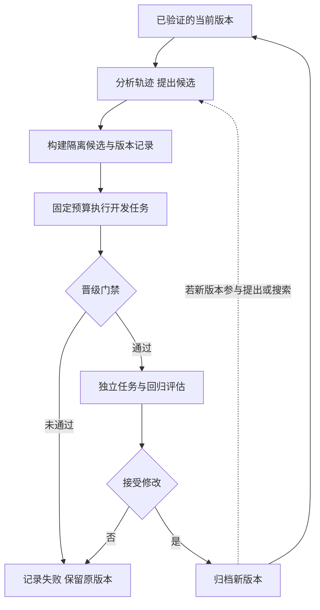

# RSI 递归自我改进深度调研报告

RSI（Recursive Self-Improvement）讨论 AI 系统能否改进自身，并让改进后的系统参与后续改进。当前可核实的证据覆盖 Agent 代码、提示、记忆、搜索策略与模型适应等不同层次；它们不能直接合并为“AI 已经能无限递归变强”。

本报告面向理解模型、工具与 Agent 基础的学习者。目标是看懂递归发生在哪里、反馈如何产生、论文结果证明到哪一步，以及哪些方法适合进入现有学习和取数项目。核验日期为 2026-10-26；采用原始论文、会议页面、作者仓库和官方博客。作者实验、本地演示与工程判断分别标注。

## 1 最重要的结论

第一，单次回答变好、经验被保存、Agent 代码被优化、模型权重被训练，是不同机制。只有说明修改对象、后续继承方式和评估条件，讨论“自我改进”才有实际含义。

第二，DGM、SICA、STOP 等说明冻结模型外围的程序可以自动演化；SEAL 说明模型可以学习生成有助于自身参数适应的数据和指令。它们各自证明局部闭环，不自动证明一般智能、自主权限或改进速度持续加速。

第三，2026 年研究开始更认真地测量泛化、固定预算和改进器效率。AIDE² 的论文报告多次有效改写，但其 ignition test 没有确证改进后的 Agent 更善于驱动下一轮自我改进。RRSI 显示过拟合控制很重要；PAST-Bench 和 AI4AI-Bench 分别审查经验迁移和训练算法研究能力。

第四，对业务 Agent，优先可控地改进提示、工具契约、检索和 Skill，并保持独立评估。开放式自改代码与模型训练适合作为后续研究，不宜一开始就让系统修改生产权限、指标真值或发布门禁。

## 2 什么才是递归自我改进

### 2.1 四个容易混淆的说法

| 说法 | 实际变化 | 是否足以证明强 RSI |
| --- | --- | --- |
| 自我修正 | 同一道题的答案、代码补丁或推理轨迹 | 不足；可能只是额外推理计算 |
| 自我演化 | 提示、工具、记忆或工作流在任务间保留 | 不足；需证明有效迁移 |
| 系统级递归改进 | 改进后的 Agent 继续参与自身或后代的改写 | 有相应局部证据，但不等于无限持续 |
| 改进能力递归增强 | 同预算下，更擅长产生下一代有效改进 | 需要独立元层实验，不能从任务分数上升推导 |

文献对 RSI 的口径并不统一。STOP 明确说明底层 LM 未变，因此不称完整 RSI；部分后续工作将 harness 自修改称为系统级 RSI。阅读时保留作者口径，并用具体机制解释，而非争论一个词是否“真正”。

这里的强 RSI 指更广泛、可持续甚至加速的递归改进主张，不是某个被一致接受的标准等级。下面的分类是本报告的工作性分类。

### 2.2 用“修改对象 × 闭环程度”阅读论文

修改对象可以是答案、上下文、长期记忆、Skill、工具实现、Agent 控制流、模型权重、训练算法，甚至评价过程。闭环程度则要看谁提出修改、谁执行、谁评价、谁决定采用，以及下一轮使用哪个版本。

例如，人类运行固定优化器寻找更好的提示，是自动优化；如果新提示帮助下一轮提出更好的提示，才需要进一步检验改进器的反馈效应。把 Agent 接到自己的仓库，只提供了访问条件，并未证明有效 RSI。

## 3 从初学者直觉到形式化理解

### 3.1 一个小例子

某取数 Agent 经常把“待确认退款”也从净收入扣除。一次自我修正只是在当前回答里改对金额。经验型改进把错误模式写入可检索记忆。系统改进修改工具校验或查询规划，使之后任务统一遵循口径。

要支持递归主张，还要问：更新后的系统能否更有效地识别下一类错误、提出改动并验证？还是一直由同一个未变化的外部优化器负责修理？

### 3.2 系统与候选选择

记 Agent 为 A_t=(θ_t,h_t,m_t)，分别表示模型参数、harness 和持久经验。t 是改进轮次；θ 可以完全冻结。提出器 G 在预算 B 内，根据可用轨迹 L_t 生成候选集合：

```text
C_t = G(A_t, L_t, D_dev; B)
A_(t+1) = Select({A_t} ∪ C_t, E_gate)
```

D_dev 是可用于调试的任务，E_gate 是晋级评估程序。Select 可以保留原版本，因此“拒绝修改”是合法结果，不应强迫每轮都发布一个新版本。

这个公式仅描述候选搜索；如果 G 一直固定，也不能仅凭轮次循环称其改进能力在递归增强。若候选影响下一轮的提出器或搜索策略，需要另外测量这条路径。

### 3.3 改进器效率的比较

定义 M(A;B,D) 为优化器 A 在预算 B、任务分布 D 上找到的最佳经验证效用的期望。它关注“发现改进的能力”，与 Agent 直接解题的分数不同。

如果声称 A_(t+1) 比 A_t 更善于改进，需要比较 M(A_(t+1);B,D) 与 M(A_t;B,D)，固定起点、任务和评价器，运行多个随机种子。这个量不是无限加速定理，也不能用一次最好的运行估计。

教学例子：旧改进器与新改进器分别有相同 10 次候选预算，新者在未参与选择的任务中产生更多通过审计的候选，才是元层效率证据。若新者多花十倍 token，分数更高不能直接归为改进器更高效。

## 4 通用闭环：生成、执行、评价、选择与继承



独立评价最好在候选无法修改的环境执行，并保存提交、输入、实际运行与产物。否则分数可能来自修改测试、读答案、降低完成标准或伪造日志，而非能力增长。

归档也不等于一直选最新版本。DGM 的重要思想是保留分支：当前分数不最高的 Agent 也可能产生有价值后代，避免被单一路径锁死。

## 5 代表性路线：从反馈到 Agent 自修改

### 5.1 Self-Refine 与 Reflexion：理解“自改”的入门基线

[Self-Refine](https://arxiv.org/abs/2303.17651v2) 用同一 LLM 生成、反馈和修订答案，主要改变测试时输出，不更新权重。[Reflexion](https://arxiv.org/abs/2303.11366v4) 将任务反馈转成文字反思，并保留在 episodic memory 中影响后续尝试。

这两者适合学习反馈闭环，但前者不是持续改进器，后者的记忆也不保证跨分布有效。自评可能强化原有错误；要与同 token 预算的重采样、外部验证和直接生成基线比较。

### 5.2 STOP：让代码优化器优化自己

[STOP](https://arxiv.org/abs/2310.02304v3) 从调用 LM、多次生成并按 utility 选择的 seed improver 开始，再把该 improver 自己作为待优化程序。更新后的程序可以改变搜索策略，形成“改进代码的代码被改进”的闭环。

优点是递归对象明确，容易理解元优化；局限是任务范围有限，LM 冻结，utility 与运行环境由实验设定。论文发表于 COLM 2024，不能把 2023 年预印本日期当成会议年份。这里没有运行其生成代码或沙箱实验。

### 5.3 Gödel Agent：运行时逻辑自修改

[Gödel Agent](https://aclanthology.org/2025.acl-long.1354/) 在 ACL 2025 论文中探索读取和修改自身运行时逻辑，包括 monkey patching。它与理论 Gödel Machine 的形式化证明路线不同；名称不能视为每次修改都有数学正确性保证。

它有助于理解“更新策略也可以被修改”，但运行时自改比修改离线配置更难定位、审计和复现。本报告仅用它作为机制对照，不以其结果代表编码 Agent 的统一成绩。

### 5.4 SICA：当前最优 Agent 成为下一轮改进者

[SICA](https://arxiv.org/abs/2504.15228v2) 保存 Agent 版本与分数，选择效用较好的版本分析历史、修改自身代码，再评价和归档。与固定 meta-agent 搜索不同，提出改动的 Agent 可以随版本更新。

效用同时考虑任务分数、美元成本和运行时间，因此最高解题分数不一定是最高效用版本。论文在固定随机 SWE-bench Verified 50 题子集报告约 17%→53%，15 轮 API 成本约 7000 美元。这是特定模型、任务与预算的作者实验，不是今天部署成本或全榜成绩。

适合研究工具、上下文和编码流程如何共同优化。原始样本小、预算和超时设定强，迁移到新题、新模型后必须重新验证。

### 5.5 DGM：自修改加开放式归档搜索

[DGM](https://arxiv.org/abs/2505.22954v3) 将 Agent 的 Python 仓库作为可修改对象，用冻结模型提出变化，通过编码评估筛选，同时保留多样化版本归档。可以从历史 Agent 分支，而不是仅从当前最新 Agent 继续。

论文报告 80 轮下 SWE-bench 指标 20.0%→50.0%；采用 SWE-bench Verified 的分阶段子集评价，强候选扩展到 200 题，不能写成在完整 500 题上统一获得该值。Polyglot 的演化子集为 50 题；完整 Polyglot 的额外评估为 14.2%→30.7%。

这证明实验边界内的系统改进与若干迁移，不证明底层模型参数更新或无限收益。DGM 的代码、论文版本和 2025 博客是不同产物；本报告以 2026 年 v3 技术内容为主，正文注明会议版本为 ICLR 2026。

## 6 权重适应与算法发现：相邻但不同的路线

### 6.1 SEAL：学习生成对自身适应有帮助的 self-edit

[SEAL](https://arxiv.org/abs/2506.10943v2) 让模型生成训练数据和更新指令，执行 SFT/梯度更新，再以适应后任务表现训练 self-edit 生成策略。外层学习如何适应，内层真的改变模型参数，因此不同于只保存文字反思。

知识实验使用 Qwen2.5-7B，在单 passage、无原文上下文的 SQuAD 问答设定中，作者报告 passage-only 为 33.5%，SEAL 为 47.0%；冻结 base 为 32.7%，不要将 33.5% 误写为冻结基线。ARC 实验是经筛选的小任务集，不是完整 ARC-AGI 领先结果。

它适合学习双层优化与参数适应，需训练资源、数据与遗忘评估；持续更新权重仍不等于持续改进“改进算法本身”。NeurIPS 2025 页面与 arXiv 作者列表存在差异，引用分别保留，不混拼作者。

### 6.2 AlphaEvolve：可执行评价驱动的程序演化

[AlphaEvolve](https://arxiv.org/abs/2506.13131v1) 使用 LLM 提议程序，通过评价器和演化搜索改进算法与计算系统。部分成果作用于模型训练栈，因此与 AI 改进 AI 有关联。

若变化只是目标算法，而提出器和搜索系统未被改进，就不能据此认定完整系统完成递归升级。适合目标可计算、正确性与性能可测试的算法优化。官方 alphaevolve_results 仓库主要提供结果和验证内容，不等于完整 AlphaEvolve 服务源码；云服务可用与否也不决定它是否开源。

## 7 2026 年前沿：改进器、泛化与独立评估

### 7.1 AIDE²：研发效率提高，但 ignition 尚未确证

[AIDE² v1](https://arxiv.org/abs/2609.26457v1) 采用外层 Agent 修改内层研究 Agent 的代码，内层在固定预算下解决 AI R&D 任务，再由私有评估评分。主运行中外层与内层使用不同固定模型，外层并不是每一轮自动被新内层版本替换。

作者报告 8 天、初始版本加 99 次候选改写，共出现 7 次接受的改进，并考察四个未参与选择的基准。结果表明受限设置中的研究效率改进能够迁移，不应将 99 个提案写为 99 次成功改进。

最关键的是 §3.6 ignition test：将 AIDE47 与人类工程 Agent 分别用于外层，各 3 个种子、50 步，均从同一内层版本出发。作者明确认为结果不确定，不能确证 AIDE47 是更高效的自我改进器。因此“任务优化更强”与“更善于继续改进自己”仍有证据差距。

论文还记载对某评价脚本故障的修补。这提示评价基础设施自身也可能影响结果；发现合理修复后应版本化、重新跑基线并独立审核，而不是一概把评价程序改动都算能力增长。

### 7.2 RRSI：让 harness 演化少记题、多学机制

[RRSI v3](https://arxiv.org/abs/2609.24972v3) 研究反复围绕有限任务演化导致的过拟合。提出端限制候选捆绑的改动规模，并利用历史鼓励不同轨迹；选择端通过 critic 和 pruner 排查任务特化、过高成本和无用改动。

它表明高演化集分数可能伴随差泛化。论文的“最高提升”来自具体表格与任务，并非各基准平均或通用增长率。本报告不将摘要中的最大值拼成单一综合分数；重点学习限制搜索自由度、清理冗余与独立泛化评估的设计。

### 7.3 PAST-Bench：保存经验是否真的改善后续行为

[PAST-Bench](https://arxiv.org/abs/2608.04003v1) 以跨 fresh-session 的有序任务序列比较保留经验与不保留经验，覆盖 26 个场景、204 个 episodes，区分记忆、流程复用、信息收集和更新。

它不仅看最后分数，还看是否按预期写入、检索和更新经验。适合评估业务记忆与 Skill 演化，不能当作训练算法或强递归加速已实现的证明。

### 7.4 AI4AI-Bench：研究算法，而非仅调运行配置

[AI4AI-Bench](https://arxiv.org/abs/2608.20318v1) 提供 10 个训练算法家族的冻结研究仓库。设定每任务探索 4 小时、1 张 B300，提交代码再从头重跑最多 12 小时，并由独立评价器评分。

其归一化标度中 0.1 是原仓库算法，1 是定义的任务最优，不能把 0.250 写为 25% 正确率。作者报告 29 种配置、6 个系统的整体均值 0.166、最佳系统 0.250，并发现很多提交没有真正改变学习机制。

这有助于判断算法研究能力，却不是“基准本身递归产出了更强 AI”的实验。标度和算力预算与其他论文不同，不与 SWE-bench 成功率横排比较。

## 8 横向对比与适配场景

| 路线 | 持久改变什么 | 权重更新 | 评价信号 | 适合学习/应用 | 关键局限 |
| --- | --- | --- | --- | --- | --- |
| Self-Refine | 当前答案 | 否 | 自评与任务评价 | 草稿修订基线 | 不证明跨任务累积 |
| Reflexion | 文字经验 | 否 | 环境/语言反馈 | 失败经验复用 | 错误记忆与迁移 |
| STOP | 代码改进器 | 否 | utility | 元优化入门 | 窄任务、冻结 LM |
| Gödel Agent | 运行时逻辑 | 否，论文主路线 | 多任务反馈 | 自引用机制研究 | 动态修改难审计 |
| SICA | Agent 代码和工具 | 否 | 分数、费用、时间 | 编码 harness 优化 | 小子集与较高评估成本 |
| DGM | Agent 归档及后代代码 | 否 | 编码任务 | 开放式搜索与分支 | 预算、评价噪声与过拟合 |
| SEAL | 数据/更新指令及适应后权重 | 是 | 适应后表现 | 知识注入与少样本适应 | GPU、遗忘与数据边界 |
| AlphaEvolve | 目标算法程序 | 视目标而定 | 可执行评价 | 内核、算法与系统优化 | 目标改进不等于改进器升级 |
| AIDE² | 内层研究 Agent 代码 | 主循环模型冻结 | 固定预算私有评估 | AI R&D 效率研究 | ignition 证据仍不确定 |
| RRSI | harness，附搜索约束 | 否 | 演化集与未见任务 | 泛化导向的演化 | 非无限递归证明 |

PAST-Bench 与 AI4AI-Bench 是评测框架，分别用于经验路径归因和训练算法设计，不与上述生成/优化方法作为同类产品评分。

## 9 如何判断结果是否可信

### 9.1 将三种改进分开检验

| 声称 | 最低需要的实验 |
| --- | --- |
| 当前任务做得更好 | 同预算、同模型版本、相同输入与评价 |
| 后续任务持续更好 | 冻结评估、独立任务、无经验/无演化对照 |
| 改进能力本身更强 | 改进器替换实验，固定初始目标、预算与多个种子 |

再比较固定优化器、只加记忆、单路径搜索、多样归档、随机搜索和人工改动。增加模型调用次数、换更强底座或扩大训练数据都要单独计账。

### 9.2 隐藏集不天然免于过拟合

开发集用于提出与调试，晋级集用于候选选择，最终审计集用于锁定版本后的外部验证。如果不断查看晋级结果并据此修改搜索，它已经成为元层开发数据。只隐藏测试代码而持续暴露总分，也可能产生适应性过拟合。

最终评估应保留新任务、新时间段或新领域，并记录候选数量、所有失败运行及选择策略。选出最好的一个随机种子不能代表稳定可复制收益。

### 9.3 工具正确不等于业务正确

修改后的 Agent 可能让 SQL 更快、格式更整齐，却用了错误币种、时间轴或退款状态。取数任务应有黄金数据、权限边界、单位、口径版本和数据时间，不只判断工具是否返回 200。

## 10 在现有 Agent 学习项目中怎样落地

### 10.1 从低成本、可审计的改进对象开始

先收集失败轨迹并标注原因，优化提示与 Tool 描述，再整理可检索经验与 Skill，之后尝试工作流和工具实现。权重适应与开放式自改代码需要更多验证资源，不应仅为追逐 RSI 名称引入。

| 现有组件 | 可以优化什么 | 应保持外部控制什么 |
| --- | --- | --- |
| Skill | 触发描述、步骤、例子、引用 | 发布版本、冲突处理与权限 |
| Tool/Function Calling | 参数说明、错误解释、调用规划 | 业务实现契约、身份与授权 |
| MCP | 目录组织、按需发现与结果摘要 | 服务权限与协议兼容 |
| LangChain | 模型调用上下文与中间件 | 固定模型基线和调用预算 |
| LangGraph | 路由、重试、上下文与状态策略 | 审批、持久化与发布门禁 |
| 语义层 | 业务解释和查询组合 | 指标真值、租户边界和源事实 |

上述只是设计映射，不说明接入这些组件就自动具备 RSI。学习与优化任务放在隔离研究副本，发布仍经独立验证。

### 10.2 一个小型研究计划

阶段一，构造固定业务任务与基线：正确取数、单位转换、查询拒绝、退款状态、空结果与大结果摘要。将开发、晋级和最终审计任务分开。

阶段二，限制修改对象为提示或 Skill 文本，固定模型、数据和工具，只允许有限候选。保存 diff、来源轨迹、成本、评分与失败原因。

阶段三，用无演化、随机改动、固定提出器、更新提出器做对照。检验已接受改动在新任务上是否仍有效；若只能记住开发题，停止扩大权限。

阶段四，条件允许才进行元层替换实验：让改进前后系统在相同起点上提出新候选，比较固定预算内有效改进的产出，而非仅比较原题分数。

## 11 离线教学实验：为什么必须有晋级和审计

[evaluation_gate_demo.py](../scripts/evaluation_gate_demo.py) 使用手工候选和虚构人民币分数据，没有模型、GPU、自改代码或真实外部调用。开发集 2 题、晋级集 2 题、审计集 4 题，只用于演示逻辑。

开发集的退款全部已确认，所以“背答案”“扣除所有退款”“只扣已确认退款”都可能答对。晋级集加入 pending 状态后，前两者失败；独立审计再检查零金额、超额退款和混合状态。

实际运行结果：开发选择的记忆型候选开发分 1.0、晋级分 0.0；规则型候选通过晋级，审计为 1.0；gross-only 基线审计为 0.25。该反例说明只看开发分可能选错，不是任何真实 Agent 的准确率结论。

脚本用标记拒绝“修改评价器”的候选，模拟受保护产物约束；没有执行评价器篡改。所有夹具在同一个源码文件中，不具备安全隐藏能力；小样本也没有统计保证。[实测记录](../intermediate/验证记录.json)

## 12 学习路线与自测

先理解 Self-Refine/Reflexion 的反馈、记忆与额外推理开销；再读 STOP 的元优化、SICA 的效用选择与 DGM 的归档；之后对比 SEAL 的内外层训练，最后阅读 AIDE² 的 ignition test、RRSI 的泛化和两类 2026 基准。

| 自测问题 | 答案要点 |
| --- | --- |
| 一道题反思三次是否证明 RSI | 不足，先判断跨任务继承和改进器是否改变 |
| 模型权重没变，系统能否改进 | 可以改工具、记忆、控制流；应注明系统级口径 |
| 底层权重改变是否就是强 RSI | 不是，训练本身不保证改进过程持续增强 |
| SWE-bench 53% 能否说胜过另一论文 50% | 不能，样本、模型、预算与评分设置不同 |
| AIDE² 7 次接受修改能否证明 ignition | 不能，独立 ignition 实验仍不确定 |
| 隐藏晋级集反复使用后仍是最终测试吗 | 不是，选择反馈会进入元层开发 |
| 代码开源是否代表可低成本复现 | 不代表，模型 API、算力、数据和预算另算 |

## 13 尚未解决的问题与研究判断

长期持续收益、跨模型和跨领域稳定迁移、独立评价器的可靠性、成本回收与改进器真正增强，仍需要更多可复现实验。不能从几十轮内上升的分数外推到无限递归或智能爆炸。

本报告的工程判断是：近期可操作的价值主要在“固定底座、可验证反馈、受限修改”的系统优化；更强 RSI 应以独立元层证据判断，而不是以自改权限、宣传标题或循环次数判断。

详细实验位置、仓库许可与论文状态见 [论文笔记](../docs/论文阅读笔记.md) 和 [来源核验](../docs/来源与版本核验.md)。
