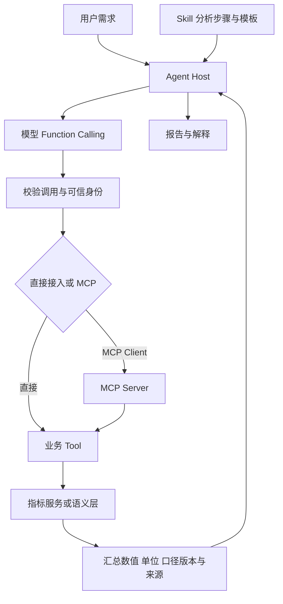

# Tool、Function Calling、MCP 与 Skill 原理与选型

Tool 是可执行能力，Function Calling 是模型生成工具调用请求的交互机制，MCP 是应用与工具/数据服务之间的连接协议，Skill 是任务知识、流程和资源的封装。它们承担不同职责，通常应分层组合。

本指南面向已理解基础 API、正在构建 Agent 的学习者，解释四者各是什么、如何进入模型上下文、在哪里执行，以及如何围绕取数任务选型。核验日期为 2026-10-26；MCP 技术条目以 2026-07-28 版本为主要依据，Skill 指 Agent Skills 开放格式。来源与适用条件见 [核验记录](../docs/来源与版本核验.md)。

## 1 四个概念先放在正确的位置

| 对象 | 层次 | 回答的问题 | 示例 |
| --- | --- | --- | --- |
| Tool | 能力接口 | 有什么操作可以执行 | query_metric、搜索、生成文件 |
| Function Calling | 模型交互 | 模型如何表达要调用什么及参数 | 输出工具名、调用 ID 和参数 |
| MCP | 系统连接 | 应用如何发现和调用服务能力 | 工具目录、工具调用、资源读取 |
| Skill | 任务方法 | 何时、按什么方法完成一类任务 | 净收入分析指南、模板、脚本 |

可以将同一个取数函数注册为 LangChain Tool，也可以通过 MCP Server 暴露。模型可能通过 Function Calling 请求调用它，Skill 则提供分析步骤与口径解释。因此“使用 Tool 还是 Function Calling”通常不是二选一。

Tool 是宽泛术语。本文以自定义业务工具为主，模型平台的搜索、代码执行等内置工具可能由平台代为运行；不同 API 的 tool calling 与 function calling 命名范围也不完全相同。

## 2 Tool：执行能力与业务契约

一个面向 Agent 的工具通常需要名称、使用说明、参数结构、执行实现及输出契约。实现可以是本地函数、HTTP 接口、数据库查询、远程任务或脚本。[工具接口文档](https://docs.langchain.com/oss/python/langchain/tools)

以 query_net_revenue(month) 为例，名称和说明帮助模型选择，参数约束月份，业务实现负责鉴权并查询，结果包含金额、单位、口径版本和数据时间。

工具粒度需要按业务设计：query_metric 比任意执行 SQL 更容易限制范围；万能 execute_action 工具虽然减少工具数量，却可能增加参数复杂度与授权难度。复杂操作也可以封装成确定性复合工具，不要求模型逐步调用每个底层接口。

**可调用不等于允许调用。** 用户身份、租户、查询预算和写操作授权应由可信执行端确定；不要只靠 description 或提示词表达权限。

普通 API 也可被直接用于程序调用，不一定先暴露给模型。只有当模型需要参与选择操作或生成参数时，才需要相应模型工具接口。

## 3 Function Calling：生成调用请求，不是执行函数

常见自定义函数流程是：应用提供工具定义 → 模型输出调用 → 应用验证并执行 → 把结果与调用 ID 关联返回 → 模型继续生成。[Function Calling 官方说明](https://developers.openai.com/api/docs/guides/function-calling)

```text
用户消息 + 工具定义
        ↓ 模型推理
工具调用意图：query_net_revenue(month="2026-09")
        ↓ Agent 应用检查与分发
业务函数执行 → 结果
        ↓ 关联原调用并加入后续模型输入
回答，或继续调用其他工具
```

模型通常看不到函数源码与连接凭据。相对于模型 API，调用模型的业务后端也是“客户端”；因此文档中的 client-side tool 不一定指浏览器。

| 部署方式 | 谁执行自定义函数 |
| --- | --- |
| 后端 Agent | 你的服务进程，或它调用的远程服务 |
| 本地桌面/CLI Agent | 本地进程或它连接的服务 |
| 浏览器应用 | 浏览器可执行的能力，或转发后的后端 |
| 平台托管工具/集成 | 平台管理的运行环境，按平台契约执行 |

### 3.1 与普通函数调用的区别

普通代码中的 query(month) 由程序决定何时调用。Function Calling 允许模型根据当前上下文生成调用意图，但应用仍可限制可用工具、拒绝调用或要求特定步骤。

“强制调用工具”的配置只约束模型输出行为，不自动授权业务操作；模型生成多个调用也不等于应用必须并行执行，它们可能存在数据或顺序依赖。

### 3.2 与结构化输出的区别

Function Calling 的输出用于请求操作；最终结构化输出通常用于把答案组织成可解析对象。两者都可能使用 schema，但作用不同。纯 JSON 回答不自动产生函数执行，工具参数 schema 合法也不保证业务事实正确。

部分供应商提供 strict schema 模式，但支持的 schema 子集、默认值和约束依 API 而异。它约束参数结构，不验证用户有权退款，也不证明月份、金额与指标选择符合业务目标。

## 4 MCP：标准化发现与连接

MCP 的 Host 是 Agent 应用，Client 是应用中的协议组件，Server 是提供能力的程序。Server 可以本地运行，也可以远程部署；MCP 不规定模型如何推理或如何组装全部上下文。[MCP 架构](https://modelcontextprotocol.io/docs/2026-07-28/learn/architecture)

| 主要服务端能力 | 用途 | 典型内容 |
| --- | --- | --- |
| Tools | 可执行操作 | 查询指标、创建工单 |
| Resources | 上下文数据 | 表结构、术语、文档 |
| Prompts | 参数化提示模板 | 调查模板、分析提示 |

工具目录与调用使用 tools/list、tools/call 等协议操作。协议还包含能力发现、版本和传输规则，不能把本地字典字段改名就称为实现了 MCP。[MCP Tools](https://modelcontextprotocol.io/specification/2026-07-28/server/tools)

### 4.1 MCP 与 Function Calling 如何配合

常见路径：

```text
MCP Server 提供工具目录
        ↓ Client 获取
Host 筛选，并适配为模型 API 的工具定义
        ↓ 模型 Function Calling
Host 得到工具名和参数
        ↓ Client 调用 MCP Server
Server 执行业务操作并返回
        ↓ Host 转换结果
模型继续推理
```

这是常见应用架构，不是唯一实现。平台原生托管 MCP 时，适配和执行循环可由平台承担；开发者不一定需要手写每次 Function Calling 的分发代码。普通程序也能调用 MCP，无需每个请求都经过模型。

### 4.2 MCP 不等于 REST API 的替代品

业务 API 关注领域操作；MCP 将能力按 Agent 客户端能够发现和使用的方式暴露。一个 MCP Server 可以复用现有 API，而非重写业务逻辑。

如果只有一个 Agent，已经有稳定 SDK/API，直接接入可能成本更低。多个兼容客户端需要统一能力目录与接入方式时，再评估 MCP；跨系统复用并不只有 MCP 一条路线。

### 4.3 版本与适配边界

客户端“支持 MCP”不表示支持所有版本、传输、认证、资源或扩展。2026-07-28 规范与旧版的发现、元数据等细节不同，示例接入必须按双方支持版本与 SDK 核对。本文不提供可直接发送的完整 MCP 报文。

工具 annotations 是行为提示，不自动构成授权或真实性保证。连接成功也不意味着查询预算、多租户隔离或审计已经落实。

## 5 Skill：可复用的任务方法与资源

Agent Skills 是开放格式。基本载体为含元数据和操作说明的 SKILL.md，可附带 scripts、references、assets。名称、说明有助于匹配任务；详细指南在需要时加载。[Skill 概览](https://agentskills.io/home)

教学结构：

```text
revenue-analysis/
├── SKILL.md              # 何时使用、步骤与输出要求
├── references/           # 指标解释、归因方法和示例
├── scripts/              # 可选的数据检查与绘图程序
└── assets/               # 报告模板
```

Skill 可以指导 Agent 检查环比、对齐统计区间、取得渠道拆分并生成报告。可执行脚本能够完成确定性计算，但实际执行仍需要工具或宿主运行环境，格式本身不是虚拟机。

Skill 也不是微调：加载内容影响当前任务上下文，不修改模型权重。开放格式不意味着所有宿主支持相同工具名、沙箱、依赖和授权策略。[Agent Skills 规范](https://agentskills.io/specification)

### 5.1 Skill 与 MCP Prompts 的区别

二者都可以承载指导内容。MCP Prompts 侧重按协议发现和获取参数化提示消息；Skill 侧重目录化封装方法与附属资源，并约定渐进加载。宿主可以组合它们，但不能自动认为格式、触发和执行语义完全等价。

### 5.2 Skill 中哪些内容适合写，哪些必须编码

| 内容 | 适合的载体 |
| --- | --- |
| 分析步骤、术语解释、报告模板 | Skill |
| 计算公式的唯一权威版本 | 指标服务/语义层；Skill 引用并解释 |
| 必须鉴权后才能查询 | 执行端与工作流代码 |
| 最多重试三次、操作幂等 | 运行时/业务代码 |
| 写操作前的必要审批 | 可信执行流程；Skill 可以说明要求 |

allowed-tools 等格式字段的宿主支持存在差异，不能将技能文件当作跨平台权限系统。

## 6 四者如何加载到模型上下文

| 对象 | 常见初始可见内容 | 按需追加 | 通常不直接加载 |
| --- | --- | --- | --- |
| Tool | 名称、说明、参数 schema | 工具结果 | 实现源码、凭据 |
| Function Calling | 模型 API 中的工具定义与调用配置 | 调用记录和结果 | 整个业务运行环境 |
| MCP | Host 从目录选择后适配的工具/资源描述 | 资源、提示与调用结果 | 整个 Server 与所有数据库数据 |
| Skill | 名称、简介等目录信息 | 指南与必要参考文件 | 所有脚本和附件的完整内容 |

工具很多时可以按需搜索和加载。MCP 不保证工具必然懒加载，直接 Function Calling 也不必每轮预加载全部工具；这是宿主策略。

Skill 的“发现 → 激活 → 按需使用资源”有助于减少初始上下文，但完整指南和结果仍占用 token。运行脚本无需让模型逐字阅读脚本源码，应用可仅提供说明和必要输出。

模型上下文、应用 state、检查点和长期 store 是不同空间。将数据存在应用里不表示必须全部发送模型，反过来也不能假设模型会记住未再次提供的信息。

## 7 完整能力矩阵

| 能力 | Tool | Function Calling | MCP | Skill |
| --- | --- | --- | --- | --- |
| 实际查询或修改系统 | 由实现执行 | 生成调用请求 | 传递调用，Server/后端执行 | 指导或包含脚本，仍需执行环境 |
| 表达输入输出契约 | 工具设计定义 | 模型 API 表达定义与调用 | 协议表达目录和结果 | 可描述约定，不强制校验 |
| 业务操作接口复用 | SDK/API 等方式 | 需适配模型 API | 面向兼容客户端标准化接入 | 复用方法，非通信协议 |
| 任务经验与模板 | 可返回相关内容 | 不主要负责 | 可暴露资源和模板 | 主要能力 |
| 身份与授权 | 执行端检查 | 不自动授权 | 协议机制加业务鉴权 | 指南不替代权限 |
| 跨步骤状态与恢复 | 取决于实现 | 调用循环由应用/平台管理 | 不等于完整工作流引擎 | 不自动持久化执行状态 |
| 强制审批/幂等 | 可以编码 | 不能仅靠模型输出保证 | 需结合 Host、Server 与业务系统 | 仅文字要求不足 |

## 8 按需求选型，而不是四选一

依次问四个问题：需要执行什么能力？需要模型选择或生成参数吗？需要多个兼容客户端共享连接吗？需要复用业务方法吗？分别对应 Tool、Function Calling、MCP 和 Skill。

| 需求 | 推荐起点 | 引入其他层的条件 |
| --- | --- | --- |
| 固定参数高频取数 | 直接 API/函数 | 无需为了 Agent 概念增加推理 |
| 单 Agent 调少量内部接口 | Tools + Function Calling | 重复方法多时增加 Skill |
| 多 Agent 应用共享业务服务 | MCP 暴露 Tools/Resources | 各 Host 按需连接模型调用机制 |
| 公司报告、审查、分析方法复用 | Skill | 需要实时系统能力时配 Tools |
| 分析 Agent 又要取数又要遵循方法 | Skill + Tools + Function Calling | 多客户端接入再加入 MCP |
| 严格顺序、审批、并行和恢复 | 工作流运行时 + 上述所需层 | 例如 LangGraph，按业务控制需求使用 |

以上为工程建议，不是产品排名。MCP 的维护成本取决于连接部署，Skill 的维护成本取决于内容和依赖，Tool 的成本取决于业务契约；Function Calling 还要评估模型参数正确率与调用预算。

## 9 取数 Agent 的组合示例



query_metric、get_metric_definition、query_breakdown 是操作能力。Skill 指导先对齐时间与口径，再查净收入、同比环比和渠道拆分。是否把这些工具通过 MCP 暴露，是连接层决策，底层指标实现可以复用。

可信身份不应由模型自由填写；MCP 转发后也必须保持身份绑定和租户隔离。仅查询到净收入，不足以证明下降原因；归因需要额外对比数据与证据。

与已有项目结合时：LangChain 可组织工具调用与上下文，LangGraph 控制强制步骤与状态；Cube/MetricFlow 等候选负责指标；Wren 可提供上下文与语义查询能力；Ossie 用于语义资产交换。此处是架构建议，不宣称这些组合已全部实测兼容。

## 10 耗时与成本如何比较

比较基准应是同一身份、查询、结果大小、网络位置与缓存状态。将时间拆成底层数据执行、工具往返、模型推理与任务整体等待；不要把完整 Agent 时间全部算作 MCP 开销。

直接 Tool 与 MCP 可能共用同一个后端。MCP 额外开销来自协议处理、序列化、传输或服务转发，部署不同不一定增加同样的网络跳数。Skill 主要影响上下文和步骤，合理的方法也可能减少无效调用。Function Calling 增加了模型生成调用的过程，但固定程序调用可以完全不经过模型。

评估 P50/P95 任务耗时、模型与工具调用次数、token、费用、结果正确率和恢复正确性。并行按关键路径计算等待时间，不能机械把所有分支相加。本文没有提供虚构毫秒数或性能倍率。

## 11 离线实验与证据边界

[标准库示例](../scripts/call_boundary_demo.py) 构造目录条目，将 inputSchema 适配为一种模型工具定义的 parameters，再分发归一化调用。相同业务后端对租户 A/B 返回 27000/25000 分，拒绝额外 tenant、未知工具、非法月份、无样本月份及未授权身份。

它验证的是应用侧设计：工具目录和模型定义可以适配、身份可以与模型参数分离、后端可以复用。它没有真实模型、MCP client/server 或 Skill 加载器；不声称产生了真实 Function Calling，也不验证完整 JSON Schema。

如需观察真实框架的工具消息循环，可运行 [LangChain 实验](../../202610_langchain与langgraph学习/scripts/langchain_tool_loop.py)，其模型也为预定脚本，仍不是模型能力测试。本主题输出和版本见 [验证记录](../intermediate/验证记录.json)。

## 12 常见误区与学习自测

| 误区 | 正确理解 |
| --- | --- |
| Tool 就是 Function Calling | 前者是能力，后者是请求调用的机制 |
| Function Calling 自动在模型服务器执行我的函数 | 普通自定义函数由应用或其运行环境执行 |
| MCP 替代 Function Calling | 常见架构中二者连接不同层；托管平台可代办适配 |
| MCP 只能远程运行 | 可以有本地进程或远程服务 |
| Skill 只是普通提示词 | 还可封装脚本、模板和参考资源 |
| Skill 一定要通过 MCP 才能使用 | 不需要，二者可独立使用 |
| MCP Prompts 就是 Skill | 有内容交集，但封装与加载契约不同 |
| strict 参数合法就能安全执行 | 类型与结构不等于业务权限和语义正确 |
| 连上服务就加载了全部知识 | Host 决定选择、读取和注入哪些内容 |

自测：一个只查询固定报表的定时任务是否需要模型？能否说明模型生成参数和可信身份的区别？同一个后端如何供直接 Tool 和 MCP 使用？Skill 中哪些步骤必须由代码强制？出现慢查询时如何区分模型、连接与数据库耗时？

建议先跑离线脚本并画出职责，再接入单个真实只读 API；验证模型调用后补业务 Skill；确认有跨客户端复用需求再接 MCP。对于写操作与恢复，先实现身份、审批、幂等和审计，再扩大自主执行范围。

关联学习：[上下文建设](../../202610_agent上下文建设/README.md)、[LangChain 与 LangGraph](../../202610_langchain与langgraph学习/README.md)、[语义层对比](../../202610_agent统一语义层/README.md)。
