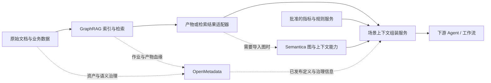

# GraphRAG 的数据能否接入 Semantica 或 OpenMetadata

核验日期：2026-11-17。本文的 GraphRAG 特指微软 `microsoft/graphrag`。基于下方固定源码判断可行性，未部署三个项目、执行真实数据导入或验证查询效果。

## 1. 先区分要接入什么

**两者都能参与接入，但目标不同：Semantica 更适合消费 GraphRAG 的知识内容并参与上下文组装；OpenMetadata 更适合管理来源、索引作业和产物的元数据与血缘。**

本次核对的源码提供了实现适配的接口，尚未确认有覆盖微软 GraphRAG 全部产物、可直接配置使用的专用连接器。能读 Parquet 不等于已经理解 GraphRAG 的图结构；提供 RDF/SPARQL 也不等于可以直接导入它的全部业务实例数据。

| “接入”的含义 | Semantica | OpenMetadata |
| --- | --- | --- |
| 读取文档、文本块、实体、关系 | 可通过读取与字段映射接入，适合知识内容消费 | 主要登记承载它们的资产、结构、来源与治理信息 |
| 复用社区划分和社区报告 | 可设计为社区节点、成员关系和派生报告；需自行实现映射与检索策略 | 可登记报告数据集与生成血缘，不等于提供 GraphRAG 的 Global Search |
| 管理产物、责任人、作业与血缘 | 可保留知识来源，管理门户能力需另核实或建设 | 属于主要用途；具体存储连接器和资产类型须匹配 |
| 请求时调用 GraphRAG 检索 | 可通过自建工具/服务适配取得证据，再交给场景组装器 | 可登记、发现相关资产；实际检索仍由 GraphRAG 服务承担 |
| 直接打开 GraphRAG 的向量索引或项目目录 | 未验证；须匹配后端、索引结构与模型配置 | 目录登记不等于读取和执行向量索引 |

## 2. GraphRAG 有哪些可交付的数据

所核对版本默认把中间/最终表写成 Parquet。具体文件集合和 Schema 受索引方法、配置与版本影响，适配前应检查真实运行产物。

| 产物 | 内容 | 接入 Semantica 的建议 | 在 OpenMetadata 中管理什么 |
| --- | --- | --- | --- |
| `documents` | 文档正文、标题、文本块引用 | 文档与原始证据引用；避免再无差别抽取一遍 | 源集合与文档产物的资产、Schema、owner、分类 |
| `text_units` | 文本块、文档关联、实体/关系引用 | 可检索文本与证据节点，保留块到原文的回溯 | 块数据集、字段及源文档到块的血缘 |
| `entities` | 抽取实体、描述、类型、来源块 | 映射为实体节点，再对齐业务主数据 ID | 实体数据集的结构与治理；业务类型可另映射到术语/本体 |
| `relationships` | 端点、关系描述、权重、来源块 | 映射为边，处理端点名称到实体 ID 的解析 | 关系数据集、字段、生成规则及血缘 |
| `communities` | 层级、成员实体/关系与文本块 | 显式保留社区及层级、成员关系 | 社区产物、算法和索引版本 |
| `community_reports` | 模型生成的摘要、发现、完整报告 | 作为派生上下文，关联社区和证据；不能当成原始事实 | 报告数据集、模型/提示词版本与生成血缘 |
| 向量及索引 | 检索所需的向量、ID 和存储结构 | 用匹配的读取适配器；不兼容时重新建索引 | 登记存储位置、模型、维度、版本和刷新状态 |

`entities` 是从文档抽取的业务实例，例如“客户甲”；OpenMetadata 的资产实体可能是表、服务或管道。两种“实体”不是相同的对象，不能逐条机械互换。`community_reports` 也不是 OpenMetadata 图分析生成的社区结果。

## 3. Semantica 怎么接

固定源码中，`ParquetIngestor.ingest()` 返回 `ParquetData`，记录在其 `.data` 属性中；`ContextGraph.add_node()`、`add_edge()` 可以接收节点、边及附加属性。这些接口支撑自建 GraphRAG 产物适配器，但不会自动完成以下工作。

建议流程：

```text
读取 GraphRAG 产物及运行清单
  → 校验 Schema、索引版本与引用完整性
  → 解析实体身份，转换节点、边、社区、报告
  → 附加文档来源、权限、数据时点与派生版本
  → 写入 Semantica 图/关联内容存储
  → 按场景检索并组装上下文
```

关键映射规则：

1. **ID 有作用域。** 保留 GraphRAG 原始 `id`，加来源集合和索引版本的命名空间。`human_readable_id` 是每轮生成的短 ID，不应直接作为跨重建的业务主键；UUID 也不意味着重建后能保持相同业务身份。
2. **边端点需要解析。** 所核对输出契约中，`relationships.source/target` 是实体名称，`entities.id` 才是实体 ID。先构建经过歧义检查的名称到 ID 映射；同名、缺失端点进入隔离队列，不能随意取第一条。
3. **抽取标签不自动成为本体。** 将实体类型、关系描述映射到业务模型；保留原始描述。没有明确关系类型时，不从自然语言描述中随意编造批准过的关系谓词。
4. **社区与报告是显式对象。** 保留社区层级、成员和报告到社区的关联。如果只导入实体和边，会丢失原本用于全局检索的摘要层。即使全部导入，也不等于复现了微软的 Local/Global/DRIFT 算法。
5. **证据链必须可回溯。** 保留实体/边到文本块、文本块到文档的关联，以及原文位置或可解析的来源引用。只保存描述、丢掉引用，会使后续答案难以核验。
6. **分值保留原义。** 边 `weight` 来自关系强度的聚合；报告 `rank` 是模型生成的相关性排序值。两者都不是经过校准的“事实正确概率”。

重复抽取可能产生不同的实体、关系和摘要。需要复用 GraphRAG 结果时，优先使用结构化映射，不要把所有产物重新拼成文本再抽取；若业务需要重新抽取，单独记录新版本和差异。

## 4. OpenMetadata 怎么接

建议先管理以下链路：

```text
原始文档/数据资产
  → GraphRAG 索引作业
  → 文本块、实体、关系、社区、报告等产物资产
  → 检索服务/场景应用的关联信息
```

- 根据真实存储选择资产类型：已经进入数据库的产物可登记为表；对象存储中的 Parquet 可按目标版本和连接器支持登记容器/文件类资产，或通过自定义采集对接。不能假定任意 Parquet 路径都能直接调用创建表接口；核对的 `createTable` 契约要求 `name`、`columns` 和 `databaseSchema`。
- 通过连接器或 SDK/API 管理 Schema、owner、描述、术语、标签、质量与血缘。索引作业可映射为受支持的 Pipeline/Task；检索服务、模型和配方用适当原生实体或经定义的扩展属性关联，不强行冒充表。
- 对索引版本、嵌入模型修订、维度、源水位、提示词版本、产物 URI 等，先确认原生字段；没有原生字段时先定义受支持的自定义属性。`extension` 字段不意味着任意 JSON 都会被接受。
- 索引执行成功和证据质量合格要分别记录。目录的访问权限和分类标签，也不会自动变成 GraphRAG 查询服务的文档级权限。

**OpenMetadata 已有的本体/RDF/SPARQL 能力值得利用，但不能据此宣称它是任意业务实例图的通用导入和 RAG 引擎。**核对的 RDF 接口面向元数据投影及其查询/治理；尚未验证将 GraphRAG 业务图完整写入的原生契约。若计划沿本体路径导入，应另做 Schema、身份、写入生命周期和权限验证。

当前固定版本的通用 `/v1/rdf/sparql` GET/POST 入口要求管理员权限；Agent 专用入口有独立授权和查询限制。不能拿管理员查询结果直接作为普通用户的上下文，也不能假定图查询会自动按每项资产权限过滤。

## 5. 针对当前业务的推荐架构



**优先按请求调用 GraphRAG 检索，确有跨源图遍历需求再同步完整图。**前者适合已有 GraphRAG 能力、主要想组合上下文的阶段：自行封装检索服务，返回证据文本、实体/社区引用、来源、索引版本和有效的权限范围，再由组装器与其他来源合并。GraphRAG 未返回的证据字段需要适配器补齐，不能用一个无来源答案替代证据包。

当需要把文档关系和 CRM、工单、客户主数据统一关联，进行跨来源关系查询时，再将产物映射进 Semantica 或选定图存储；同时维护身份对齐和增量同步。OpenMetadata 作为主目录管理来源和生成链路，避免多个地方独立维护业务口径。

例如“解释客户本月回款异常”：金额由批准的指标服务计算；GraphRAG 提供合同、政策和沟通记录的相关证据；Semantica 可用于关联客户、事件和条款；场景服务按有效期、权限、预算和证据质量组装后，通过受控 API/MCP 返回下游。OpenMetadata 管理字段含义、规则版本、owner 和来源链路，抽取关系本身不能替代批准的判断规则。

## 6. 上线前要验证的边界

| 检查项 | 验收要求 |
| --- | --- |
| 引用与身份 | 文档、块、实体、边、社区引用可解析；同名实体不误合并 |
| 增量与删除 | 新索引发布可切换；删除/撤权会使相关摘要、缓存和派生图失效 |
| 权限传播 | 检索前按可信身份授权；混合权限文档生成的社区报告不能仅靠结果后过滤保障安全 |
| 向量兼容 | 模型及修订、维度、归一化、距离度量、ID 映射与后端契约一致，否则重建 |
| 结果质量 | 以实际业务问题对照原始证据；分别评估检索覆盖、引用正确和答案正确 |
| 可追溯交付 | 每个证据包记录源、索引/模型/映射/配方版本与数据时点 |

这些是建议的接入验收条件，本文尚未完成端到端实测。

## 7. 固定来源与判断依据

以下均为一手仓库文件，2026-11-17核验；锁定提交的接口不代表其他发行版具有相同契约。

- [Microsoft GraphRAG 输出契约](https://github.com/microsoft/graphrag/blob/34b2b67ae4601ad0b47bcd179fbe3f2a23aa0857/docs/index/outputs.md)：Parquet、各产物字段、名称端点、短 ID、权重与报告排序的含义。
- [Semantica ParquetIngestor](https://github.com/semantica-agi/semantica/blob/066505cf7bf80a7944e1efe729b88f8a2878fd41/semantica/ingest/parquet_ingestor.py)：Parquet 读取与 `ParquetData` 返回对象。
- [Semantica ContextGraph](https://github.com/semantica-agi/semantica/blob/066505cf7bf80a7944e1efe729b88f8a2878fd41/semantica/context/context_graph.py)：`add_node/add_edge` 及图对象接口，不能由此推断微软产物已被自动映射。
- [Semantica GraphBuilder](https://github.com/semantica-agi/semantica/blob/066505cf7bf80a7944e1efe729b88f8a2878fd41/semantica/kg/graph_builder.py)：可接收预抽取结构，是否重新抽取与具体选项有关。
- [OpenMetadata 创建表契约](https://github.com/open-metadata/OpenMetadata/blob/930926a86ca8622cd30356706f5b5c7e9cd93afa/openmetadata-spec/src/main/resources/json/schema/api/data/createTable.json)：表资产所需父级与字段约束。
- [OpenMetadata RDF 接口](https://github.com/open-metadata/OpenMetadata/blob/930926a86ca8622cd30356706f5b5c7e9cd93afa/openmetadata-service/src/main/java/org/openmetadata/service/resources/rdf/RdfResource.java)、[本体/RDF 契约说明](https://github.com/open-metadata/OpenMetadata/blob/930926a86ca8622cd30356706f5b5c7e9cd93afa/docs/rdf-ontology-contract.md)：元数据投影、查询接口与权限边界。

关联：[多源接入与场景组装](../output/08_多源接入管理与元数据及上下文组装设计.md)、[Semantica 报告](../output/01_Semantica深度调研.md)、[OpenMetadata 报告](../output/03_OpenMetadata深度调研.md)、[GraphRAG 报告](../output/05_GraphRAG深度调研.md)。
