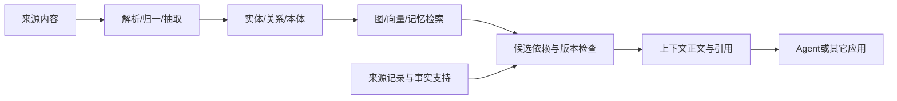

# Semantica：语义、来源与上下文组装框架

研究基线：2026-11-16；2026-11-17依据会话内容重建并重新取得固定源码。对象`semantica-agi/semantica`，固定提交`066505cf7bf80a7944e1efe729b88f8a2878fd41`。以下是源码和文档分析，不是框架运行或生产性能结论。[来源记录](../docs/来源与源码证据.md)

## 1. 定位与版本

Semantica是可组合的Python框架，覆盖数据接入、知识抽取、本体、图存储、混合检索、Agent记忆、来源与上下文。它不是预训练模型，也不是仅开放SDK的商业服务。核心许可MIT；该提交的pyproject为0.8.0、Python >=3.11.5,<3.14；原研究时latest release为v0.7.0。主分支的新机制不能直接算进旧release。

适合参考的是“如何把知识变成可验证、可更新的上下文”，尤其是依赖失效、引用与版本检查。是否适合直接做整个平台底座，需要验证存储、授权、并发、管理界面和实际负载，不能从模块数量得出结论。

## 2. 核心模型与工作流

这是本报告归纳的逻辑流，不表示每个默认入口自动经过全部校验。

| 模块/对象 | 职责 | 接入边界 |
| --- | --- | --- |
| ingest、parse、normalize | 接入、解析与结构处理 | 企业数据类型、单位和业务含义需明确映射 |
| kg、ontology、reasoning | 知识模型、图与规则 | 自动抽取结果不等于批准的业务事实 |
| AgentContext、ContextRetriever | Agent记忆与检索编排 | 要确认实际调用路径启用了哪些约束 |
| GroundedContextAssembler | 版本化上下文组装 | 依赖可信provider与artifact注册信息 |
| provenance | 来源、活动、血缘记录 | 实际执行事件需由应用捕获 |
| PolicyEngine | 业务政策管理与判定 | 不是数据库RLS或统一身份系统 |

## 3. 重点源码：从候选到有效上下文

`semantica/context/grounded_context.py`中的`assemble()`先捕获provider视图和artifact registry快照，再过滤候选。候选通过内容、来源依赖及artifact一致性检查后，才进入此路径的后续排序和选择，防止失效的高分材料挤掉有效结果。

这仍受候选池大小约束：若召回池大部分无效，结果可能不足K条；过滤不能补回从未召回的内容。应结合索引刷新与候选池策略验收。

组装器渲染正文和引用后检查`max_context_chars`，超预算则移除相关块。官方测试`test_budget_never_keeps_summary_without_its_citation`对应“不要留下失去引用的摘要”。该预算是字符数，真正调用模型前仍要按目标tokenizer计算token。

最后调用`provider.assert_current(view)`，并核对artifact revision。若组装期间视图或注册表变化，会中止这条路径。这保护组装的一致视图，不能推成源数据库、向量索引、图存储与全部服务的全局事务。

`truth_maintenance_filter.py`用快照检查候选的依赖支持。依赖无效与程序契约错误被区别处理：前者可以排除候选，后者应报错，避免把服务异常伪装成“没有知识”。

`provenance/storage.py`提供内存、SQLite来源存储与血缘查询。可追溯的前提是采集链和执行链都准确记录了来源；存储一个解释字符串不等于捕获真实调用，也不等于法规认证或事实正确。

## 4. 数据来源接入与管理能力

`semantica/ingest/registry.py`提供方法注册，按文件、数据库、API、MCP等类别组织扩展点。这是代码层面的连接器能力，不证明已有来源配置、secret、调度、运行历史、审批发布的一体化管理后台。

建议外部来源注册表管理Source、Connection、Binding、物理Schema和Mapping版本；Semantica消费已校验的文档或事实。不同业务接口都转成dict，不等于它们已经具有同一语义。相同订单来自三个通道时，也不能重复相加。

## 5. MCP与权限

`semantica/mcp_server/__init__.py`包含stdio工具服务，支持`semantica-mcp`或`python -m semantica.mcp_server`。有图文件路径、可选自动重载，并保护加载失败后不以空图覆盖原文件。

这不自动提供多用户远程HTTP服务、OAuth、逐实体授权或多进程写入事务。生产接入需要可信身份、工具白名单、存储隔离和源端权限。政策检查引擎也不能替代IAM或数据库的行列限制。

## 6. 学习与PoC路径

先读grounded_context、truth_maintenance_filter、provenance/storage及对应tests，再看ontology/quality_gate和MCP。先用手工确认事实验证：来源→记录→检索→撤回依赖→引用组装，再接自动抽取与LLM，便于分离错误。

若安装，固定提交或选定release，使用隔离环境；不能用不带版本的pip安装复现本报告接口。本次仅重新取得和静态核对源码，没有安装/执行上游测试或模型抽取。

## 7. 当前业务接入建议

用于“净回款是多少、依据是什么、为什么变化”时：数值由受控执行层计算，目录提供批准定义；Semantica可评估承担规则/来源记录、依赖撤回及证据组装。记录实际工具调用结果，而非只保存模型对自己推理的描述。

| 风险 | PoC验证 |
| --- | --- |
| API或文档漂移 | 固定SHA，对实际方法签名运行最小用例 |
| 源更新未传播 | 事实更新、撤回、并发组装，观察版本检查 |
| 自动实体合并错误 | 中文别名、同名客户、单位和时间差异 |
| 上下文越权 | 两租户同名实体、共享索引、缓存和记忆 |
| 引用/预算失真 | 必需证据不能丢，按真实tokenizer复核 |

结论：研究优先级较高，可做上下文和来源层的小范围PoC；不能仅凭广泛模块声明认定其已经是可直接部署的完整企业Context平台。详见[接入设计](08_多源接入管理与元数据及上下文组装设计.md)。
