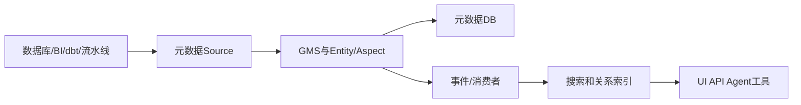

# DataHub：元数据治理与Agent发现上下文

研究基线2026-11-16；2026-11-17依据会话重建。对象`datahub-project/datahub`，不是阿里云同名服务。固定SHA `58672db9b680cb3fdc7a62662ac2806d2a346d31`，原研究时latest release v1.9.0；Apache-2.0。Cloud产品能力与OSS分别核对。[固定证据](../docs/来源与源码证据.md)

## 1. 定位与选型结论

DataHub围绕数据资产组织schema、描述、owner、术语、使用模式、血缘、质量与治理信息。Agent可以据此判断“应该用哪个资产，如何解释，谁负责，是否符合当前任务”；业务事实值仍来自执行服务或源库。

它与OpenMetadata属于较接近的同层候选，应先选一个权威目录，不要为了一个Agent维护两个重复主目录。现有目录已经运转时优先通过API/工具复用。

## 2. Entity与Aspect模型

Entity是资产，Aspect是资产某方面的结构化信息。Dataset可拥有schema、ownership、glossaryTerms、upstreamLineage等aspect，支持扩展而不把所有字段塞进同一个固定对象。

`DatasetKey.pdl`体现platform、name、origin等身份因素。资产关联不能只用表名/显示名称；同名测试表和生产表、不同实例的表需要稳定区分。

`UpstreamLineage.pdl`描述上游及细粒度血缘。数据派生关系不同于业务实体关联；目录中的血缘也不自动解释每个聚合结果的所有计算细节。

指标“净回款”的目录信息至少应包括：批准定义、单位/币种、粒度、时间口径、owner、关联字段、执行模型版本、质量检查时间和有效期。描述不能替代执行公式，应通过ID与版本关联。

## 3. 架构与更新



至少区分源系统变化、元数据写入、搜索/血缘可见三个时点。采集成功不自动保证所有索引立即一致，元数据实时也不等于业务数据实时。

传统架构使用Kafka。本次固定主分支还包含`docs/pgqueue-design.md`：PostgreSQL原生消息transport作为替代路径，可减少broker依赖。不能再绝对断言DataHub必需Kafka；也不能未经实测认定pgQueue适合任意规模。需要测消费者、保留、恢复、IOPS和连接池。

## 4. 来源管理界面与采集框架

`docs/ui-ingestion.md`描述来源模板、owner、连接详情、secret引用、连接测试、调度及运行管理。不是每种自定义源都有完整可视表单；复杂源仍可能需要recipe与代码扩展。

`metadata-ingestion/.../api/source.py`中的Source面向MetadataWorkUnit，统一不同来源的元数据输出。**这不能直接当作统一业务记录/API响应的运行时代理。**

连接器代码在受信worker执行；允许修改并运行recipe是一种工程权限，不应无区别发给业务用户。目录采集与运行时访问可以关联同一个来源实例，但各自使用不同凭据与授权范围。

## 5. Agent能力与边界

当前仓库有`datahub-agent-context`，可供资产/文档搜索、schema与owner查询、血缘、关联SQL案例以及元数据修改工具。默认建议只开放读取。

| 能力 | 用途 | 容易误解的地方 |
| --- | --- | --- |
| 搜索与详情 | 找批准数据及理解字段 | 搜到资产不等于允许读其业务数据 |
| 血缘 | 影响分析与来源解释 | 血缘不保证当前新鲜度 |
| get_dataset_queries | 获取关联SQL案例和使用模式 | 是读SQL案例，不是执行SQL |
| 修改描述/标签/owner等 | 维护目录上下文 | 普通取数Agent不应自动拥有这些权限 |
| ask_datahub_chat | Cloud助手 | README标明Cloud-only，不能算OSS完整助手 |

历史SQL不能未经口径确认就当真值，schema/指标改动后应使旧案例失效。SDK示意：

```python
from datahub.sdk.main_client import DataHubClient
from datahub_agent_context.langchain_tools import build_langchain_tools
client = DataHubClient.from_env()
tools = build_langchain_tools(client, include_mutations=False)
```

这是固定文档中的接入形状，本次没有调用服务；版本需与SDK/工具包/服务适配。只读工具配置不代替后端API授权。

DataHub中的MCP可能指Metadata Change Proposal，也可能指Agent使用的Model Context Protocol。集成设计中应写全称，不能混为同一种通道。

## 6. 权限、质量和审计

平台策略、元数据可见性和源数据库RLS是三层不同权限。需检查view authorization及具体部署配置，不能只靠UI隐藏。描述、历史SQL、预览、API返回都可能包含敏感信息。

质量状态应带检查时间、分区和运行ID；上个月检测通过不能自动当本月质量保证。定义测试、执行、调度和告警应分开核对OSS/Cloud边界。

审计应关联user/request ID、资产URN、目录revision、执行模型版本与数据水位。目录变化事件不能代替所有业务查询的执行日志。

## 7. 当前业务的PoC与接入建议

接一个真实类型的数据库，再接相关dbt/ETL和BI血缘，检查三方是否指向同一稳定资产。随后配置owner和批准术语，让Agent能发现唯一指标并获取执行绑定；金额仍由受控查询服务计算。

用同样问题集和数据源与OpenMetadata比较：连接器覆盖、身份映射、术语维护、质量接入、增量与删除、索引延迟、升级恢复和团队运维负担。不给没有相同负载实测的“更快/更成熟”结论。

DataHub可承担来源/元数据管理控制面的一部分；异构业务响应的规范化和场景DAG另建或复用已有平台，详见[平台设计](08_多源接入管理与元数据及上下文组装设计.md)。
