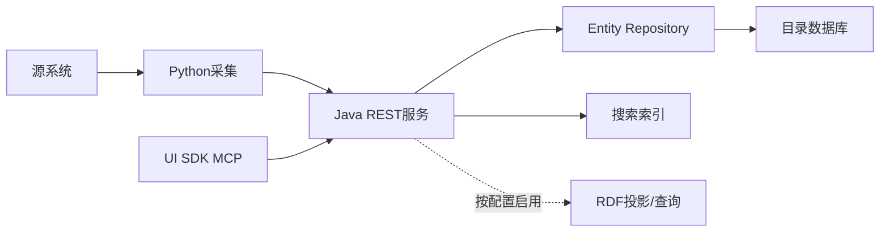

# OpenMetadata：资产治理、语义元数据与Agent接入

研究基线2026-11-16；2026-11-17重建。固定SHA `930926a86ca8622cd30356706f5b5c7e9cd93afa`；原研究时latest release 2.0.8-release，但该主分支POM为2.0.0-SNAPSHOT，不可互换。根目录Apache-2.0，`ingestion/`另有Collate Community License 1.0。[证据](../docs/来源与源码证据.md)

## 1. 定位

OpenMetadata管理表、流水线、仪表板、术语、owner、血缘、质量与协作信息。当前固定源码还有本体、RDF、SPARQL和MCP，不能仅按传统表目录评价；它也不会因此自动成为订单数据库或专用指标计算引擎。

## 2. Schema-first架构

`openmetadata-spec/.../json/schema/`定义表、术语和本体等模型，并生成多语言类型；resources接入请求，Repository持久化，search组织索引。Python采集通过API写入目录，不是另起一套资产真值。

目录数据库、搜索索引和RDF投影不是单一原子副本。写入成功、搜索可见、图投影就绪要分别判断；状态和时点应传给下游。

## 3. 接入管理、API资产与结构统一

Service和工作流可以管理连接、测试、范围、调度与运行状态。`apiService.json`和`apiEndpoint.json`表达API服务、端点、方法和requestSchema/responseSchema；REST source读取OpenAPI并生成Collection/Endpoint资产。

这是接口元数据采集，**不能据此推断目录原生支持任意业务API代理、分页、运行时字段转换及场景编排**。实际取数还需Binding、授权和CanonicalModel适配层。

技术元数据由连接器发现；业务含义、计算口径、owner及有效期需业务与工程共同维护。自动发现一个字段类型不可能自动确认它是含税收入还是净回款。

## 4. 本体、术语与RDF的区别

Glossary主要表达术语与关系；native ontology是独立概念/属性模型。固定`docs/rdf-ontology-contract.md`明确区分，不可把SKOS broader直接当OWL subclass继承。

RDF投影可以连接资产、字段和血缘，例如output通过PROV关系关联source。这主要是元数据及语义模型视图，不是自动将源库每条订单转成实时业务实例图。它与Ontop查询的对象和执行方式不同，即使都使用SPARQL。

### OSS与Collate界面边界

固定提交的2026-11-15至16日ADR说明：Ontology Studio编写界面属于Collate；OSS保留本体后端API、RDF/SPARQL和共享部分，并有只读Ontology Explorer。不能把商业编辑/发布界面全部算进OSS，也不能因此说OSS没有本体。

选用OSS时，要实际验收团队如何通过开放API、外部工具或自建界面完成建模和发布，不能用商业演示代替。

## 5. MCP身份与特殊SPARQL边界

MCP模块文档包含用户SSO/Basic Auth、Authorization Code + PKCE、令牌刷新、只读与禁用工具等机制。它是用户接入目录，不是连接器访问源库的OAuth。

`RdfResource.queryAgentSparql()`的当前契约尤其重要：只允许受控SELECT，拒绝FROM/GRAPH/SERVICE等；需要明确的ExecuteSparqlQuery授权；**结果不再按persona或资产级权限逐条过滤**；重建/降级时可返回PROJECTION_NOT_READY。

因此不能把“用户MCP身份有效”直接当成“所有图查询都已按其资产范围过滤”。普通用户优先使用经过验证的目录检索接口；图查询应单独验证隔离投影、模板与授权范围。

## 6. 采集目录的许可修正

根LICENSE不足以代表整仓全部组件。`ingestion/LICENSE`为Collate Community License 1.0，REST采集实现文件头明确引用它；其Excluded Purpose限制提供竞争性SaaS/PaaS/IaaS等在线服务。

这是带用途限制的许可，不能按Apache-2.0处理整套采集代码。具体复用/分发需核对目标版本和文件范围；本次没有追溯所有历史tag。这个问题与Ontology Studio商业界面是两个独立边界。

## 7. 部署、更新与质量

采集、搜索、可选Fuseki/RDF投影各有维护成本，需验证重建、备份、回滚与恢复目标。查询成功、投影未就绪、超时、无数据必须返回不同状态。

质量检测可能查询源数据，权限和负载不同于只采schema。应记录定义、执行时间、数据分区、结果及告警处置，不能把目录中的绿色状态当永久保证。

按实际发布版选择配套配置、镜像和采集依赖，不混用旧1.x教程和当前2.x主分支。本次没有启动平台、SSO或采集任务，不能给资源最低值或吞吐承诺。

## 8. 当前业务建议与验收

与DataHub在同一来源、用户和问题集上PoC，优先验证管理界面、业务术语/owner、质量血缘、REST/MCP可见性、更新同步和恢复。目录负责发现和治理，精确数值由批准的执行模型提供。

| 重点 | 验收方式 |
| --- | --- |
| OSS范围够用 | 用实际OSS完成模型维护，不用商业演示代替 |
| MCP权限 | 两普通用户与直接REST对照 |
| SPARQL授权 | 跨域、直接查询、模板与投影反例 |
| Schema变化 | 映射、索引、指标和场景依赖同时检查 |
| 模块许可 | 目录/采集/商业UI分别核对 |

下一层需要来源注册、结构映射和场景服务，参见[多源接入设计](08_多源接入管理与元数据及上下文组装设计.md)。
