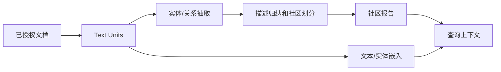

# Microsoft GraphRAG：文档图索引与上下文检索

研究基线2026-11-16；2026-11-17重建。对象`microsoft/graphrag`，不是所有图增强RAG或Neo4j同名库。固定SHA `34b2b67ae4601ad0b47bcd179fbe3f2a23aa0857`，实际包3.3.0，Python >=3.11,<3.14，MIT。根workspace的0.0.0不能当实际包版本。[证据](../docs/来源与源码证据.md)

## 1. 核心问题与研究基础

普通向量检索偏局部片段，“这些材料共同体现哪些主要风险”需要跨语料综合。GraphRAG提取实体关系，组织社区并生成摘要，为全局问题提供结构化背景。

原研究采用Edge等《From Local to Global: A GraphRAG Approach to Query-Focused Summarization》，arXiv:2404.16130v2（2025-02-19；首发2024-04-24）。论文的全局问答评价不能泛化为所有事实问答、实时统计或业务正确率。现行Fast、DRIFT、输入API与包结构按源码分别核对。

## 2. 建库与产物



Standard主要使用LLM抽取实体、关系并归纳描述/社区报告；FastGraphRAG用NLP名词短语与共现替代部分抽取，但社区摘要仍可能调用模型。共现不等于业务关系，Fast不意味着相同质量或完全无LLM成本。

产物包括documents、text_units、entities、relationships、communities、community_reports及可选covariates。ID关联可帮助追溯原文，但有引用不代表每句结论都受来源支持。

自动抽取、实体合并、摘要都会引入错误；图不是批准业务本体，图中关系也不能直接作为因果证据。

## 3. 查询模式

| 模式 | 工作方式 | 适用及代价 |
| --- | --- | --- |
| Basic | 文本向量检索 | 局部问题与较轻基线 |
| Local | 实体邻域、文本和相关报告 | 实体关联问题，受消歧/邻域预算影响 |
| Global | 社区报告map-reduce | 全局主题总结，查询时可能多次模型调用 |
| DRIFT | 社区背景加迭代局部探索 | 需扩展搜索的问题，限制探索深度与成本 |

固定源码中global_search/search.py、local_search/search.py和drift_search/search.py是主要入口。中间相关性/重要性分数不是校准的答案正确概率。

## 4. 接入与元数据能力

`docs/index/inputs.md`规定documents DataFrame，支持文件、自带DataFrame和自定义InputReader；结构化输入可保留raw_data并将选定元数据带入chunk。

它统一的是文档输入，不是所有业务服务响应。把订单转成文档不能自动保留数据库聚合、快照、权限和指标口径。企业来源配置、secret、同步任务、Schema管理与CanonicalModel适配应由外层平台负责。

## 5. 权限与更新

如果两个授权域文档共同生成一个社区摘要，只在查询时过滤原文ID不能消除摘要中已经包含的机密信息。需要按域分索引、追踪派生报告完整来源，或在授权集合中构建上下文，并用反例验证。

新增、修改、撤回和删除不同。具备增量更新接口不等于相关实体描述、社区报告、向量、缓存和Agent记忆都自动正确失效。

索引版本至少绑定source版本、抽取模型/提示词、切分、embedding、社区参数、时间和授权范围。旧政策撤回后，相关摘要应被排除或重建，不能继续当作当前规则。

## 6. 入门与成本

以下是上手指引，本次没有执行模型调用或完整建库：

```bash
python -m venv tmp/graphrag-venv
# 安装需要网络；模型端点及凭据按获准配置填写
 tmp/graphrag-venv/bin/python -m pip install 'graphrag==3.3.0'
 tmp/graphrag-venv/bin/graphrag init --root tmp/graphrag-work
 tmp/graphrag-venv/bin/graphrag index --root tmp/graphrag-work
 tmp/graphrag-venv/bin/graphrag query --root tmp/graphrag-work --method local --query '回款政策有哪些限制？'
```

成本应分别计算文档处理、抽取、归纳、社区报告、embedding、查询生成、更新和存储。不能将某环节token倍率宣传为整个系统收益。记录实际模型修订、语料、配置与调用量后再测。

## 7. 当前业务建议

对于“净回款为什么下降”，先由结构化执行层取得准确数字与分维度拆解；GraphRAG提供政策、会议和工单等证据。把观测值、规则和可能解释分开；关系相关性不证明因果。

| 场景 | 建议 |
| --- | --- |
| 少量局部事实 | 先测普通RAG/Basic |
| 跨文档主题 | 测Global |
| 实体、多跳与探索 | 测Local/DRIFT |
| 财务精确求和 | 使用批准执行层 |
| 高变更细粒度ACL | 先验证派生摘要隔离与删除成本 |

输出应包含原文位置、源版本、索引版本、有效期、授权域和派生标识。它是场景配方的文档支路，不是完整上下文管理平台。

## 8. 验收边界

比较召回、全局覆盖、实体消歧、引用忠实、时间冲突、拒答、授权、删除传播和建库/查询成本。与同语料普通RAG比较，不能只比一个好看的问答案例。本次只有静态核对与既有论文学习，没有上游效果或性能实测。
