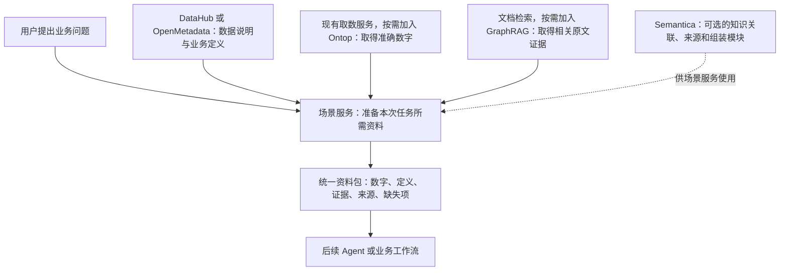

# 五个项目怎么选：从数据接入到给 AI 准备业务资料

**如果目标是做一个“能接数据、理解业务含义、按场景准备资料”的平台，优先比较 DataHub 和 OpenMetadata 的管理能力；根据实际缺口，再考虑 Semantica、Ontop 和 GraphRAG。**

这五个项目解决的问题不同。本文先用业务例子说明各自的工作，再回答数据接入、业务含义管理、资料组装和下游交付四个问题。这里的“上下文”，指 AI 处理一次任务时需要的数字、定义、规则、文档片段及其来源。

本文说的 Agent，是能调用工具完成任务的 AI 程序。例如，它可以先调用取数工具，再读取合同，最后整理回答。

阅读方式：先读第 1、2 节理解分工；第 3 节看完整例子；第 4、5 节用于选型。专业词的简短解释放在第 7 节。

原研究基线为 2026-11-16，2026-11-17重新取得固定版本源码；本次在同日重写讲解方式。结论来自源码和文档分析，未部署五套系统进行效果或性能测试。GraphRAG 特指微软项目。[版本及一手来源](../docs/来源与源码证据.md)

## 1. 先看懂：每个项目到底帮你做什么

假设你要让 AI 回答：“某客户这个月回款多少？合同怎么约定？是否需要跟进？”

| 项目 | 主要帮你做什么 | 在这个问题中的作用 | 使用前需要知道的边界 |
| --- | --- | --- | --- |
| **DataHub** | 管理企业有哪些数据、字段是什么意思、谁负责、数据从哪里来 | 找到正确的回款数据表和经过确认的指标定义 | 查到表的资料后，还需要查询服务去取得实际金额 |
| **OpenMetadata** | 管理数据来源、字段说明、业务术语、质量检查和来源关系 | 查到回款数据的定义、负责人及最近检查结果 | 目录中的“检查通过”有检查时间和范围，不能代替本次取数校验 |
| **Ontop** | 把“客户、订单、退款”等业务概念与数据库表关联，让应用按这些概念查询 | 按配置好的规则查客户及其订单、退款 | 需要工程师事先配置对应关系，业务计算规则也要事先确定 |
| **GraphRAG** | 从文档抽取人、组织、事件及关系，生成摘要，辅助跨文档问答 | 从合同、政策和沟通记录中找相关依据 | 抽取和摘要可能出错，需要保留原文；精确金额由查询服务计算 |
| **Semantica** | 提供知识接入、关系组织、来源记录和上下文组装等代码模块 | 关联客户、合同和事件，检查引用资料是否仍有效 | 需要开发集成；本次未确认有满足完整需求的一体化管理后台 |

DataHub 和 OpenMetadata 是较直接的同类候选，通常先选一个作为企业数据的主要管理目录。其余三个应根据业务需要加入，五个项目不必全部安装。

## 2. 对照你的四个需求，分别看谁能做、还要补什么

### 2.1 数据来源怎么管理，不同格式怎么统一

假设数据来自交易数据库、HBase、客户系统接口和合同文件。这里有两项不同的工作：

- **管理来源**：配置连接地址和凭据，选择采集范围，安排任务，查看运行是否成功。
- **统一实际数据**：处理不同字段名、嵌套结构、金额单位、分页方式，把结果转换成业务可以使用的格式。

例如，一个系统把“客户编号”放在表的一列里，另一个放在接口返回内容里，第三个放在 HBase 的列中。你需要配置三者如何对应；还要确认编号是否属于同一套客户体系。把字段改成同一个名字，只完成了其中一部分工作。

| 项目 | 可以承担的部分 | 还需要补充的工作 |
| --- | --- | --- |
| DataHub / OpenMetadata | 提供数据来源及采集任务的管理能力；实际表单和连接支持按目标来源检查 | 业务查询的调用、分页、字段转换、单位转换与异常处理 |
| Semantica | 提供文件、数据库、接口等接入扩展点，可参与内容处理 | 企业自有数据格式的转换规则，以及来源配置、审批、监控等管理功能 |
| Ontop | 在支持的数据库范围内，把表和字段对应到业务概念 | HBase、任意接口、文件等来源的通用接入管理 |
| GraphRAG | 接收并处理文档内容 | 文档下载、更新、权限、来源配置，以及非文档数据的统一访问 |

**当前建议：管理目录负责记录来源和数据资料，再由一层统一的数据访问服务调用真实来源、转换实际结果。**这层服务可以复用已有系统，也可以自行开发。

DataHub/OpenMetadata 的连接器主要采集“有哪些表和字段、含义是什么”等资料。不能仅根据连接器数量，就判断它们能替所有 Agent 完成实际取数。

### 2.2 字段含义、业务知识和计算口径怎么管理，有没有页面

先区分数据本身与“介绍数据的资料”：

| 例子 | 属于什么 | 用来做什么 |
| --- | --- | --- |
| 客户甲本月净回款为 250 元 | 实际业务数据 | 回答具体金额 |
| 净回款按“实付减退款”计算，单位为元，按支付月份统计 | 业务定义和计算口径 | 说明数字的含义，指导查询如何计算 |
| 这个字段由财务部负责，来自交易系统，昨天检查过 | 管理资料，通常称为“元数据” | 判断来源、责任与检查情况 |

这里的计算口径只是教学假设。真实业务还必须确认退款归哪个月份、采用什么时区、哪些订单状态参与计算。

**DataHub 和 OpenMetadata 更适合集中管理这些说明资料，并提供查询和维护页面。**但“写下了计算公式”和“已经按公式执行取数”是两件需要分别建设的工作。

| 需要管理的内容 | 建议放在哪里 | 谁负责确认 |
| --- | --- | --- |
| 表、字段、类型、来源 | DataHub 或 OpenMetadata，由连接器采集并补充说明 | 数据工程师 |
| “客户”“回款”等术语和含义 | 管理目录中的业务术语及关联资料 | 业务负责人 |
| 指标公式、时间范围、币种和生效日期 | 目录保存定义，关联实际执行查询的版本 | 业务与数据工程共同确认 |
| 合同、政策原文及生效时间 | 原文系统保存；检索系统处理内容；目录关联来源 | 相应文档负责人 |
| “什么情况需要跟进”等判断规则 | 在受控的规则配置或规则服务中维护，并与目录关联 | 业务负责人 |

Semantica 可以组织知识和规则相关信息，但需要核实具体管理流程。Ontop 的重点是概念与数据库的对应配置。GraphRAG 的重点是从材料中提取信息和摘要。

本体是明确规定业务概念、属性和关系的模型，例如规定“客户拥有订单，订单可以关联退款”。它需要事先设计，不能直接等同于模型从文档中抽取出的关系。

**界面方面要特别注意：**所核对的 OpenMetadata 版本提供本体管理接口和只读浏览能力；用于编写本体的 Ontology Studio 界面属于 Collate 产品范围。不能根据商业演示，认定开源部署也有相同的编辑、发布页面。更详细的边界见 [OpenMetadata 报告](03_OpenMetadata深度调研.md)。

### 2.3 怎么按业务场景组装上下文——这是重点

“客户回款跟进”和“合同合规审查”即使使用同一批数据，需要准备的材料也不相同。建议给每个场景定义一份**资料准备清单**：要查哪些数据、按什么顺序查、哪些必须成功、如何处理冲突、最多返回多少内容。

以前文的客户回款问题为例，一次资料组装应包括：

1. **确认访问者身份**：这个人能查看哪些客户、地区和合同。
2. **取得生效的定义**：本次“净回款”使用哪一版公式和统计时间。
3. **取得准确数字**：通过已批准的查询接口，读取金额及必要明细。
4. **寻找相关材料**：查客户合同、当前政策、工单和沟通记录，并保留原文出处。
5. **检查能否使用**：客户是否对应正确，材料是否过期，有没有越权，数字的单位和时间是否一致。
6. **区分事实与解释**：已付款金额是事实；某次沟通“可能影响回款”是待确认的解释。
7. **选择并组织内容**：优先保留必需定义、数字和来源，再加入相关补充资料。
8. **记录缺失信息**：合同查询失败时，不能让 AI 据此断言“合同没有相关限制”。

上面是建议的场景服务流程，不是五个项目中的某一个已经默认完成了全部步骤。

| 项目 | 在组装过程中提供什么 | 需要应用继续完成什么 |
| --- | --- | --- |
| DataHub / OpenMetadata | 说明应该找哪份数据、字段含义、业务定义、来源及质量记录 | 实际查询、按场景组合材料和失败处理 |
| Ontop | 根据配置好的业务概念取得数据库结果 | 访问授权、业务规则确认、与文档证据合并 |
| GraphRAG | 查找文档中相关的人、事件、关系和主题材料 | 确认引用支持结论，处理权限、过期及与精确数值的组合 |
| Semantica | 可评估其来源记录、资料有效性检查和上下文组装模块 | 接入可信来源，配置并验证实际调用流程，补充业务场景规则 |

Semantica 值得进一步验证的例子是：一条政策已撤回，依赖这条政策的摘要也不应继续进入答案。它有处理来源依赖和版本检查的模块；应用需要正确登记依赖并调用相应流程，不能假定所有入口默认启用这些检查。

**对于你最关心的“按场景组装”，仍需要明确的场景服务。**先用一个具体业务场景做通，再判断 Semantica 的哪些模块能减少开发量。只把所有资料存到一起，并不会自动得到上述业务流程。

### 2.4 组装后，以什么方式给下游使用

建议返回一个有固定字段的“资料包”，包括业务结果、定义、证据、来源和缺失项。这样，后续 Agent 可以解释内容，工作流也可以直接读取其中的结构化数值。

| 提供方式 | 适用情况 | 需要注意什么 |
| --- | --- | --- |
| 普通接口，也称 API | 给业务后端、工作流或 Agent 服务调用 | 定义请求参数、返回结构、身份与错误状态 |
| MCP 工具 | 下游 Agent 已使用 MCP 连接工具 | MCP 是工具通信协议；实际取数和资料组装仍由后端服务执行 |
| 文件或消息通知 | 批处理报告、定期分析、异步任务 | 附上生成时间、版本与访问限制 |

DataHub/OpenMetadata 的接口适合查询管理目录；Ontop 的接口用于按业务概念查询数据库；GraphRAG 提供文档检索能力；Semantica 有工具服务模块。你需要围绕自己的场景统一返回格式，而不是让下游理解五种项目的内部对象。

## 3. 用一条完整问题，串起五个项目

教学问题：“客户甲这个月净回款多少？结合合同和沟通记录，判断是否需要跟进。”以下金额和材料均为示意，不代表真实业务数据。

| 步骤 | 具体做什么 | 可以使用什么 |
| --- | --- | --- |
| 找定义 | 确认“净回款”的公式、时间、单位和负责人 | DataHub 或 OpenMetadata |
| 取数字 | 按批准规则查到实付 300 元、退款 50 元，得到净回款 250 元 | 现有取数接口；需要按业务概念访问数据库时评估 Ontop |
| 找依据 | 找到客户甲的付款条款和相关沟通段落 | 文档检索；涉及跨材料关系和主题时评估 GraphRAG |
| 组合检查 | 对齐客户编号、排除旧政策、检查权限，保留数字和原文引用 | 场景服务；可使用 Semantica 的部分模块 |
| 提供结果 | 返回数字、计算依据、证据和仍待确认的问题 | 场景服务的 API 或 MCP 工具 |

一个便于理解的返回内容可以是：

```json
{
  "客户": "客户甲",
  "净回款": {"数值": 250, "单位": "元"},
  "计算依据": "实付300元减退款50元，按示例月份口径",
  "数字来源": "经批准的取数接口及其查询记录",
  "合同证据": {"摘要": "具体付款条款", "来源": "合同原文位置"},
  "沟通证据": {"摘要": "相关沟通内容", "来源": "记录原文位置"},
  "待确认": ["沟通中提到的事项是否实际影响付款"],
  "版本与时间": "记录实际口径版本、文档版本和查询时间"
}
```

这是讲解用的资料包，不是任何项目的原生返回格式。生产中还应包含真实的授权范围、数据时间和完整性状态。

对于“是否需要跟进”，有批准的判断规则时按规则执行；缺少规则或证据时，给出需要人工确认的事项。不能仅凭检索到的文字，让模型自行发明业务标准。



图中组件需要开发连接；这里表达的是建议分工，不能理解为安装后就能自动连通。

## 4. 最容易选混的项目，怎么区分

### 4.1 DataHub 与 OpenMetadata：先用同一份需求试用

两者都能管理数据资料，功能名称也有较多重叠。现有证据不足以给出“某个一定更好”的结论，也不宜简单按公司规模选。

建议让两者完成同一项实际任务：接入一个数据库和一个业务接口，维护“净回款”的说明，查看数据来源，安排一次采集，再修改一个字段，观察影响。

| 对比项 | 在试用时实际看什么 |
| --- | --- |
| 来源接入 | 你的数据库和接口是否受支持，复杂配置是否仍需写代码 |
| 页面操作 | 数据工程师能否配置任务，业务人员能否找到并理解术语，操作权限是否合理 |
| 业务管理 | 定义、负责人、生效时间如何维护；修改确认流程是否满足需求 |
| 数据检查 | 检查如何执行，失败后如何发现，能否看到检查时间和范围 |
| 变更处理 | 字段修改后，相关查询、指标和应用能否定位受影响对象 |
| Agent 使用 | 能否通过受控接口找到正确资产，普通用户会不会看到超范围资料 |
| 长期成本 | 升级、备份、故障恢复需要多少人力，哪些功能属于商业产品 |

已有一个目录且运行正常时，优先接入它；新建时，以这组实际任务的结果决定。DataHub 的云端专属助手与开源工具包要分别看；OpenMetadata 的开源接口、商业编辑界面及采集模块许可也要分别看。

### 4.2 Semantica 与 GraphRAG：按主要任务选择

| 你当前的主要困难 | 优先研究谁 | 原因 |
| --- | --- | --- |
| 大量材料分散，想总结共同风险或查跨文档关系 | GraphRAG | 从文档抽取关系、形成分组摘要和检索的流程较明确 |
| 需要把客户、事件、规则和多种来源联系起来 | Semantica | 有知识关系、来源和上下文相关模块可供开发使用 |
| 政策撤回后，旧摘要、旧记忆仍被用于回答 | Semantica 的依赖检查模块，以及应用自身的更新流程 | 需要明确资料依赖和失效规则，单纯换检索模型不够 |
| 只是从几份合同中找一条付款条件 | 先做普通文档检索问答 | 先验证简单方案是否够用，再评估 GraphRAG 的额外处理是否值得 |

普通检索增强生成（RAG）就是先找相关资料，再把资料提供给模型作答。GraphRAG 在此基础上组织文档中的关系和分组摘要；是否更有用，应拿同一批问题和原文比较。

为了快速找到资料，系统会预先建立检索结构，称为“索引”。文档内容发生变化后，相关索引也需要更新。

两者也可以组合：GraphRAG 产出实体、关系和报告，适配后给 Semantica 使用。但需要处理字段、编号、来源和版本，尚未确认有完整的现成连接器。已有 GraphRAG 时，也可以直接调用它的检索服务，把证据交给场景服务，减少全量同步。详见 [接入说明](../docs/GraphRAG产物接入说明.md)。

### 4.3 Ontop：什么时候值得引入

如果不同应用需要按统一的“客户—订单—退款”关系查询数据库，Ontop 值得试用。工程师先规定业务概念与表字段的对应关系，这种配置称为“映射”。例如，把 `customer_no` 对应到客户编号。

应用使用图查询语言（SPARQL）描述“查客户及其订单”这类请求，Ontop 再转换为数据库查询语言（SQL），由数据库执行。这里的“图”，是用对象和关系组成的信息网络，例如“客户甲签署合同乙”。

它通常无需先把源库全部记录复制为另一份图数据，但查询速度仍受源数据库和查询复杂度影响。数据库表结构、记录的唯一编号（主键）和业务映射发生变化时，需要重新检查结果。

如果已有接口能稳定、准确地给出回款数据，可以先复用。需要管理任意接口、HBase 和文件时，仍要做对应接入；Ontop 不会自动承担所有来源的访问。

## 5. 针对当前需求，建议按什么顺序建设

**先打通一个完整场景，再逐步增加组件。**建议第一阶段就选“一个客户、一项指标、一份合同”，让正确数字和可回查的证据能够到达下游。

| 顺序 | 先完成什么 | 选用建议 | 阶段完成的标志 |
| --- | --- | --- | --- |
| 1 | 确认业务定义、时间、单位、权限和对照答案 | 业务与工程共同完成 | 同一个问题有共同认可的计算方式和答案 |
| 2 | 管理来源和说明资料 | DataHub / OpenMetadata 二选一，或复用已有目录 | 找得到数据、定义和负责人，能看到采集状态 |
| 3 | 统一真实取数和结果格式 | 复用现有查询服务，补来源适配 | 不同格式能转成业务理解一致的结果 |
| 4 | 按场景组合数字、规则和证据 | 建设场景服务；评估 Semantica 模块 | 必需数据缺失会明确报出，资料有来源和版本 |
| 5 | 改善文档检索和跨材料解释 | 先测普通 RAG，再对照 GraphRAG | 在实际问题上，答案和引用质量有可验证收益 |
| 6 | 统一按业务概念查询数据库 | 有明确需求时试用 Ontop | 与批准查询结果一致，复杂度和运行成本可接受 |

第 5、6 步按业务需要安排，不必等待全部完成才交付。Semantica 也可以在第 4 步先小范围使用，重点核验真正需要的模块。

## 6. 还有哪些成本和风险需要提前看

### 6.1 各自主要花钱、花人力在哪里

| 项目 | 主要投入 | 怎么衡量是否值得 |
| --- | --- | --- |
| DataHub / OpenMetadata | 部署、接入、资料维护、采集任务、搜索和升级 | 找数据是否更容易，定义是否有人维护，变更是否更容易发现 |
| Ontop | 业务概念建模、字段对应、查询调优 | 查询结果是否正确，映射维护是否可控，数据库负载能否接受 |
| GraphRAG | 文档抽取、摘要生成、索引存储、查询及更新时的模型调用 | 同一批问题的证据覆盖和答案质量，是否抵得上额外费用与延迟 |
| Semantica | 模块集成、图和检索存储、来源登记、更新处理 | 是否减少自建工作，过期资料是否能被正确排除，组装是否可靠 |

本次没有统一的性能和费用测试。应分别测“找数据资料”“查询业务数据”“检索文档”“模型生成答案”的耗时，才能知道真正的瓶颈。

### 6.2 三个容易忽视的问题

- **看得到说明，不等于能读取业务记录。**目录访问权限、真实数据库权限、文档权限都需要落实。所核对 OpenMetadata 版本的 Agent 图查询有特殊的授权与结果过滤边界，使用前应单独验证，见独立报告。
- **原文删除，不代表派生内容已删除。**从原文生成的实体描述、摘要、索引、临时保存的结果（缓存）和 Agent 记忆，需要一起更新或阻止继续使用。不同权限文档共同生成摘要时，还要防止摘要泄露受限内容。
- **同名不一定是同一个对象。**目录里的“订单表”、数据库中的“订单123”和文档提到的“某笔订单”，分别是数据说明、实际记录、文本提及。关联时要确认编号、来源和时间，不能只看名字。

### 6.3 开源、商业功能与版本

下表描述本次固定源码的边界。开发分支用于研究，正式部署应选定发行版，再确认该版本实际包含哪些功能。

| 项目 | 本次需要记住的限制 |
| --- | --- |
| Semantica | 核心为 MIT 许可；研究的开发分支标为 0.8.0，原研究记录的发行版为 0.7.0，功能不能混算 |
| DataHub | 开源代码为 Apache-2.0；云端产品专属功能另行核对 |
| OpenMetadata | 仓库根为 Apache-2.0，但采集模块另用 Collate Community License 1.0，含竞争性在线服务等用途限制；本体编辑界面另有商业边界 |
| Ontop | 代码为 Apache-2.0；开发版本与正式版、数据库驱动许可分别核对 |
| GraphRAG | MIT；实际包版本为 3.3.0，模型调用、存储和运维仍有成本 |

MIT 和 Apache-2.0 是常见开源许可证，允许的使用方式与保留声明等义务以原文为准。OpenMetadata 的限制来自具体组件许可，不能只看仓库根目录的一份许可证。

## 7. 需要时再查：这些词是什么意思

| 词语 | 在本文中的直白含义 | 例子 |
| --- | --- | --- |
| 元数据 | 用来介绍和管理数据的资料 | 字段类型、负责人、来源、检查时间 |
| 数据目录 / 数据资产 | 可搜索的数据资料管理系统 / 被管理的表、文件、接口等对象 | 在页面查到“回款明细表” |
| 数据血缘 | 一份数据经过哪些处理，从什么来源得到 | 交易明细 → 月度汇总 → 回款报表 |
| 业务口径 | 一个指标或判断的具体规则 | 退款归哪个月、用支付时间还是下单时间 |
| Schema，结构定义 | 数据有哪些字段，各是什么类型 | 客户编号是字符串，金额用整数分 |
| 本体 | 明确定义业务概念、属性及它们的关系 | 客户拥有订单，订单关联退款 |
| 映射 | 把来源字段对应到业务概念的配置 | 表中的 `customer_no` 对应客户编号 |
| 图 / 知识图谱 | 用对象及其关系组织信息 | 客户甲—签署了→合同乙 |
| 索引 | 为了快速找到内容而预先建立的检索结构 | 文档处理后生成的文本与向量索引 |
| API / SDK | 程序调用服务的接口 / 辅助调用接口的开发工具包 | 场景服务调用取数服务 |
| MCP | 让 Agent 以约定方式发现和调用工具的通信协议 | Agent 调用“获取客户回款资料”工具 |

这些词描述的是不同工作。实际选型时，回到“输入是什么、能做哪一步、输出是什么、剩下谁负责”，比只比较功能名称更有帮助。

## 8. 继续查证与深入阅读

本文重写了讲解结构，没有增加五个项目的实测结论。版本、论文和固定源码路径见 [来源记录](../docs/来源与源码证据.md)；实现细节分别见 [Semantica](01_Semantica深度调研.md)、[DataHub](02_DataHub深度调研.md)、[OpenMetadata](03_OpenMetadata深度调研.md)、[Ontop](04_Ontop深度调研.md)、[GraphRAG](05_GraphRAG深度调研.md)。

落地时可继续看 [业务接入建议](07_业务接入建议与验收计划.md) 和 [多源接入与场景组装设计](08_多源接入管理与元数据及上下文组装设计.md)。这两篇保留了更详细的工程设计，阅读时可以对照本文中的业务例子。
