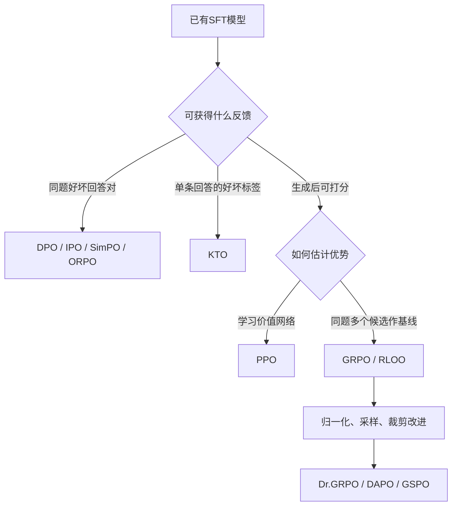

# DPO、PPO、GRPO与其它优化方法：原理、选型与实操

核验：2026-11-16。面向已了解SFT的初学者；先读[前置学习](SFT与RL的场景选择和实操.md)。论文版本、实现接口和实验边界见[证据记录](../docs/po论文与实验记录.md)。

## 1. 先把名字分清

**PPO、GRPO中的PO是Policy Optimization（策略优化）；DPO中的PO是Preference Optimization（偏好优化）。**“O”是Optimization，不是一种单独技术；这些方法也不构成必须逐个升级的版本链。

大模型的“策略”就是：给定输入和已有输出，下一token怎么选。SFT用标准答案教它模仿；偏好优化教它更倾向被选中的回答；在线RL让它生成回答、取得反馈，再调整策略。

贯穿示例：输入`2+3=`，好回答`5`，坏回答`6`。

- DPO：事先准备好`5优于6`，训练时比较这两个固定回答的概率。
- PPO：模型现场回答，规则/奖励模型打分；另一个价值网络预测“这个状态通常能得多少分”，据此更新。
- GRPO：同一道题现场生成多个回答，用它们之间的分数差替代价值网络。

**在线是指训练期间由策略持续采样新数据，不要求面向真实用户或生产流量。**数据可以来自离线题库。离线DPO也可以通过周期性重新采样构成迭代流程，但一次固定数据集DPO不因此变成在线策略梯度算法。



## 2. 选型总表

下表描述典型论文/本例配置；“不需要奖励模型”不等于“不需要反馈”。参考策略是限制偏离的冻结模型，critic是预测回报的可训练模型，两者不同。

| 方法 | 主要训练数据 | 冻结参考策略 | 可训练critic | 核心区别 | 优先考虑的场景 |
| --- | --- | --- | --- | --- | --- |
| DPO | 同prompt的chosen/rejected | 通常需要 | 无 | 参考修正的偏好logistic损失 | 有优质成对偏好，先做离线对齐基线 |
| PPO | prompt、在线采样及标量奖励 | RLHF通常用；PPO本身不要求 | 通常有 | actor–critic、GAE、概率比裁剪 | 有可靠奖励，需学习状态价值或处理多步反馈 |
| GRPO | 每题G个在线候选及奖励 | 可选，取决于KL项 | 无 | 同组奖励中心化/标准化 | 数学、代码等有可验证结果的任务 |
| IPO | 成对偏好 | 通常需要 | 无 | 平方误差，有限目标偏好间隔 | 研究DPO过度拉大间隔与噪声敏感性 |
| SimPO | 成对偏好 | 无 | 无 | 长度平均log概率、显式间隔 | 希望省参考模型，能认真验证长度/漂移影响 |
| ORPO | 成对偏好，chosen兼作示范 | 无 | 无 | chosen NLL与odds-ratio偏好项联合 | 希望在一个目标中结合模仿和偏好 |
| KTO | 单条回答+好/坏标签 | 通常需要 | 无 | 收益/损失相对KL基准的非对称效用 | 有点赞/点踩，难构造成对比较 |
| RLOO | 每题多个在线候选及奖励 | 可选 | 无 | leave-one-out奖励基线 | 想研究更直接的无critic策略梯度基线 |
| DAPO | 在线候选、奖励、动态重采样 | 原论文配方不依赖KL | 无 | 裁剪、动态采样、token损失、超长奖励四项 | 长推理训练，已具备较成熟的采样工程 |
| Dr.GRPO | 在线组候选及奖励 | 可选 | 无 | 移除组标准差缩放，固定长度归一化 | 排查长度与题目难度相关的权重偏置 |
| GSPO | 在线组候选及奖励 | 可选 | 无 | 序列级长度归一化重要性比与裁剪 | 长序列/MoE等，希望验证序列更新稳定性 |

这些是适配方向，不是性能保证。线上采样开销常常超过一次loss计算；无critic也可能因为候选数G、长输出和参考模型而很贵。离线方法省去持续rollout，但偏好数据制作、两种回答前向和参考log概率仍有成本；可以预计算固定参考log概率。

## 3. 公共符号：到底优化什么

- `x`：输入；`y=(y₁,…,yT)`：完整回答；`πθ(y|x)`：当前模型生成该回答的条件概率。
- `log πθ(y|x)=Σt log πθ(yt|x,y<t)`；默认只累计回答token，不把prompt或padding算进损失。
- `πref`：冻结参考模型，常取SFT；`πold`：生成当前训练批的旧策略。**参考模型不等于旧策略**。
- `r(x,y)`：奖励，可为程序规则、测试器、人工或训练出的奖励模型。奖励不是模型置信度，也不必是概率。
- `A`：优势，表示比基线好多少；`β`：依目标而定的缩放/正则参数；`σ(z)=1/(1+e⁻ᶻ)`。

公式展示最关键目标；工程还涉及采样温度、token mask、截断、batch归一化和KL估计。不能仅凭两段相似公式认定实现完全一致。

## 4. DPO：直接从偏好对训练策略

DPO全称Direct Preference Optimization。原论文从带KL正则的奖励最大化和Bradley–Terry偏好模型推导出：不必先显式训练奖励模型再做RL，可以直接训练策略。

令`yw`为被偏好的回答，`yl`为被拒绝回答，定义：

```text
hθ = [log πθ(yw|x) − log πref(yw|x)]
   − [log πθ(yl|x) − log πref(yl|x)]
L_DPO = − E log σ(β hθ)
```

直觉：好回答相对参考策略应变得更受偏好，坏回答则相反。它优化两者的相对关系，不保证每个样本的chosen绝对概率都上升。

手算：假设好/坏概率比，参考为2、当前为4，则`h=log(4/2)=log2`。教学取`β=1`，预测好回答被选的概率是`2/3`，loss约`0.4055`。当`h=0`时loss是`log2≈0.6931`。这里的`σ(βh)`来自偏好建模，**不是“这个回答事实正确的概率”**。

形式上，x是prompt，yw/yl是chosen/rejected，πθ是训练策略，πref是冻结参考，σ是sigmoid，β>0：

```text
h = [logπθ(yw|x) − logπref(yw|x)]
  − [logπθ(yl|x) − logπref(yl|x)]
L_DPO = −E logσ(βh)
```

这里回答log概率是completion各token条件log概率之和，不能把prompt或padding算进去。h表示“相对参考，策略更偏好winner多少”；h=0时单条损失为log2，βh=1时约0.313。反向传播提高winner相对概率、压低loser相对概率。平均损失下降仍不保证业务质量提高。

特点：流程接近SFT，不需要在线生成、独立critic或显式训练奖励模型，容易建立基线。局限是偏好覆盖不足、标签噪声、长度捷径和分布外能力；DPO不是能自动发现新正确答案的搜索器。β改变目标中的尺度与推导中的KL关系，不是学习率的另一个名字。

适用：客服语气、摘要偏好、拒答边界等有成对反馈的任务。评测应拆开任务质量、风格与拒答，而非只看训练集chosen胜率。

本例用算术真值构造25对标签，是教学替代，不能代表真实人类偏好采集。

## 5. PPO：有critic的在线策略优化

PPO全称Proximal Policy Optimization，是通用RL算法；用于大模型RLHF时通常与SFT、奖励模型、KL约束组合。

典型循环：

1. 用`πold`生成回答，保存旧log概率；奖励函数评分。
2. critic预测每个状态的价值`V(s)`，利用奖励、价值及GAE得到优势。
3. 同一批样本做有限轮策略更新，并训练critic拟合回报。
4. 用更新后的模型采集下一批，重复。

```text
δt = rt + γ V(st+1) − V(st)
At = Σl≥0 (γλ)^l δt+l       # GAE，终止/截断需要正确mask
ρt = πθ(at|st) / πold(at|st)
Jclip = E min[ρt At, clip(ρt,1−ε,1+ε) At]
```

最大化`Jclip`；实现通常最小化其负值，加价值损失和可选熵项。RLHF还常在奖励或目标里加入相对`πref`的KL惩罚，不能忽略具体放置方式。

手算：`A=2, ρ=1.5, ε=0.2`，两项为3与2.4，取2.4，抑制继续提高这条有利动作的收益。若`A=-2`，则取`min(-3,-2.4)=-3`；裁剪按优势符号起作用。**它不保证所有token概率变化都不超过20%，也不是严格信赖域保证。**

critic直觉：一道题通常就能拿0.9分时，拿1分提升有限；本来只能拿0.1分时，拿1分更值得强化。critic是在学这个“通常水平”，不是在判断回答好坏。

特点：可利用状态级价值估计，适用于多步或稠密反馈，也能使用回答末尾的单一奖励。但模块多，价值估计、奖励尺度、KL、采样和更新次数需协同调参。价值估计偏差会影响优势。

本例是真实TRL PPO：规则奖励取代学习型RM，policy、reference、critic均存在；policy和critic都实际更新。它没有训练人类偏好RM，因此不是完整工业RLHF复现。多步Agent环境还需额外处理工具执行、终止状态和轨迹，当前算术demo不覆盖。

## 6. GRPO：同题多个回答互相作基线

GRPO全称Group Relative Policy Optimization，由DeepSeekMath提出。对每个x采样G个回答，得奖励`r₁…rG`：

```text
Ai = (ri − mean(r)) / (std(r) + εnum)
ρi,t = πθ(yi,t | x,yi,<t) / πold(yi,t | x,yi,<t)
J ≈ mean_i mean_t min[ρi,t Ai, clip(ρi,t,1−ε,1+ε) Ai]
    − β × KL项
```

论文和实现对标准差估计、KL估计和归一化可能不同，应固定版本。`εnum`是防除零数值项，不是PPO裁剪幅度ε。

例：奖励`[1,0,0,0]`，均值0.25；若用总体标准差约0.433，优势约`[1.732,-0.577,-0.577,-0.577]`；用样本标准差0.5则约`[1.5,-0.5,-0.5,-0.5]`，加数值ε后略变。不要把不同约定混写成本次精确输出。

如果奖励全0或全1，中心化后全0，组内没有策略梯度区分信号。加ε不能解决“没有信息”；有KL等其它项时仍可能发生更新。应统计无差异组比例，并区分题目太难、太易、采样重复与奖励失效。

特点：不用训练critic，尤其适合可验证数学、代码、格式/约束任务；需要同题多样采样，G增大会增加生成成本。组标准差与长度归一化会引入不同权重，奖励漏洞也可能被迅速放大。

没有正确的候选时，GRPO不会凭空知道正确答案；可先改善SFT、课程难度或奖励反馈。SQL执行不报错不等于SQL符合业务问题，代码通过少量测试也不等于完全正确。

## 7. 还有哪些PO：按它们解决的问题学习

### 7.1 IPO：避免把偏好间隔无限推大

IPO是Identity-PO，原论文是偏好学习的理论框架。用前述参考修正log-ratio差`h`说明其核心：

```text
L_IPO = E (h − 1/(2β))²
```

DPO的logistic损失在间隔继续增大时继续下降；IPO用有限目标间隔控制这个趋势。教学取β=0.5，目标h=1，h=0与h=2的平方损失都为1。它不是“对所有噪声都鲁棒”的保证。

用DPO一节定义的参考修正间隔h，可写为`L_IPO=E[(h−1/(2β))²]`。目标间隔有限：β=0.1时目标为5，h=5的单条平方损失为0；超过这个目标还会受罚。这与DPO持续奖励更大间隔的形状不同。此为抽象目标，h采用何种长度归一化必须核对具体实现。

本例TRL `loss_type=["ipo"]`，其实现对回答log概率做长度平均；读论文的抽象动作概率和实际语言模型归一化时要区分。需要成对偏好和参考模型，适合与DPO做控制变量实验。

### 7.2 SimPO：不用参考模型的长度平均偏好目标

SimPO全称Simple Preference Optimization：

```text
sθ(y|x) = log πθ(y|x) / |y|
L = − log σ[β(sθ(yw|x) − sθ(yl|x)) − γ]
```

`γ`是显式目标间隔。平均log概率减少直接使用总log概率时的长度效应，但不意味着从此没有长度偏置。没有参考前向可节省资源，也减少了相对SFT策略的显式约束，需看任务退化和输出分布漂移。

本例通过TRL实验性CPOTrainer执行SimPO，**`cpo_alpha=0`**关闭额外NLL项；保留默认NLL会变成另一种联合目标。γ在本例设1、β设2，仅是微型演示参数。

### 7.3 ORPO：模仿chosen，同时惩罚不偏好的回答

ORPO全称Odds Ratio Preference Optimization。定义平均token log概率`ℓ(y)`，`p̄(y)=exp(ℓ(y))`：

```text
odds(y) = p̄(y) / (1 − p̄(y))
L = L_NLL(chosen) − λ log σ[log odds(chosen) − log odds(rejected)]
```

odds是几率，和概率不同：p=0.8的odds为4，p=0.5的odds为1，二者比为4；logistic后的偏好分数为0.8。`p̄`是长度归一化的生成概率分数，不是业务正确率。

优点是无参考模型、把SFT与偏好项合起来；局限是联合权重、长度和训练数据仍影响结果。接近p=1时分母很小，实现须用稳定log计算，不直接相减后取log。本例采用库实现，`ORPOConfig.beta`承担偏好权重。

ORPO本身常用于单阶段偏好训练；本例为了控制起点仍从同一SFT分支，这不代表ORPO必须先单独SFT。

### 7.4 KTO：只有单条好坏标签也能训练

KTO是Kahneman–Tversky Optimization，借鉴前景理论，区分“收益”和“损失”。令`rθ=logπθ(y|x)−logπref(y|x)`，`z`为停止梯度的KL基准估计：

```text
好样本：L = λD [1 − σ(β(rθ − z))]
坏样本：L = λU [1 − σ(β(z − rθ))]
```

rθ=z时，两类未加权损失都为0.5；提升rθ会降低好样本损失、增加坏样本损失。λD/λU用于效用与类别权衡。KL估计方法和裁零等细节见固定版本源码。

适合零散点赞/点踩或单条人工标签；不必同一道题同时拥有好坏回答。曝光偏差、选择偏差和标签含义仍需处理，不能把点赞自动当高质量真值。本例把25对标签拆成50条独立记录，只验证接口，不宣称真实标签无偏。

### 7.5 RLOO：别的回答作为奖励基线

RLOO是REINFORCE Leave-One-Out。G≥2时：

```text
bi = Σj≠i rj / (G−1)
Ai = ri − bi
策略梯度 ≈ mean_i Ai ∇θ logπθ(yi|x)
```

`[1,0]`的优势是`[1,-1]`。在同题独立采样条件下，别人的奖励可作不依赖自身动作的基线，减少方差；不是“把所有其它题的奖励平均”。它与GRPO都可无critic，但基线和标准化并不相同。

TRL版本还可包含裁剪、KL和多轮样本复用，所以不能把现代RLOOTrainer全等同于上面最原始一行REINFORCE。适合建立无critic在线基线，重点监控梯度方差、奖励分布与采样成本。

### 7.6 DAPO：一整套长推理RL配方

全称Decoupled Clip and Dynamic sAmpling Policy Optimization，四个重点是：

1. **Clip-Higher**：上下裁剪幅度不同，给低概率探索动作更多上升空间；不是简单全面放大更新。
2. **动态采样**：过滤组内奖励无区分的题并继续采样，补齐有效训练批；会改变参与训练的数据分布，并增加生成工作。
3. **token级损失**：按有效token总量归一化，区别于每条回答平均后再对样本平均。
4. **超长奖励塑形**：区分因截断而被判错与真正错误，缓解长度上限带来的奖励噪声。

本例`dapo-components`只实际运行**非对称裁剪+token归一化**，没有接入动态重采样和超长奖励塑形，因此**不算完整DAPO复现**。数学脚本另演示无差异组过滤，不能据此说已经完成动态训练管线。完整配方应追溯[论文](https://arxiv.org/abs/2503.14476)中的代码入口和分布式环境说明。

### 7.7 Dr.GRPO：修正归一化造成的权重偏置

论文《Understanding R1-Zero-Like Training: A Critical Perspective》提出Group Relative Policy Optimization Done Right：

- 只做奖励中心化`Ai=ri−mean(r)`，去掉组标准差除法，避免标准差造成题目权重变化。
- 去掉每条回答的实际长度分母，改用固定最大长度归一化，减少目标对回答长度的特定偏置。

令token贡献为`c_it`，忽略KL，可对比：

```text
GRPO：   (1/G) Σi [ (1/Ti) Σt c_it ]
DAPO：   Σi,t c_it / Σi Ti
Dr.GRPO：(1/(G×Lmax)) Σi,t c_it
```

当一条长度1、一条长度3且token贡献均1时，三者分别1、1、0.5（Lmax=4）。把token贡献换成不同值，前两者也会不同；这些公式是在说明权重，不是算法成绩。

本例**同时设`loss_type="dr_grpo"`和`scale_rewards="none"`**，只切loss不关标准差缩放不足以表达上述目标。它不自动解决所有长回答问题，长度、正确率与截断率应联合评估。

### 7.8 GSPO：把重要性比与裁剪放到序列级

GSPO全称Group Sequence Policy Optimization。GRPO常在每个token计算重要性比；GSPO对完整回答构造：

```text
si(θ) = exp{ (1/Ti) Σt [logπθ(yi,t|…) − logπold(yi,t|…)] }
J ≈ mean_i min[si Ai, clip(si,1−εlow,1+εhigh) Ai]
```

它是token概率比的几何平均。假设两个token比为2和0.5，序列比为1，算术平均为1.25；不能把GSPO写成token比的普通平均。原文讨论长序列和MoE训练的稳定性，具体优势限于论文实验，不能推成普遍最优。

TRL 0.28.0本例设`importance_sampling_level="sequence"`，**不是虚构`loss_type="gspo"`**。本例εlow=3e-4、εhigh=4e-4，序列级阈值不直接照搬PPO常见0.2。其余KL、组标准化、loss归一化也应一起记录。

### 7.9 从目标到业务落地

有静态优质偏好对，先做SFT→DPO基线；只有单条好坏标签，可评估KTO；有可靠执行/验证器，优先比较GRPO与RLOO；已有actor–critic体系或需要状态价值，可考虑PPO。存在具体的长度偏置或更新不稳定证据，再有针对性地试Dr.GRPO、GSPO与DAPO。

这些是起点，不是固定优劣顺序。算在线成本需同时计入候选数G、输出长度、采样吞吐、参考模型前向、critic训练和重采样丢弃率；无critic并不保证总成本更低。离线方法也有候选采集/标注成本。

真实代码任务可用隔离测试执行反馈，但通过公开测试可能只是钻空子；SQL能执行也不等于取数语义正确。多维奖励应区分正确性、格式、成本和安全约束，监控奖励上升而独立质量下降的reward hacking。数据质量与评估错误无法靠换一个PO缩写自动修复。

还有CISPO、SAPO等变体，本报告不试图穷尽缩写；学习时先问它改了数据、优势、重要性比、裁剪、归一化还是奖励，再看论文证据。

## 8. 如何选择：从反馈条件和工程预算开始

**已有高质量偏好对**：先建立SFT+DPO基线；再有针对性地比较IPO、SimPO、ORPO。不要因为省一个参考模型就忽略质量退化。

**只有单条好坏反馈**：考虑KTO，先审计反馈来源、正负比例及曝光偏差；不要随意把不同问题的两条回答拼成DPO偏好对。

**可以可靠自动评分**：GRPO或RLOO是自然候选；要求模型能采到有信息的候选。PPO也能用规则奖励，不专属于人类偏好。

**需要状态价值或复杂多步反馈**：考虑PPO及适当的轨迹设计；为价值模型和采样工程留预算。无critic方法也能扩展多步Agent，具体支持取决于训练系统，不能仅按算法名字断言。

**长输出训练出现不稳定**：先看奖励漏洞、长度上限、采样与训练策略不同步、无信号组比例，再分别验证Dr.GRPO、DAPO组件或GSPO；不要一次改十个超参数后把改善都归功于新名字。

共同验证：固定训练/验证/测试划分，覆盖业务失败类型，报告任务正确率、长度、截断率、有效组比例、KL/梯度异常、吞吐、显存和总成本。比较算法时还需尽量对齐token/采样预算；只对齐step不公平。参考模型的KL估计也不是质量评分。

## 9. 实操：十种方法真实训练，一个DAPO组件演示

### 9.1 环境与任务

完整安装见[运行指南](../docs/运行指南.md)。固定CPU环境：Python 3.12.14、Torch 2.5.1+cpu、TRL 0.28.0、Transformers 4.57.3、Datasets 4.4.1、Accelerate 1.11.0。安装后不需要外网、GPU、密钥或付费调用。

模型是**26,976参数、随机初始化的真实GPT-2架构**，不是预训练大模型。字符tokenizer；题目为0到5的两数加法；按无序操作数组合分组哈希，交换操作数的题不跨集合，得到25训练/5验证/6测试。种子17。程序精确校验答案；不把正确答案喂给在线生成的prompt。

先在本主题目录运行：

```bash
python scripts/check_verifier.py
python scripts/check_po_math.py
tmp/venv/bin/python scripts/sft_demo.py
```

SFT checkpoint存在`tmp/sft`。以下训练**分别加载这一份SFT**；不要串成DPO→PPO→GRPO。重跑同一路径会覆盖该实验的输出与记录，研究对照应另设`--output`并保存报告副本。

### 9.2 DPO demo：把成对偏好交给DPOTrainer

```bash
tmp/venv/bin/python scripts/offline_po_demo.py --method dpo --steps 40
```

数据形状：`{"prompt":"2+3=","chosen":"5","rejected":"6"}`。脚本显式用`DPOConfig(loss_type=["sigmoid"], beta=0.1)`、冻结SFT副本作ref，训练后保存模型并检查参数变化。Rejected用答案加1再模11，保证与chosen不同；这种错误类型很单一，不能用来验证通用偏好对齐。

### 9.3 PPO demo：在线采样、规则奖励、可训练critic

```bash
tmp/venv/bin/python scripts/ppo_demo.py --episodes 256
```

`trl.experimental.ppo.PPOTrainer`要求reward-model接口，本例用**程序规则适配器**接入；不是伪造训练出的奖励网络。输入正例`2+3=5`与反例`2+3=6`实际经过库的`get_reward`检查为1、0。critic用同规模Transformer加标量head，真正参与价值训练。

批8、256条rollout episode、32个采样批，每批4轮PPO；KL系数0.02。保存policy到`tmp/ppo`、critic到`tmp/ppo/critic`。一次episode不是一次反向传播，不能直接与DPO的40step比成本。

### 9.4 GRPO demo：同题4个候选、组内奖励

```bash
tmp/venv/bin/python scripts/online_po_demo.py --method grpo --steps 40
```

显式`num_generations=4`、`generation_batch_size=16`、`num_iterations=2`、`loss_type="grpo"`、`scale_rewards="group"`、`beta=0.02`。规则奖励见共享脚本。最多4个新token适用于微型答案任务，不适用于长思维链。

### 9.5 其它方法的完整运行命令

```bash
tmp/venv/bin/python scripts/offline_po_demo.py --method ipo
tmp/venv/bin/python scripts/offline_po_demo.py --method simpo
tmp/venv/bin/python scripts/offline_po_demo.py --method orpo
tmp/venv/bin/python scripts/offline_po_demo.py --method kto

tmp/venv/bin/python scripts/online_po_demo.py --method rloo
tmp/venv/bin/python scripts/online_po_demo.py --method dr_grpo
tmp/venv/bin/python scripts/online_po_demo.py --method gspo

# 仅DAPO部分组件，命令名称有意标明范围
tmp/venv/bin/python scripts/online_po_demo.py --method dapo-components
```

离线统一脚本：[offline_po_demo.py](../scripts/offline_po_demo.py)；在线统一脚本：[online_po_demo.py](../scripts/online_po_demo.py)；独立PPO：[ppo_demo.py](../scripts/ppo_demo.py)。所有新增训练脚本仅支持本地tiny checkpoint；没有把未测的大模型路径伪装成已验证。

### 9.6 本次结果与证据边界

**十种方法以及DAPO组件演示全部实际执行成功，所有策略均有29个state_dict张量发生变化；PPO另有29个critic张量变化。**state_dict含共享权重引用，29不是独立参数组数，更不是参数总量。训练后留出集均为**0/6**，SFT起点也是0/6。

| 实验 | 本次预算 | 参数更新检查 | 留出题正确数 |
| --- | --- | --- | --- |
| DPO、IPO、SimPO、ORPO、KTO | 各40个训练step | 各通过 | 各0/6 |
| PPO | 256 episodes，批8，每批4轮 | policy与critic均通过 | 0/6 |
| GRPO、RLOO、Dr.GRPO、GSPO | 各40个训练step | 各通过 | 各0/6 |
| DAPO组件 | 40step，缺少动态采样/超长塑形 | 通过 | 0/6 |

详细生成文本、训练集探针、训练日志数值见[实验汇总](../intermediate/po实验汇总.json)指向的逐方法JSON。这个任务和模型都太小，测试只有6题，训练预算也未对齐；**验证的是模型调用、损失/奖励管线和权重更新，未证明任何方法提升质量，也不构成算法排名。**

下一步应使用有基本任务能力的预训练模型、更多独立测试、健全的奖励和预算对照，再研究效果。先看验证集选方案，最终测试用于一次评估，不按6道测试题反复调参。

## 10. 自测：能回答这些问题才算建立了框架

1. 为什么DPO不需要显式奖励模型，却仍然依赖反馈质量？
2. PPO的ref、old、critic各负责什么，谁冻结、谁更新？
3. GRPO一组全错时为何没相对信号，加ε为什么无效？
4. 同样是无critic，RLOO与GRPO的优势计算为什么不同？
5. 为什么`loss_type="dapo"`不代表复现完整DAPO？
6. 为什么Dr.GRPO还要关闭奖励标准差缩放？
7. 为什么GSPO的序列比不是token比的算术平均？
8. 为什么29个张量改变但0/6不变，仍只能说明训练流程成立？

答案分别对应第4、5、6、7及9节。优先掌握反馈→优势/偏好目标→更新→独立评估这条链，再扩展缩写。
