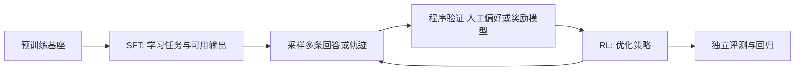

# SFT和RL怎样选，为什么通常先SFT再RL

核验日期：2026-11-16。这里的RL指大模型后训练中的策略优化，例如PPO、GRPO；不是Agent仅靠prompt规划，也不是用户点了赞就自动更新线上模型。原始依据及版本见[来源记录](../docs/来源与验证.md)。

## 1. 先建立直觉

**SFT看示范，学习“面对这种输入应该怎样回答”；RL先自己生成，再根据结果评价调整“哪些行为应更常出现”。**

两者通常都从预训练模型开始，都可能更新同一批模型参数。主要区别是监督信号与优化过程，不是模型种类不同。

| 维度 | SFT：监督微调 | RL：本篇用在线GRPO演示 |
| --- | --- | --- |
| 输入 | 问题/上下文与示范回答 | 问题，及供奖励系统使用的判定依据 |
| 模型怎样学习 | 提高示范回答中目标token的概率 | 采样回答，对比奖励，提高相对更优行为的概率 |
| 反馈粒度 | 常见为逐token交叉熵 | 常见为整个回答/轨迹的标量奖励，再影响token概率 |
| 是否需要示范完整答案 | 通常需要 | 不一定需要完整示范；仍必须有可用反馈 |
| 典型目标 | 行业任务、指令遵循、输出格式、工具调用范式、语气与多轮行为 | 可验证正确率、偏好、任务完成、长程工具策略及质量成本取舍 |
| 常见数据问题 | 错标签、模板/角色错、长尾不足、泄漏与近重复 | 奖励错误/稀疏、可钻漏洞、偏好偏差、环境不稳定 |
| 常见计算代价 | 对固定示范做teacher forcing，通常较易批处理 | 额外生成多条候选、评分并更新，常更耗推理计算 |

SFT也能通过优质解题过程教授推理；RL也能优化写作和指令遵循。不能简化为“SFT只能学格式，RL才会推理”。总成本还包含标注与验证，不能保证SFT在所有项目中更便宜。

## 2. 分别适合哪些场景

### SFT优先的情况

1. **有可靠示范，希望稳定学会行为。**例如客服回复规范、法律文书结构、分类标签和工具调用模式。先检查是否用提示或约束输出就足够，再考虑训练。
2. **模型缺少完成任务的基本能力。**例如连合法SQL/工具参数都生成不了，先用正确示范建立起点，避免RL长期采不到有效行为。
3. **专家经验能写出来，但暂时难以自动评分。**例如特定机构的表达规范；可以先SFT，再逐步建立偏好与效果评估。
4. **需要补充任务覆盖。**长尾场景、必要的安全拒答与多轮工具交互，可以用审定样本有针对性地教授。

### RL优先评估的情况

1. **结果容易验证，完整最优过程难写。**代码有隔离单测、数学有可靠判定、环境任务有明确成功条件，可让模型探索多种方案。
2. **模型已经能做，想提高成功概率或优化取舍。**例如相同质量下减少工具调用、在计算预算内提高任务完成率；必须防止单纯学会“少做事”。
3. **同一问题存在多种合理答案。**可用人工比较或经过校准的奖励模型优化偏好，但奖励模型本身也会错。
4. **需要根据多步交互结果学习策略。**例如先查询什么、何时重试、何时停止；需要可恢复环境、动作权限和轨迹级评测，不只是把最终文本打分。

### 两者都不是首选的情况

- 价格、库存、法规等事实频繁变化：优先数据库、RAG、版本和权限治理。
- 只要求严格JSON：先考虑schema约束、约束解码和校验，不必立即训练。
- 数据解析、口径或权限错误：先修数据与访问契约，不能指望RL学会绕开系统缺陷。
- 无可靠示范也无可靠奖励：先建设数据与评测，不把更复杂优化当作信息来源。

## 3. 为什么常见顺序是SFT→RL



### 原因一：给探索一个好起点

假设模型生成一个合格工具调用的概率只有0.1%，采样4条，至少出现一次合格调用的概率约为 `1-(1-0.001)^4≈0.3994%`。大部分采样组拿不到正反馈，训练预算会耗在无效尝试上。

若SFT将合格率提高到50%，同样4条至少有一条合格的概率为93.75%。这是独立采样的教学算术，不是实测提升；表达的是起始策略影响反馈密度。真实候选可能相关，概率也不固定。

### 原因二：SFT信号通常更密

给一段正确示范，SFT可以在多个目标token上得到明确监督。RL的奖励往往到回答或轨迹结束才出现，哪个决策导致成功需要策略优化估计。先学基础形式和任务结构，可减少奖励要同时纠正的错误类型。

### 原因三：减少奖励系统的负担

SFT可先建立角色、工具协议、基本语言和任务行为，RL再着重优化结果。但这不能保证不会出现奖励投机：如果奖励只看标签或长度，模型仍可能学会包装错误答案。

### 原因四：方便控制策略漂移

一些RL训练用SFT策略作固定参考，以KL项约束偏离；PPO还可能使用价值网络，GRPO则用组内比较构造优势，不需要同样的学习型critic。**KL是可选设计，不是所有RL默认都有；本demo显式设置beta=0.02。**

## 4. 不是必须先SFT，也不是只做一遍

InstructGPT是典型的SFT→奖励模型→PPO路线。DeepSeek-R1-Zero则直接从**已经预训练的强基座**开始RL，没有预先的SFT阶段；这不是从随机权重直接训练出大模型。

DeepSeek-R1又引入冷启动示范，并结合后续RL、拒绝采样/SFT和再次RL改善能力与可读性。它说明训练可以交替，不是固定“先一次SFT，再一次RL”模板。

已有合适的Instruct模型时，可以直接从它做RL；这个起点可能早已包含供应方做过的SFT或其它后训练，并非整个生命周期完全没SFT。

**DPO也要区分：**它通常利用固定chosen/rejected对做离线偏好优化，不等同于本篇在线采样的PPO/GRPO。它与KL约束RLHF目标有理论联系，但不能把任意“偏好微调”都描述成执行了在线RL。

## 5. 用同一个任务做两个真实训练demo

任务：输入 `2+3=`，只输出整数 `5` 并停止。选择算术是为了有容易审计的奖励，不需要外部judge。

这不是生产选型推荐：既然程序能直接算答案，真实应用可能直接调用计算器，或者只需SFT。这里用于清楚对比“示范监督”和“结果反馈”。

提供两种运行规模：

- **默认CPU微型版：**本地随机初始化GPT-2架构，26,976个参数，自建字符tokenizer，使用真实SFTTrainer/GRPOTrainer完成训练。不下载预训练权重，用于训练链路验证。
- **可选Qwen版：**同一脚本切换到固定修订的`Qwen/Qwen2.5-0.5B`，这才是从真实预训练模型继续后训练。模型元数据已核验，权重未下载、训练未执行；GPU与内存需自行按配置评估。

### Demo A：SFT

数据是完整示范：

```json
{"prompt": "2+3=", "completion": "5"}
```

核心流程：固定分组划分→加载初始模型/tokenizer→构造prompt-completion→只对completion及结束符计算loss→训练→保存checkpoint→留出题评测。

对应目标可理解为 `L_SFT=-Σ log πθ(y_t|x,y_<t)`，实际如何平均由实现决定。x是prompt，y是示范回答，θ是参数。若示范目标概率从0.2提高到0.8，对应单token负对数似然从约1.609降到0.223。这不是整个回答正确率。

本例使用`completion_only_loss=True`，并检查真实collator生成的prompt label确为-100；不是仅凭参数名声称已mask。使用普通字符串，因此无需聊天模板；换成messages必须使用与模型匹配的模板。

运行：

```bash
tmp/venv/bin/python scripts/sft_demo.py
```

完整代码：[sft_demo.py](../scripts/sft_demo.py)。输出模型在`tmp/sft`，指标在该目录的`sft_metrics.json`。

### Demo B：在线RL，使用GRPO

训练题保留prompt和供奖励函数使用的答案：

```json
{"prompt": "2+3=", "answer": "5"}
```

`answer`作为元数据送给奖励函数，**不拼进模型prompt，也不当作teacher-forcing的completion labels**。RL不要求完整示范过程，但并非不需要正确性依据。

核心流程：加载SFT checkpoint→同一问题采样G=4条→程序分别评分→计算组内优势→策略更新与KL约束→重复→独立留出评测。

例如候选为`5`、`6`、`The answer is 5`、空串，本例奖励分别为1、0、0、0。奖励要求只有一个规范整数；完整自然语言回答在别的任务可能是好的，这里判0只是明确任务契约。

GRPO的组内优势可理解为 `A_i=(r_i-mean(r))/(std(r)+ε)`，r_i为第i条回答的奖励。当前TRL版本按样本标准差处理；对[0,1,0,1]，均值0.5、样本标准差约0.577，优势约[-0.866,+0.866,-0.866,+0.866]（忽略很小的ε）。这只是在本组中相对更优，不是正确概率。

当全组奖励都为0或都为1时，相对奖励项没有区分信号；加入ε可避免数值异常，但不能创造学习信息。KL等其它目标仍可能贡献梯度，不能据此说总loss一定为0。

本例显式设置：

```python
num_generations = 4
per_device_train_batch_size = 4
gradient_accumulation_steps = 4
generation_batch_size = 16
beta = 0.02
loss_type = "grpo"
```

单进程下生成批16可被G=4整除。固定TRL 0.28.0的默认loss_type是dapo，本例显式选grpo用于说明原始思路；生产还需评估长度偏差及其它变体，不能把类名相同当成目标完全相同。

运行：

```bash
tmp/venv/bin/python scripts/rl_demo.py
```

完整代码：[rl_demo.py](../scripts/rl_demo.py)，奖励与模型代码见[common.py](../scripts/common.py)。输出在`tmp/grpo`。

## 6. 怎样解释这次实际运行结果

固定seed=17，全部36个有序输入按交换律分组再划分：训练25、验证5、测试6；例如`2+3`与`3+2`不会跨训练/测试。SFT 120步，GRPO 80步；未按测试结果调参或挑选最佳checkpoint。

| 检查 | 观察 |
| --- | --- |
| 真实SFT训练 | 已完成，prompt loss mask断言通过 |
| 真实在线GRPO | 已完成采样、奖励计算和参数更新 |
| 测试贪心准确率 | 初始0/6，SFT后0/6，GRPO后0/6 |
| 训练题贪心probe | SFT后6/25，GRPO后6/25 |
| 训练采样组奖励零方差比例 | 各日志区间约63.75%–66.25% |

这验证了链路，**没有证明本次RL改善泛化**。随机微型模型、极少样本、固定短预算、很小测试集，不足以支持大模型能力结论；训练probe与测试不能混用。

详细结果见[微型训练记录](../intermediate/微型训练结果.json)。不要只看到loss下降或非零reward就宣布业务正确率提高；不同训练目标的loss数值也不能直接横比。

## 7. 真正使用时怎样判断下一步

先看模型是否能生成合法输出、是否有非零且有区分的奖励，再检查奖励是否与业务目标一致。长期全错时考虑更合适的基座、补示范、任务课程或奖励诊断；全对则可能已饱和，不需要继续在同一任务上消耗RL预算。

用验证集选择配置，测试集保留最终验收。比较同一题集上的成功率、格式、成本、长度、通用能力和风险；RL阶段持续监控reward、组内方差、KL、entropy、截断和奖励投机。不要只盯一个平均reward。

对于复杂代码、SQL和工具任务，验证器应运行在受控环境，校验实际结果而不只是能执行；对偏好任务应校准奖励模型与人工评价。RL优化的是你给出的目标，不会自动发现目标定义里的漏洞。

框架选择和训练/推理的分工见[SFT/RL训练框架与批量推理选型](训练与批量推理框架选型.md)：同一上层框架可以支持两类训练，RL的rollout也可以复用独立推理引擎。
