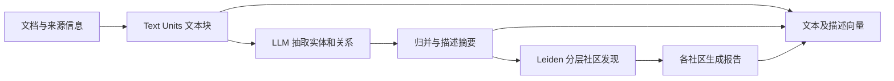
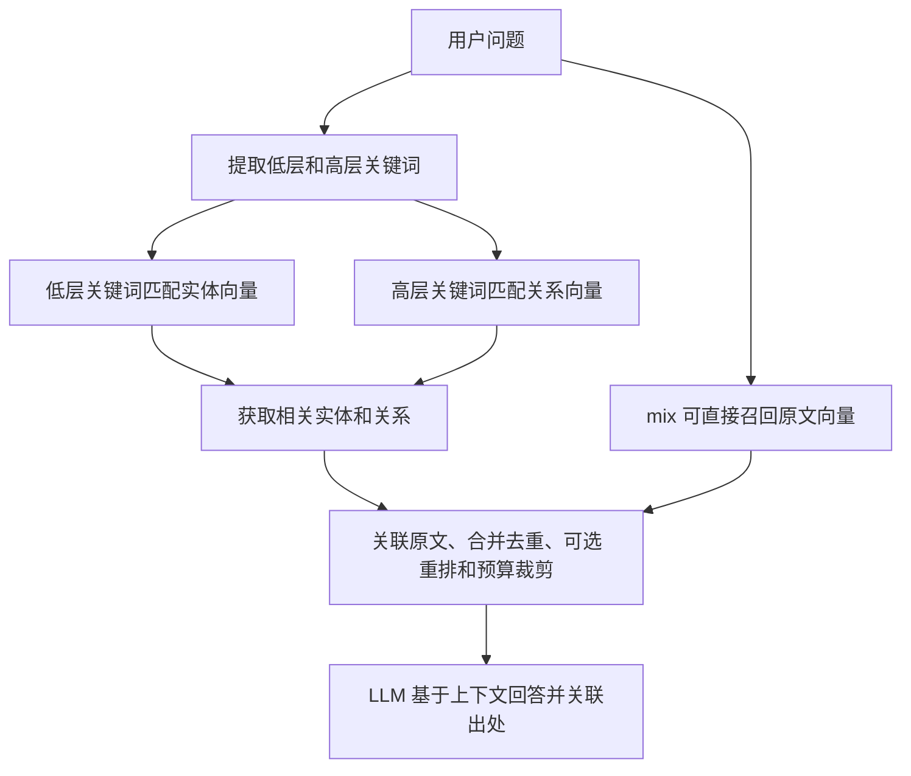

# GraphRAG、LightRAG、HippoRAG 2：从入门到工程选型

核验日期：2026-11-09。本文依据原始论文、作者仓库及固定提交的源码；来源编号见[证据文档](../docs/论文与源码证据.md)。机制分析不等于本地模型效果实测。

## 1. 先建立整体认识

这三个项目都通过外部知识帮助大模型回答问题，通常不需要训练大模型权重。核心区别在于：**怎样把文档组织成可检索的记忆，以及查询时怎样找到证据。**

| 项目 | 入门直觉 | 核心检索路线 | 优先验证的业务问题 |
| --- | --- | --- | --- |
| Microsoft GraphRAG | 先把资料整理成分层专题报告，再按问题组织回答 | 社区报告全局汇总；另有实体局部检索、DRIFT 等 | 大量访谈、研究、事件记录中的主题、共性和跨资料综述 |
| HKUDS LightRAG | 同时建立人物/事物索引和关系/主题索引 | 低层关键词找实体，高层关键词找关系；现代 mix 再融合文本向量召回 | 既问具体对象又问关联主题、持续补充的知识库 |
| OSU HippoRAG 2 | 把概念和原文接成记忆网络，让相关性沿连接传播 | 问题匹配三元组、LLM 筛选、短语与段落联合播种、PPR 排段落 | 证据分散、多跳连接、持续扩展的关联记忆 |

这是适配方向，不是效果排名。三者都有抽取错误、信息丢失和检索遗漏；增加图也可能不如调好的向量/BM25 混合检索。[G1][L1][H1]

### 1.1 普通 RAG 的工作方式

RAG（Retrieval-Augmented Generation，检索增强生成）的基本流程是：

```text
离线：原始文件 → 解析和清洗 → 文本块 → Embedding 向量 → 索引
在线：问题 → 问题向量 → 找相似文本块 → 作为上下文交给 LLM → 答案
```

Embedding 是把文字编码成向量，用于比较语义相近程度。向量相似度是排序信号，不是“该事实正确的概率”。BM25 是基于词项统计的检索方法，对编号、精确术语等常有帮助。

假设三篇资料分别说：“北辰项目负责人为林悦”“林悦在澄海科技任职”“澄海科技总部在杭州”。问题是“北辰项目负责人的公司总部在哪”。只找与问题最相似的段落，可能找到第一篇，却漏掉后两篇。

再问“这些项目共同有哪些风险”，问题没有特定实体，少量相似段落又可能无法覆盖全库。前者是关联证据问题，后者是全局覆盖问题。三种组件从不同角度改善它们。

### 1.2 需要掌握的图概念

| 概念 | 示例 | 不能自动保证的事 |
| --- | --- | --- |
| 节点 node | 林悦、澄海科技；也可以是一整段文本 | 名字相同就是同一个人 |
| 边 edge | 林悦—任职于→澄海科技 | 关系真实、当前仍有效 |
| 三元组 triple | （澄海科技，总部位于，杭州） | 抽取保留了否定、时间和条件 |
| 社区 community | 一组连接较密的项目、机构、风险节点 | 社区等同业务部门或人工分类 |
| 出处 provenance | 关系来自文档 d2 的某个文本块 | 有出处就意味着出处支持该结论 |
| PPR | 从问题相关节点反复扩散并回到种子 | 分数是答案置信度或逻辑证明 |

知识图谱不一定要 Neo4j。图可以保存在表格、文件或内存图结构中；图数据库是存储选择，图检索算法才决定怎样组织上下文。

## 2. Microsoft GraphRAG：先做分层概括

### 2.1 离线建库流程



Standard 路线中，同名同类型实体的多份描述、同端点关系的多份描述会归并，再由 LLM 总结。图划分为不同粒度社区，每个社区预先生成报告。输出包含 documents、text units、entities、relationships、communities、community reports 等表，常以 Parquet 保存，并保存查询需要的向量。[G2]

可选的 claim extraction 生成带状态与时间边界的声明信息，当前默认关闭，需要领域调优。不能把“支持时间字段”理解为已自动解决时间推理与事实冲突。

**主要离线代价**是实体关系抽取、描述归纳、社区报告生成和向量化。社区报告把重复的概括工作提前做了，但也会压缩掉细节。抽取污染会继续影响社区和报告。

### 2.2 四种查询模式分别做什么

| 模式 | 查询过程 | 适合的问题 | 主要代价或局限 |
| --- | --- | --- | --- |
| Global | 选定层级的社区报告组织为批次；map 生成问题相关要点，reduce 汇总 | “全库的共同挑战、趋势、主题是什么” | 通常多次 LLM 调用；摘要可能漏细节；不是 SQL 聚合 |
| Local | 问题向量匹配实体描述；收集相关实体、关系、原文、报告等并裁剪 | “某公司与哪些项目合作，依据是什么” | 实体召回、预算分配和原文质量决定效果 |
| DRIFT | 社区报告提供初始答案及追问；多轮局部检索补充并汇总 | 需要先理解大局，再深入多个相关问题 | 追问扩展带来更多调用与延迟，需限制预算 |
| Basic | 文本块向量检索后回答 | 简单事实；建立普通 RAG 基线 | 不利用图的全局组织能力 |

Global 不等于“把整张图交给模型遍历”；Local 也不等于“每次做严格最短路径推理”。当前 Global 有动态社区选择等配置，实际调用量取决于选择与上下文预算。[G3]

**同一示例怎么走：**全局风险综述先看风险相关社区报告；北辰负责人问题可用 Local 收集人物、组织、总部关系和原文。若需要跨多个方向探索，可测试 DRIFT。无论哪条路线，最终仍需检查引用原文是否支持答案。

### 2.3 FastGraphRAG 与 Standard

Fast 用 NLP 提取名词短语，以文本块内共现构造边，省去部分 LLM 抽取和描述归纳，再生成社区报告。因此“fast”不是完全不调用 LLM，也不是效果保持不变。

共现只说明一起出现，不能当成“任职于”或“因果关系”。当前默认 NLP 路线主要适合英语；中文语料应先核验分词、短语提取和社区质量，不能直接沿用英语结果。[G4]

### 2.4 特点与边界

最值得学习的是**先整理全库的语义结构，再回答全局问题**。适合资料稳定、报告类问题多、愿意承担前置加工成本的知识系统。一次建库服务多次查询时，成本应按生命周期摊销。

当前代码有 `update` 路线；“GraphRAG 一律不能增量更新”是过时的绝对说法。但增量更新不代表局部修改永远便宜：实体归并、社区及派生摘要的更新范围仍需验证。本文未发现足以据此承诺通用文档级删除 SLA 的证据，涉及撤回与隐私删除时要专门设计和测试。

Global 的自然语言总结不能替代财务报表中的精确计数。诸如“有效订单金额总和”应优先查询结构化数据库，再由模型解释结果。

## 3. LightRAG：实体与关系的双层检索

### 3.1 离线建库流程

```text
解析、切块
  → LLM 抽取实体、关系、描述和关键词
  → 归并重复项，必要时摘要
  → 图存储：实体与关系
  → 向量存储：实体描述、关系描述、原文块
  → KV：文档、文本块、缓存等；状态存储：处理进度
```

双层中的“层”是**检索语义层次**：具体实体与抽象关系/主题，不是 Microsoft GraphRAG 的分层社区报告。[L1][L2]

当用户问“北辰项目负责人所在公司总部在哪”，低层关键词可能包含“北辰项目、负责人、公司”，高层关键词可能是“项目治理、组织归属”。这些是教学解释，不是本次模型的实际抽取结果。

### 3.2 在线检索流程



源码的 global 分支调用 `_get_edge_data()` 搜索关系向量，local 调用 `_get_node_data()` 搜索实体向量。它们并不执行 Microsoft 的社区报告 map-reduce。仓库个别概述把 global 写成 community/summary，本文以论文和实际分支代码为准。[L3]

### 3.3 六种模式怎么选

| `QueryParam.mode` | 召回入口 | 初学者使用方式 |
| --- | --- | --- |
| `local` | 低层关键词→实体→相关图信息与原文 | 观察人物、产品、项目等具体对象 |
| `global` | 高层关键词→关系→相关实体与原文 | 观察关系和主题；不等同全库穷举 |
| `hybrid` | local 与 global 合并 | 论文双层思路的直观入口 |
| `mix` | local/global 加直接文本块向量召回 | 当前源码默认；适合先建立综合基线 |
| `naive` | 原文向量检索 | 与图路线作消融对比 |
| `bypass` | 跳过知识库检索，直接生成 | 调试模型通路；不能作为知识库回答 |

`top_k` 在不同图分支中对应实体或关系数量；`chunk_top_k` 是文本候选数。它们与 GraphRAG 的社区层级不是同一个参数。`max_total_tokens` 等预算影响最终上下文，检索出的候选不一定全部送入模型。[L2]

`only_need_context=True` 可先观察检索上下文，避免一开始只看润色后的最终答案；它仍可能触发关键词提取等模型调用。没有配置重排器时，不应把“打开重排开关”当作已经获得重排收益。

### 3.4 工程能力与特点

LightRAG 当前仓库提供 Python API、HTTP 服务、WebUI、图查看以及多种后端绑定，入门操作面比较丰富。这是当前工程版本能力，不应全部归因于 2024 年的论文。

四类存储分工明确，可分别配置，例如图存 Neo4j、向量存数据库、状态和 KV 存 PostgreSQL。接入数据库不等于天然具备横向扩展能力：并发写入、重试和跨存储一致性需要联合验证。

当前源码明确：图、向量、KV、状态之间**没有跨存储全局事务**；文件后端仅支持小规模测试与验证。适合教学的默认文件方案不能直接用作多进程高并发生产部署。[L4]

增量插入、文档删除和图编辑接口是工程便利，但“支持删除”不代表删除缓存、摘要、共享实体与原文的所有残留都已满足业务要求。必须实测删除后的检索、进程重启和失败恢复。

当前 `conversation_history` 传给生成上下文，源码注释明确它不直接参与检索。追问“他现在在哪家公司”时，应在上层先改写成独立问题，不能把存了聊天记录当成完成了指代检索。

## 4. HippoRAG 2：概念与原文联合扩散

### 4.1 “记忆”指什么

HippoRAG 系列受到人类记忆机制启发，但运行时仍是模型、向量索引与图算法。所谓非参数持续学习，是不断向外部记忆增加知识；不是自动训练 LLM，也不保证永不遗忘、知识永远正确。[H1]

HippoRAG 2 仍在 `OSU-NLP-Group/HippoRAG` 仓库，不要用另一个同名项目替代。仓库旧 release `v1.0.0` 也不能当作第二代算法的当前版本。

### 4.2 离线建库流程

```text
段落 → LLM OpenIE 开放信息抽取 → （主语短语，关系，宾语短语）
     → 短语节点 + 关系边
     → 相似短语的 synonymy 边
     → 每段原文一个 passage 节点，与其中短语建立 contains 连接
     → 保存 passage、phrase、fact 向量及来源关系
```

OpenIE 不要求提前固定所有关系类型，因此适合开放领域；代价是类型约束和数据治理更难。相似短语连接可以跨文档串联信息，也可能把“相似但不同”的对象错误连接，尤其在别名、简称和同名人上。

这里的 passage 节点很关键：只保存“林悦—任职—澄海科技”，容易丢掉“2025 年以前”“仅为顾问”等上下文；原文节点保留了更完整的语境，供检索和最终阅读使用。[H1][H2]

### 4.3 在线检索流程

1. 用完整问题的向量检索候选事实三元组（query-to-triple）。
2. LLM 对候选三元组做相关性筛选，称为 recognition memory。
3. 从筛选后的三元组取相关短语节点，赋予种子权重。
4. 同时计算问题与原文段落的相似度，为 passage 节点提供较低权重的重启信号。
5. 在联合图上运行 Personalized PageRank，按 passage 节点的最终分数排序。
6. 把排名靠前的原文交给问答 LLM；如果没有筛出事实，当前代码回退到 dense passage retrieval。

相比第一代偏重“问题先做 NER，再连接实体”的路线，第二代强调完整问题匹配事实、LLM 筛选，以及 passage 节点参与图搜索。这些机制共同作用，不能把升级简化为“换了一个更大的模型”。[H1][H3]

当前实现用无向投影传播相关性，即使原关系有语义方向，也不能把 PPR 路径直接当成有向关系推理。`公司→员工→项目` 能帮助找证据，不足以证明某条业务结论。[H3]

### 4.4 PPR 公式与直觉

令图有 n 个节点；W 是非负边权矩阵，P 是按行归一化的转移矩阵；r 是和为 1 的非负种子分布，d∈[0,1) 是继续沿边行走的概率。采用列向量表示分数：

\[
p_{t+1}=(1-d)r+dP^\top p_t
\]

没有出边的节点需要规定处理方式；本主题教学脚本把它的质量按 r 重新分配。因为每轮有概率 `1-d` 回到种子附近，最终分数更偏向与问题相关的邻域，而非只偏向全图最热门的节点。

**手算例子：**A 和 B 只有一条相互连接的边，r=(1,0)，d=0.5。平稳状态满足 pA=0.5+0.5pB、pB=0.5pA，因此 p=(2/3,1/3)。B 没有直接成为种子，也能通过 A 获得相关性。

这解释了为什么多跳证据可能被找出，也解释了噪声边为什么有害。d 越大通常扩散越远，但并非越大越好；需要在验证集上选。当前 HippoRAG 2 的默认 damping 为 0.5、passage_node_weight 为 0.05，这是实现默认，不是所有数据集的最佳值。[H4]

特别注意：**p 在全图上归一化，不代表“答案正确概率”。**只取 passage 子集后分数之和也未必为 1；不同问题、图规模、播种方式下分数不可直接用统一阈值解释为置信度。

### 4.5 特点与边界

HippoRAG 2 的价值在于关联证据检索和检索结果可分开评估，`retrieve()` 与 `rag_qa()` 分工清楚。它需要额外的事实向量、短语向量、图及来源维护，远不只是普通 RAG 多加一张表。

在线 recognition 调用仍有延迟和费用；不要因为 PPR 本身快，就认为在线完全不调用 LLM。图扩散也不是每跳一次 LLM 调用，两者应分别计量。

当前代码包含增量索引、删除、状态一致性检查和多种向量后端；但默认图搜索仍围绕本地图对象，使用外部向量库不等于图计算已经成为分布式服务。研究复现方便与大规模多租户运维成熟度是不同问题。

## 5. 能力、场景与成本横向比较

| 维度 | Microsoft GraphRAG | LightRAG | HippoRAG 2 |
| --- | --- | --- | --- |
| 图的主要组织 | 实体关系图、层级社区、社区报告 | 实体关系图，实体/关系/原文向量 | 短语、事实、原文联合记忆图 |
| 核心全局信息来源 | 社区报告的覆盖与聚合 | 高层关系召回；mix 融合原文 | 关联传播后的原文段落 |
| 主要模型工作 | 抽取、摘要、报告；查询生成/聚合 | 抽取、归并摘要、关键词与生成，可重排 | OpenIE、recognition 筛选、问答 |
| 向量化对象 | 文本、实体描述、社区报告等，依配置 | 实体、关系、原文 | 短语、事实、原文 |
| 全库主题综述 | 优先候选 | 可以测试，但并非遍历全部社区 | 需另外验证覆盖与汇总能力 |
| 具体实体关系问答 | Local/DRIFT 候选 | local/hybrid/mix 候选 | 关联段落检索候选 |
| 多跳原文证据 | 应测试 Local/DRIFT 与基线 | 通过图关联补足，必须检验桥接召回 | 设计重点，仍不保证完整证据链 |
| 增量能力 | 当前有 update；派生报告成本需评估 | 当前有插入/删除/编辑与状态管理 | 当前有增量 index/delete 与清单校验 |
| 存储与服务 | 表格输出、向量存储及 API/CLI | 四类可插拔存储，API 与 WebUI 丰富 | 默认本地持久化与 igraph，向量后端可选 |
| 中文 | 模型、抽取提示与别名治理影响大；fast 默认英语需特别处理 | 提示、模型及多语种向量需核验 | OpenIE、短语归一化、同义连接需核验 |
| 可解释性入口 | 实体/关系/报告及原文映射 | 召回实体关系、原文及处理状态 | 三元组 seeds、原文、PPR 排序分数 |
| 主要风险 | 摘要损失、社区变化、全局查询成本 | 关键词偏差、图与多存储一致性 | 错误连接扩散、种子选择、内存与维护成本 |

上表的“候选”表示值得纳入 POC，不代表业务已验证。三仓库快照许可均为 MIT；依赖、模型权重、语料许可仍应分别核实。

### 5.1 成本不能只看单次问答

\[
C_{total}=C_{parse}+C_{extract}+C_{embed}+C_{derive}+Q\cdot C_{query}+U\cdot C_{update}+C_{ops}
\]

Q 为查询次数，U 为更新批次；各项按实际计费单位换算。GraphRAG 的 derive 包含社区与报告，LightRAG 包含归并与相关派生，HippoRAG 2 包含连接构建和图准备。自部署还要计 CPU/GPU、内存、存储和运维。

公式是成本记账框架，不能把所有 API 输入输出 token 混成一种价格。无真实请求量、文档长度、提取模型和更新频率，就不能确定谁最便宜。

降低成本的优先顺序通常是：去重并减少无效文本→改善切块和抽取→复用兼容缓存→按任务选择查询模式→控制候选和生成预算→再调并发。并发主要影响耗时，不自动减少 token 费用。

### 5.2 常见业务怎么选

- **访谈、会议、调研的跨资料综述**：优先评估 GraphRAG Global；对结论做出处和覆盖审查。
- **企业知识库，同时需要图查看、API 和持续导入**：优先评估 LightRAG mix/hybrid，并设计数据库和恢复方案。
- **科研文献、人物组织网络、多跳关联记忆**：优先评估 HippoRAG 2，重点看全部支持证据的召回。
- **简单 FAQ、少量文档、严格低延迟**：先做 BM25/向量混合加重排；图的额外成本可能没有回报。
- **订单、财务、库存等精确指标**：优先结构化查询与统一语义层，RAG 负责解释与文档证据。
- **强权限隔离、高频撤回、严格时间推理**：先解决数据与访问契约，再测试三项目；不能靠换组件补齐治理。

## 6. 从教学样例走到可信系统

本主题[统一语料](../input/企业知识样例.json)故意放入历史负责人、新负责人、旧任职与现任职、别名、无答案问题和相似项目名。期望学习到的不是“图能连出答案”，而是区分：**相关候选、有效证据、可发布结论**。

“林悦曾任职澄海科技”与“林悦现在任职星河数据”可以同时正确。若图把时间消掉，即使路径连通，答案也可能错。三组件中的默认摘要/连接/排序都不能自动替代业务有效期规则。

权限也必须早于派生汇总：如果一个社区报告混入另一个租户的资料，只在最终答案隐藏文档 ID 不能消除泄漏。workspace、文件目录和 source_id 是隔离与追踪机制的一部分，不等于完整身份鉴权及行列权限。

在 Agent 中，可把“检索证据”和“回答问题”封装成独立 Tool，必要时通过 MCP 暴露。Skill 可指导什么时候用全局/局部检索、怎样核查引用；这些包装不会改变底层召回能力。检索得到的文本应当作为数据处理，不能执行其中的恶意指令。

推荐学习路径：先运行离线图扩散示例，再只观察真实组件的检索上下文，之后再生成答案；最后用[评估方案](../docs/选型与评估方案.md)比较正确率、证据、成本和更新可靠性。安装和运行步骤见[上手实操](../docs/上手实操.md)。

## 7. 自测问题

1. 为什么 LightRAG global 不等于 Microsoft GraphRAG Global？它检索的向量对象是什么？
2. 为什么 HippoRAG 2 同时需要 phrase 节点和 passage 节点？删掉后者可能损失什么？
3. 一个节点 PPR 分数为 0.2，能否解释成答案有 20% 概率正确？为什么？
4. 如何区分“索引增量加入成功”和“过期事实已无法影响答案”？
5. 全局总结很好但事实问答差，应该检查哪类评估口径和查询路由？
6. 为什么多租户权限不能只放在答案输出之后？

参考方向：实体/关系与社区报告不同；原文提供细节语境；图分数只表示检索相关性；更新要验证派生与缓存；按问题类型和证据分层评估；派生摘要本身可能携带受限信息。
