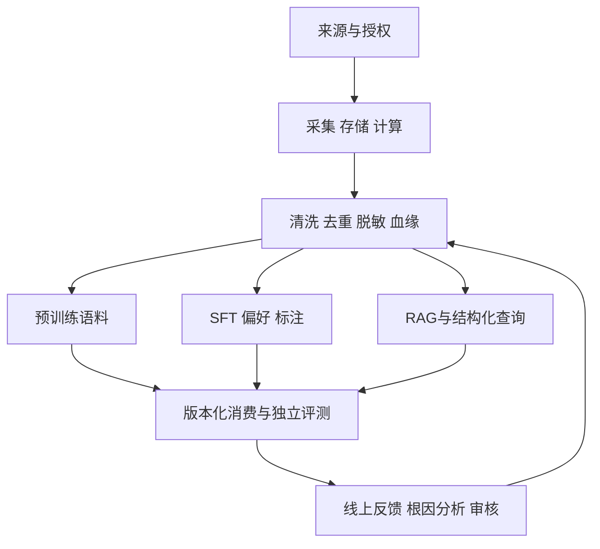

# 从数据工程到大模型数据开发：学习总纲

完整题目及每题出处见[采集与分类](../docs/问题采集与分类.md)，章节导航见[主题入口](../README.md)。本资料遵循“先采题、后研究答案”，不是先编一套答案再找相似链接。

## 1. 能力体系：沿数据怎样被消费来学习

横向底座是SQL/Python、Spark/Ray、湖仓/流处理和调度可靠性；纵向重点是样本语义、token、训练格式、证据与评测。治理和版本贯穿全链路，不能等最后“再加一个脱敏模块”。

## 2. 学习路线按岗位侧重分配

| 路线 | 先建立的底座 | 重点深入 | 最后串联 |
| --- | --- | --- | --- |
| 传统数据开发转型 | Q01–Q24 | Q25–Q36、Q43、Q49–Q54 | Q55–Q57、Q59–Q60 |
| 训练数据工程 | Q01–Q06、Q10–Q24 | Q25–Q36、Q43、Q46、Q53 | Q55、Q57–Q58 |
| RAG/知识数据工程 | Q01–Q12、Q19–Q24 | Q37–Q52、Q54 | Q56、Q59–Q60 |
| 高阶平台/系统设计 | 能说明基础机制和故障边界 | Q18、Q21–Q24、Q41–Q54 | Q55–Q60，含容量、发布与恢复 |

不在本主题展开纯算法推导、CUDA内核、全部Transformer结构和无限量刷SQL题，因为它们不直接替代数据开发能力；根据具体JD再扩展，而非假定所有岗位都一样。

## 3. 建议先掌握的题

这里的“先掌握”基于知识依赖与岗位任务，不是企业考频统计。

- 基础机制：Q05血缘、Q07并列、Q08关联粒度、Q10内存、Q13 shuffle、Q14倾斜、Q18幂等。
- 大模型特有：Q25清洗链、Q27近似去重、Q29配比、Q30污染、Q31样本、Q32模板、Q33 packing。
- 应用与验证：Q38分块、Q39检索重排、Q41向量迁移、Q42权限、Q43切分、Q44指标、Q47归因。
- 可靠与设计：Q49隐私、Q50删除、Q53 loader恢复、Q54回补、Q55全链路、Q56容量、Q60项目表达。

其它题用于补齐相邻概念和深入追问。学会“因为哪些条件，所以选这个方案”，比背某个固定阈值更有迁移价值。

## 4. 四阶段学习安排

### 阶段一：解释数据为何会算错

阅读模块01–04并运行SQL实验。能手算并列排名、JOIN膨胀、ROWS/RANGE差异；能区分driver与executor、partition与offset、checkpoint与端到端提交。

产物：画一条自己理解的数据链路，标出主键、粒度、边界、重试点与SLA。对每条“优化”说明会不会改变结果。传统基础不稳时先停在这里，不靠增加框架名绕过。

### 阶段二：解释数据为何会让模型变差

阅读模块05–06；手算Jaccard、LSH候选概率、温度采样、masked loss与DPO目标。能解释低PPL不必然高质量、合成数据也会污染、EOS与PAD混用的风险。

产物：为一个虚构任务设计数据契约、任务覆盖矩阵和过滤/标注流程，给每一步写输入、输出、拒绝原因与验证方法。所有假设参数标“教学”，不拿它们当业务最佳值。

### 阶段三：解释检索和评测为何会骗人

阅读模块07–09；能区分ANN recall与证据recall，理解judge偏差和分组切分。设计一个旧事实、别名、无答案、越权和近重复的测试集，说明应该拒绝什么，而非只放容易成功的样本。

产物：一份离线评测方案、一个数据撤回演练方案与一次恢复演练。先定义通过标准，再运行；不要根据结果临时改测试分母。

### 阶段四：把知识组织成设计和表达

练模块10，以Q55为主线，追问Q18、Q27、Q42、Q50、Q53和Q56。讲清资源估算、模型身份、失败状态、发布与回滚；已有项目使用真实证据，没有项目可以诚实讲学习POC。

产物：一页架构图、一页质量/成本账、一页实验和局限、一段项目复盘。无需构造虚假的“亿级生产经验”。

## 5. 一题分三层准备

第一层，30–60秒：定义、结论和适用条件。第二层，2–3分钟：解释机制并给具体场景和方案。第三层，深入追问：边界、反例、故障恢复、代价与怎么验证。时间仅是训练方法，不是所有面试轮次的固定要求。

以MinHash为例，第一层说清shingle/Jaccard/签名/候选；第二层解释分桶、精确复核、代表与来源；第三层讨论超大桶、传递聚簇、跨语种、误杀、数据切分和恢复。背“MinHash+LSH”六个字不足以支撑工程实践。

## 6. 自评与模拟面试

每题可从五个角度自评：能否直接回答、机制是否正确、能否落到数据契约与流程、是否解释代价/边界、有没有验证证据。此自评量表为本资料方法，不是企业评分标准。

模拟一轮可以选：一题SQL、一题Spark、一题训练数据、一题RAG/评测、一题可靠性、一题综合设计。对答不上来的部分记录具体知识缺口，再回查来源；不要因一次流畅回答就判断已掌握。

常见失分不是不知道新名词，而是把条件说成绝对：Kafka保证任意sink恰好一次、向量分数等于置信度、数据集公开就可随意训练、换embedding只改模型名、删除原文就等于模型遗忘。对应答案均给出反例与边界。

## 7. 阅读与验证的边界

55题是公开题意的筛选归并，5题是补齐能力的扩展；同源转载不算独立证据，不声称公司覆盖或高频。39项技术来源中有明确版本文档、动态官网与7篇论文相关章节；动态内容用获取时间和哈希追踪。

实际完成的是文档研究、公式/SQL实验与产物一致性校验；没有运行真实模型训练、GPU或分布式服务。这使资料适合入门、机制理解与系统化备考，但不能拿教学结果宣传真实吞吐、效果或生产可靠性。
